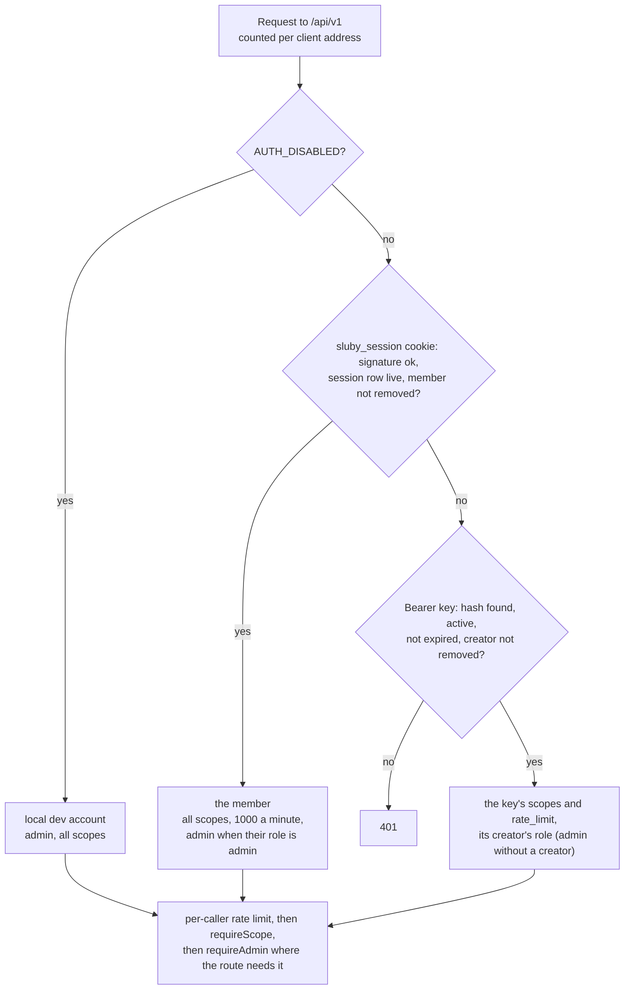

# Accounts and roles

One Sluby install is one team's workspace. Everything the team makes (assets, API keys, webhook endpoints, uploads) belongs to the workspace, and every member sees all of it. People are members with a role, `admin` or `member`, and join through single-use invite links an admin makes. They sign in with an email and password, or with GitHub when the server has a GitHub OAuth app. Nothing in `.env` names a person.

Every API request resolves to a caller with a set of scopes and whether it acts as an admin. Scopes decide what kind of action is allowed; the role decides whether the caller sees the deployment's operations data and may manage members. Callers come from API keys, Studio sessions, or, for local development only, `AUTH_DISABLED`.

## Resolving the caller



`/api/v1/auth/*`, `/api/v1/openapi.json` and `/api/v1/docs` are mounted before this middleware and need no credentials.

The REST API and the tus endpoint share this resolution (`resolveCaller` in `backend/src/api/auth/caller.ts`); tus additionally requires the `upload` scope. With `AUTH_DISABLED=true`, cookies and bearer keys are not consulted at all: every request acts as the local dev account. When a request carries both a live session cookie and a bearer key, the session wins. The role is read from the database on every request, so a role change or a removal applies to the member's sessions and keys on their next request.

## The workspace

Every owned row carries the owner address `workspace` in `creator_address`: assets, API keys, webhook endpoints, and the `creatorAddress` in upload sessions' metadata (`WORKSPACE_ADDRESS` in `backend/src/api/ownership.ts`). Every caller acts as the workspace, so a member lists, reads, changes and deletes every asset, key, webhook endpoint and playback id, whoever made it. Handlers still pass the caller's address through `ownerFilter` on every lookup and listing, so a row under any other address (migration `0022` leaves none) is never reachable, and an id that is not in the workspace answers 404 like an unknown one.

What a member may do is decided by the role instead:

| Role     | May                                                                                                                                                                                                                                                                           |
| -------- | ----------------------------------------------------------------------------------------------------------------------------------------------------------------------------------------------------------------------------------------------------------------------------- |
| `member` | Everything in the library, within their scopes: upload, edit, delete and retry assets, playback ids, webhooks, API keys, and the health summary of the server.                                                                                                                |
| `admin`  | Everything a member may, plus the operations data (the full `GET /api/v1/system/status`, `GET /api/v1/metrics`, the whole reconciliation report and `POST /api/v1/reconciliation/run`) and member management (`/api/v1/members`, `/api/v1/invites`, see [Members](#members)). |

The admin-only routes are guarded by `requireAdmin` (`backend/src/api/middleware/api-key.ts`), which answers 403 `Only an admin may use this endpoint`, and the reference marks them `x-required-identity: admin`. The scope checks still apply: metrics and status need `read`, reconciliation and the member routes need `manage`. `GET /api/v1/auth/me` reports `role`, so the Studio can show or hide the admin views; its `operator` field is a deprecated alias of `role === "admin"`, kept for one release.

## API keys

- **Format and storage.** A key is `sluby_` followed by 32 random bytes in base64url. Only its SHA-256 hex digest is stored, in `api_keys.key_hash`; the raw key is returned once, when the key is created or rotated. Every request hashes the bearer token and looks the hash up, then rejects keys that are inactive or past `expires_at`. The first 12 characters (`sluby_` and 6 random ones, far too few to guess the rest from) are kept in `api_keys.prefix` and listed, so people can tell which key a server holds. A key that authenticates gets `last_used_at` set to now when it was null or more than a minute old, written after the request is answered and at most once a minute per key and process (`backend/src/api/auth/key-usage.ts`); a failed write is logged, never the request's problem.
- **Keys act with their creator's role.** `api_keys.created_by` is the member who made the key, and the API lists it as `created_by: { id, name }`. On every request the key takes its creator's current role, and stops while its creator is removed: the request answers 401 with `reason: "not_allowed"`. Restoring the member brings their keys back, since nothing was deleted. A key with no creator acts as an admin: `BOOTSTRAP_API_KEY`, keys from `db:seed-key`, keys made by such a key, and keys whose creator's row is gone. Only someone with access to the server can make those. Keys made by the `AUTH_DISABLED` dev account keep working after sign-in is turned on, as admin keys, since that account is an admin that is never removed. Signing out everywhere ends sessions only; keys are revoked in Settings or with `DELETE /api/v1/keys/:id`.
- **Scopes.** `read` covers listing and reading assets, upload status, processing status, renditions and Sia details, playback URLs (public, signed and share), listing playback ids, stats and system status. `upload` covers tus uploads and cancelling them. `manage` covers changing, deleting and retrying assets, creating and deleting playback ids, everything about webhooks (listing them too, since receiver URLs often carry credentials), everything under `/api/v1/keys`, reconciliation, and the member routes. A new key gets `upload` and `read` unless the request names other scopes. Treat every key as a server-side secret, a `read` key included: `read` mints signed URLs and share maps, so a `read` key can play every private asset of the workspace.
- **Creating keys.** `POST /api/v1/keys` needs `manage`. The new key belongs to the workspace and is made by the caller, so it acts with the caller's role; a key with no creator makes keys with no creator. Rotation works the same way: the replacement is made by whoever rotates the key, not by the old key's creator, so a member who rotates an admin's key gets a member's key.
- **Rotation.** `POST /api/v1/keys/:id/rotate` issues a new key with the same name, scopes and rate limit and sets the old one's `expires_at` to now plus `grace_period_seconds` (0 to 7 days), in one transaction with the old row locked, and records the replacement in the old row's `replaced_by_id`. A key that already has a replacement is refused with 409, during its grace period too, so one key never yields two live replacements: rotate the replacement instead. `DELETE /api/v1/keys/:id` revokes immediately by deleting the row, and `PATCH /api/v1/keys/:id` renames a usable key, nothing else. `GET /api/v1/keys` also answers the server's `limits` (`max_keys`, `max_rate_limit`), so a form can check a new key before sending it.
- **Rate limits.** Each key has a `rate_limit` in requests per minute (100 by default, at most `API_KEY_RATE_LIMIT_MAX`, which also caps older keys at use); Studio sessions get 1000. The workspace holds at most `API_KEYS_PER_ACCOUNT_MAX` usable keys, checked under an advisory lock so parallel creations cannot overshoot. In front of authentication, every `/api/v1` call is counted against its client address (`req.ip`, with `TRUST_PROXY` naming the proxies to look through) and handed back once it authenticates, so only unauthenticated calls use up `API_IP_RATE_LIMIT` (`backend/src/api/rate-limiter.ts`). Both limiters count in fixed one-minute windows in memory, so the limits apply per backend process. Over a limit, the API answers 429 with `Retry-After`. In front of the backend, the shipped nginx also limits each client address, in requests per second and open connections, on the delivery routes under `/v1/` and on `/api/v1/auth/` (the `WEB_*` settings, see [configuration](../guide/configuration#web-proxy)).
- **Browsers on other origins.** Origins in `CORS_ORIGIN` get credentialed CORS; any other origin gets CORS without credentials, or none at all while `AUTH_DISABLED` is on. A write (`POST`, `PUT`, `PATCH`, `DELETE`) whose `Origin` is neither this server nor a listed origin and that has no `Authorization` header is refused with 403 before authentication, because a page on another origin can send one without a preflight and it could only act through the cookie or `AUTH_DISABLED` (`backend/src/api/cors.ts`).
- **A key from the server.** `npm run db:seed-key --workspace=backend -- [--name <name>]` (in the production image, `docker compose exec backend node dist/db/seed-api-key.js`) prints a new key with all three scopes and no creator, so it acts as an admin. `BOOTSTRAP_API_KEY` seeds a given raw key the same way, with a rate limit of 1000, before the backend takes requests, once: its hash is recorded in `bootstrap_keys`, so once deleted or rotated it is never seeded again. With `NODE_ENV=production` the backend refuses to start unless the value looks like a generated key (`sluby_` and at least 32 more letters, digits, `-` or `_`).

## Members and identities

A member is a `users` row: an id, a display name, a `role` (`admin` or `member`, `member` by default) and `disabled_at`, set while an admin has removed them. The ways a member signs in are `user_identities` rows, unique on `(provider, subject)`:

| Provider   | `subject`                                                       | `username`                                  |
| ---------- | --------------------------------------------------------------- | ------------------------------------------- |
| `password` | the member's id                                                 | their email                                 |
| `github`   | the numeric GitHub account id from `GET /user`, never the login | the login at the last sign-in, display only |
| `local`    | `dev`, the `AUTH_DISABLED` account                              | the dev account's name                      |

A password member also has a `password_credentials` row: the email, lowercased and unique, and the password hash. Hashes are scrypt with N=32768, r=8, p=1 and a 64-byte key, stored as `scrypt$<N>$<r>$<p>$<salt>$<hash>` so the parameters can be raised later without breaking old hashes (`backend/src/api/auth/password.ts`). A new password must be 10 to 256 characters long, counted as Unicode code points; there are no other rules.

A GitHub account is always the same member, whatever its login is now: nothing is keyed on the login, so a renamed login keeps its member, and someone who registers a freed login is not a member at all.

`AUTH_DISABLED` runs as a real account too: the local dev account, with the identity `local:dev`, created on first use, and an admin. No sign-in can produce that identity, so turning sign-in on never hands the dev library's account to anyone, and the dev account does not count as an admin who can sign in (see [The first admin](#the-first-admin)).

## The first admin

`GET /api/v1/auth/config` answers before anyone is signed in:

```json
{ "auth_disabled": false, "setup_required": true, "methods": { "password": true, "github": false } }
```

`setup_required` is true while no admin can sign in: no member has the role `admin`, is not removed, and has an identity other than `local`. `methods.github` is true when `GITHUB_CLIENT_ID` and `GITHUB_CLIENT_SECRET` are both set. While setup is required, the backend logs a line at startup with the Studio URL and the setup code:

```
No admin can sign in yet. Open https://video.example.com/studio and set up the first admin with the setup code ABCDE-FGHJK.
```

The setup code is derived from `SESSION_SECRET` (an HMAC-SHA256 of a fixed label, its first 50 bits in Crockford base32, shown as `XXXXX-XXXXX`; `backend/src/api/auth/setup-code.ts`), so whoever can read the server's logs or environment can claim the install, and nobody else can. It stays the same across restarts while `SESSION_SECRET` does; without a `SESSION_SECRET` (development only) every start makes a new one. When typed in, case, spaces and dashes do not matter, and `I`, `L` and `O` count as `1`, `1` and `0`.

`POST /api/v1/auth/setup` with `{ code, name, email, password }` creates an admin who signs in with that email and password, and signs them in. It is refused with 403 `reason: "bad_code"` for a wrong code, with 409 `reason: "already_set_up"` once an admin who can sign in exists (checked under an advisory lock, so two setups at once make one admin), and with 409 `reason: "email_taken"` when another member already signs in with the email. An upgraded install whose members include no admin uses the same screen: setup adds a new admin, and that admin can then change the others' roles.

## Signing in

### Email and password

`POST /api/v1/auth/password` with `{ email, password }` signs in and sets the session cookie. The email is trimmed and lowercased. A wrong email or a wrong password both answer 401 `Wrong email or password` with `reason: "bad_credentials"`; an unknown email still costs a full scrypt run, so the response time does not tell which part was wrong. A removed member with the right password gets 403 `reason: "disabled"`.

`POST /api/v1/auth/password/change` with `{ current_password, new_password }` changes the signed-in member's password and ends every other session of the account; the current one stays. It needs a Studio session, not a key, and answers 409 `reason: "no_password"` for a member who signs in with GitHub only (they set a first password from a reset link) and 403 `reason: "bad_credentials"` for a wrong current password.

The routes that take a secret count attempts in the backend's memory (`backend/src/api/auth/attempts.ts`, per process like the API rate limits):

| Limit                                | Counts                                                                                                               |
| ------------------------------------ | -------------------------------------------------------------------------------------------------------------------- |
| 10 per client address per 10 minutes | every password sign-in and password change                                                                           |
| 5 per email per 15 minutes           | wrong passwords for one email, from anywhere, at sign-in and at a password change; a right password clears the count |
| 10 per client address per 10 minutes | setup attempts                                                                                                       |
| 30 per client address per 10 minutes | invite and reset link lookups and uses                                                                               |

Over a limit, the route answers 429 with `Retry-After` and `retry_after` (seconds) in the body.

### GitHub

GitHub is optional and only ever a way to sign in, never a way in: a GitHub account signs in only when it is already a member's identity. The flow (`backend/src/api/routes/auth.ts`, GitHub in `backend/src/api/auth/providers/github.ts`):

1. `GET /api/v1/auth/github/login` picks a random `state` and stores it, with the time, where to land afterwards and what the sign-in is for, in the `sluby_signin` cookie (`HttpOnly`, `SameSite=Lax`, path `/api/v1/auth`, ten minutes), then redirects to GitHub asking for `read:user`. Nothing is kept on the server, so any backend replica can finish the sign-in. The sign-in is for one of three things: signing a member in (the default), joining with an invite (`?invite=<token>`, see [Invites and reset links](#invites-and-reset-links)), or adding GitHub to the signed-in member (`?link=1`, which needs a live session).
2. `GET /api/v1/auth/github/callback` accepts the sign-in only from the browser that started it: the `state` GitHub sends back must equal the one in that browser's `sluby_signin` cookie (compared in constant time) and be at most ten minutes old. A callback URL opened in another browser, the way an attacker would sign a victim into the attacker's account (login CSRF), is refused. The cookie is cleared whatever the outcome; a replay of the same code also fails at GitHub, which accepts a code once. Both GitHub calls time out after ten seconds.
3. It exchanges the code and reads the GitHub user. A plain sign-in finds the member with that GitHub identity, updates the login and display name it shows, stores a row in `studio_sessions` and sets the session cookie. A join creates the member with the invite's role; a link adds the identity to the signed-in member, refusing a GitHub account that is already another member's.
4. It redirects to the page the sign-in started from. That path is resolved against `PUBLIC_URL` the way a browser would and used only if it stays on the same origin, so `/\evil.example` (browsers read a backslash as a slash), `//evil.example`, and paths that become one of those once tabs are dropped or dot segments resolved all land on `/studio`.

Every failure redirects back to the page the sign-in started from with `signin_error=<code>` added (to `/studio?signin_error=<code>` when the handshake itself is missing or expired, since that is where `next` lives), so the Studio explains it on its own screen. Refusals of a GitHub account also add `&handle=<the GitHub login>`, which the Studio shows as text. The codes:

| Code                                                                  | Why                                                                                                               |
| --------------------------------------------------------------------- | ----------------------------------------------------------------------------------------------------------------- |
| `expired_handshake`                                                   | The handshake is older than ten minutes or was started in another browser.                                        |
| `not_a_member`                                                        | No member has this GitHub account. Joining takes an invite.                                                       |
| `disabled`                                                            | The member was removed.                                                                                           |
| `already_linked`                                                      | Joining or linking with a GitHub account that already belongs to a member.                                        |
| `not_signed_in`                                                       | Linking was started or finished without a session of the member it was for.                                       |
| `invite_not_found`, `invite_used`, `invite_expired`, `invite_revoked` | Joining with an invite that does not work.                                                                        |
| `cancelled`, `provider_failed`, `not_configured`                      | The person declined at GitHub, GitHub refused the code or could not be reached, or this server has no GitHub app. |

## Invites and reset links

People join through invite links; nobody signs up on their own. Both kinds of link are rows in `invites` (`kind` `invite` or `reset`) with a token of 32 random bytes in base64url. The token is shown once, in the link, and only its SHA-256 is stored, so the table alone cannot be used to join or to take over an account. A link works once and for 7 days (`backend/src/api/auth/link-token.ts`):

- an invite: `<PUBLIC_URL>/studio/join/<token>`, for one new member with the role the admin chose;
- a reset link: `<PUBLIC_URL>/studio/reset/<token>`, for one member to set a new password, or a first one when they sign in with GitHub only.

There is no email: an admin copies the link from the Studio and passes it on.

The join and reset pages read the link with `GET /api/v1/auth/invites/:token`: `{ kind, role, expires_at, github }` for an invite, `{ kind, email, expires_at, github }` for a reset link (`email` is null for a member with no password yet). An unknown token answers 404; a link that was used, has expired or was withdrawn answers 410 with `reason` `used`, `expired` or `revoked`; a reset link for a removed member answers 403 `reason: "disabled"`.

`POST /api/v1/auth/invites/:token/accept` uses the link and signs in:

- an invite takes `{ name, email, password }` and creates a member with the invite's role (201), or answers 409 `reason: "email_taken"`;
- a reset link takes `{ password }`, plus `email` when the member has no password yet, sets the password and ends every session the member had, since whoever held the old password may hold one.

To join with GitHub instead, the join page sends the browser to `GET /api/v1/auth/github/login?invite=<token>`; the token travels in the handshake cookie, never through GitHub. The new member takes their display name from GitHub.

When an admin is locked out with no other admin to make them a link (a forgotten password), whoever runs the server prints a reset link for an email:

```sh
npm run admin:reset-link --workspace=backend -- --email you@example.com
# in the production image
docker compose exec backend node dist/db/reset-link.js --email you@example.com
```

It refuses an email no member signs in with (a member who signs in with GitHub only has no email and gets a reset link from an admin) and a removed member.

## Members

The member routes are for admins only, through a Studio session or an admin's key with the `manage` scope (`backend/src/api/routes/members.ts`):

| Route                                 | Does                                                                                                                                                                      |
| ------------------------------------- | ------------------------------------------------------------------------------------------------------------------------------------------------------------------------- |
| `GET /api/v1/members`                 | Every member, removed ones included: `id`, `name`, `role`, `status` (`active` or `removed`), `sign_in` (each `provider` and `username`), `created_at`, `last_sign_in_at`. |
| `PATCH /api/v1/members/:id`           | Change `role`.                                                                                                                                                            |
| `POST /api/v1/members/:id/remove`     | Remove a member.                                                                                                                                                          |
| `POST /api/v1/members/:id/restore`    | Let a removed member back in, with the role they had.                                                                                                                     |
| `POST /api/v1/members/:id/reset-link` | Make a reset link: `{ url, expires_at }`, the url shown only here.                                                                                                        |
| `GET /api/v1/invites`                 | Pending invites (unused, not withdrawn, not expired), newest first, with who made each. Their links are not shown again.                                                  |
| `POST /api/v1/invites`                | Make an invite for `{ role }`: `{ id, url, role, expires_at }`, the url shown only here.                                                                                  |
| `DELETE /api/v1/invites/:id`          | Withdraw a pending invite; its link stops working.                                                                                                                        |

Removing a member keeps their row, so their keys and history still name them, but they can no longer sign in, every session they have ends at once, and every key they created stops until they are restored. Nobody removes themselves (409 `reason: "self"`), and the last admin who can sign in can be neither demoted nor removed (409 `reason: "last_admin"`): make someone else an admin first. The last-admin check runs under an advisory lock, so two admins demoting each other at once cannot leave the workspace without one.

## Studio sessions

A successful sign-in, setup, invite or reset stores a row in `studio_sessions` (member, identity, user agent, created and expiry times) and sets `sluby_session`, a cookie of the form `base64url({ sid, uid, exp }).HMAC-SHA256` signed with `SESSION_SECRET`, valid for 7 days, `HttpOnly`, `SameSite=Lax`, `Path=/`, and `Secure` when `PUBLIC_URL` is https. Run the Studio over https anywhere but on localhost: on plain http the cookie travels unencrypted, and the backend warns at startup when `PUBLIC_URL` is http on another host.

The signature only proves the cookie came from this server. On every request the backend also loads the session row and accepts the cookie only while the row is neither revoked nor expired and the member is not removed (`resolveSession` in `backend/src/api/auth/session.ts`, used by the API, tus uploads and `/auth/me`). So a session can be ended server-side:

- `POST /api/v1/auth/logout` revokes the current session, so a copied cookie stops working too.
- `GET /api/v1/auth/sessions` lists the member's live sessions, `DELETE /api/v1/auth/sessions/:id` ends one, and `DELETE /api/v1/auth/sessions` ends all of them. The Studio shows these under Settings, Sessions.
- Changing the password ends the member's other sessions, using a reset link ends all of them, and removing a member ends all of theirs.

A request whose session is not live gets a 401 whose body says why, as `reason`: `missing` (no session cookie, or one this server did not sign), `expired`, `revoked` (signed out, ended from another browser, or ended by a password change, a reset or a removal) or `not_allowed` (the member was removed). The reason is worked out only on that path (`whySessionEnded`), with one more lookup of the session row, so a signed-in request pays nothing for it. An API key that fails gets a 401 without a reason, except a key whose creator was removed, which gets `not_allowed`.

Each session row also has `last_seen_at`: when a request resolves the session and the stored value is null or more than five minutes old, it is set to now, after the request is answered. The sessions list shows it, so a browser that has not been used for weeks stands out.

Ended sessions are deleted 30 days after they expire or are revoked: when the same member next signs in, and for every member by an hourly sweep in the backend. Changing `SESSION_SECRET` ends every session at once, invalidates every signed playback URL, since the URL signing key is derived from it, and changes the setup code.

`AUTH_DISABLED=true` makes every request act as the local dev account with all scopes and no sign-in. It exists for the local quickstart; with `NODE_ENV=production` the backend refuses to start.

There are no per-member limits on how many videos someone uploads, how much they store on Sia or how many transcodes they queue, only `MAX_UPLOAD_SIZE` per file. Invite only people you would trust with your Sia account.

## Upgrading an existing install

Older versions gave each account its own library (`creator_address` `user:<account id>`, or `github:<login>` before accounts existed), let in whoever `GITHUB_ALLOWED_USERS` admitted, and gave the accounts in `OPERATOR_USERS` the operations data. Migration `0022_team_workspace` (`backend/drizzle`) moves an install to one workspace:

- every asset, key, webhook endpoint and upload session moves to the owner `workspace`, so every member sees every library that existed;
- a key owned by `user:<id>` gets that account as its `created_by`; keys of other owners (`github:<login>`, the bootstrap key's `platform`, the old platform address) get no creator and act as admins;
- the local dev account becomes an admin and every other account a member;
- `legacy_owner_claims` is dropped. Sessions and GitHub identities stay, so GitHub members keep signing in as before.

On the first start after the upgrade, before the backend takes requests, `GITHUB_ALLOWED_USERS` and `OPERATOR_USERS` are applied once to the accounts that exist (`backend/src/api/auth/adopt-legacy.ts`): with an allowlist that is neither empty nor `*`, every GitHub account it would refuse (judged as a sign-in would have been, with `allowlist_pins`) is removed, and every GitHub account the operator list names becomes an admin. The start records this in `instance_meta` as `legacy_access_adopted`, so it runs once, also when several replicas start together. From then on both settings are ignored, and a start that still finds either set logs a warning saying so; remove them from `.env`. Without an `OPERATOR_USERS` entry that matches anyone, the upgraded install has no admin who can sign in, so the backend logs the setup code and the first admin is set up as on a fresh install.

## Adding a sign-in provider

A provider is one module implementing `SignInProvider` (`backend/src/api/auth/providers/types.ts`) and one line in `providers/index.ts`:

- `id` (stored in `user_identities.provider` and used in the routes `/api/v1/auth/<id>/login` and `/callback`) and `label`;
- `isConfigured()`, `authorizationUrl({ state, callbackUrl })` and `completeSignIn(query, { callbackUrl })`, which returns `{ subject, username, displayName }` with a stable `subject` or throws a `SignInError` with a fixed message;
- `normalizeHandle(handle)`, how its handles compare.

The handshake cookie with its intents (sign in, join with an invite, link), members, sessions and the Studio's `/auth/me` are shared and name no provider, so a new provider signs members in, joins invited people and links to existing members the same way GitHub does.

## What is not per member

- **The delivery gateway** (`/v1/objects`, `/v1/stream`, `/v1/share`) has no identity at all. Public objects, and public assets' share maps, are served to anyone with the id, and private ones to anyone with a valid signature.
- **Webhooks** go to every active endpoint of the workspace subscribed to the event, and only to public addresses (see [webhooks](/api/#webhooks)).
- **Uploads** take their owner from the caller, never from client metadata, and any caller with the `upload` scope may resume or cancel any unfinished upload, an upload begun before the workspace upgrade included.
- **Reconciliation** covers the whole deployment, and only an admin can start a run (only one run is ever pending). Any caller with `manage` can read the latest run; a member gets the missing objects of the workspace's videos, and only admins get the deployment-wide counts, the orphans, the error text and the full id lists (see [what each caller sees](./deletion-and-reconciliation#what-each-caller-sees)).
- **System status** (`GET /api/v1/system/status`, scope `read`) gives a member a health summary: whether the database, Redis and the indexer answer, and the host pool. The shared indexer account, the indexer URL, probe errors, uptime, the delivery cache and the last reconciliation go to admins only, as does `GET /api/v1/metrics`, which counts the whole process. `GET /api/v1/stats` counts the workspace's library for everyone.
