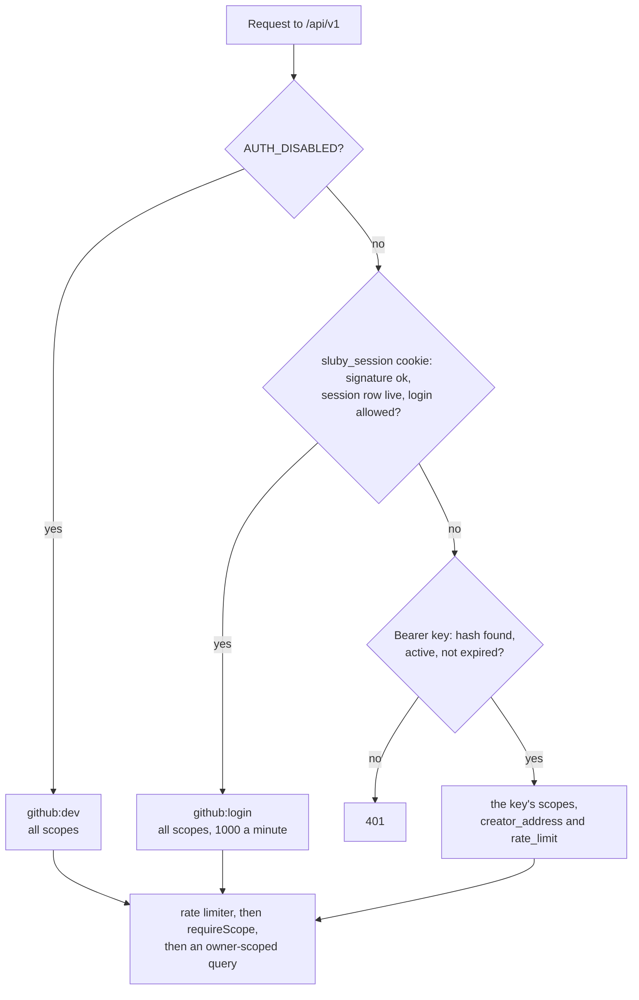

# Auth and tenancy

Every API request resolves to an identity with a set of scopes and an owner address, the `creator_address`. Scopes decide what kind of action is allowed; the owner address decides whose data the action can touch. Identities come from API keys, Studio sessions, or, for local development only, `AUTH_DISABLED`.

## Resolving the caller

`/api/v1/auth/*`, `/api/v1/openapi.json` and `/api/v1/docs` are mounted before this middleware and need no credentials.

The tus endpoint resolves callers the same way, except that it checks the session cookie before `AUTH_DISABLED`, and a key must have the `upload` scope (`backend/src/upload/tus-server.ts`). With `AUTH_DISABLED=true`, bearer keys are not consulted at all: every request, key or no key, acts as `github:dev`.

## API keys

- **Format and storage.** A key is `sluby_` followed by 32 random bytes in base64url. Only its SHA-256 hex digest is stored, in `api_keys.key_hash`; the raw key is returned once, when the key is created or rotated. Every request hashes the bearer token and looks the hash up, then rejects keys that are inactive or past `expires_at`.
- **Scopes.** `read` covers listing and reading assets, upload status, processing status, renditions and Sia details, playback URLs (public, signed and share), listing playback ids and webhooks, stats and system status. `upload` covers tus uploads and cancelling them. `manage` covers changing, deleting and retrying assets, creating and deleting playback ids and webhooks, everything under `/api/v1/keys`, and reconciliation. A new key gets `upload` and `read` unless the request names other scopes.
- **Creating keys.** `POST /api/v1/keys` needs `manage`, and the new key always gets the caller's own `creator_address`, so a key can only mint keys for its own account.
- **Rotation.** `POST /api/v1/keys/:id/rotate` issues a new key with the same name, scopes and rate limit and sets the old one's `expires_at` to now plus `grace_period_seconds` (0 to 7 days), in one transaction with the old row locked, and records the replacement in the old row's `replaced_by_id`. A key that already has a replacement is refused with 409, during its grace period too, so one key never yields two live replacements: rotate the replacement instead. `DELETE /api/v1/keys/:id` revokes immediately by deleting the row.
- **Rate limits.** Each key has a `rate_limit` in requests per minute (100 by default); Studio sessions get 1000. The limiter counts in a fixed one-minute window per identity, in memory, so the limit applies per backend process. Over the limit, the API answers 429 with `Retry-After`. `API_RATE_LIMIT_PER_MIN` is accepted by the configuration but not read by the limiter.
- **The first key.** `npm run db:seed-key` in `backend/` prints a new key with all three scopes; its owner defaults to the platform address described below, and `--address` sets another. `BOOTSTRAP_API_KEY` seeds a given raw key with all scopes at startup if that key is not in the database yet; its owner is the literal address `platform`, which is an ordinary tenant, not the platform address.

## Studio sessions

The Studio signs people in with GitHub OAuth (`backend/src/api/routes/auth.ts`):

1. `GET /api/v1/auth/github/login` stores a random `state` in memory for 10 minutes, remembers where to return in a short-lived cookie, and redirects to GitHub asking for `read:user`.
2. `GET /api/v1/auth/github/callback` checks and consumes the `state`, exchanges the code for a token, reads the GitHub user, and, when `GITHUB_ALLOWED_USERS` is set, rejects logins not on the list.
3. It stores a row in `studio_sessions` (login, user agent, created and expiry times) and sets `sluby_session`, a cookie of the form `base64url({ sid, login, exp }).HMAC-SHA256` signed with `SESSION_SECRET`, valid for 7 days, `HttpOnly`, `SameSite=Lax`, `Path=/`, and `Secure` when `PUBLIC_URL` is https.

The signature only proves the cookie came from this server. On every request the backend also loads the session row and accepts the cookie only while the row is neither revoked nor expired and the login is still allowed by `GITHUB_ALLOWED_USERS` (`resolveSession` in `backend/src/api/auth/session.ts`, used by the API, tus uploads and `/auth/me`). So a session can be ended server-side:

- `POST /api/v1/auth/logout` revokes the current session, so a copied cookie stops working too.
- `GET /api/v1/auth/sessions` lists the user's live sessions, `DELETE /api/v1/auth/sessions/:id` ends one, and `DELETE /api/v1/auth/sessions` ends all of them. The Studio shows these under Settings, Sessions.
- Taking a login off `GITHUB_ALLOWED_USERS` ends that person's sessions on their next request.

Ended sessions are deleted 30 days after they expire or are revoked, when the same login next signs in. Changing `SESSION_SECRET` ends every session at once, and also invalidates every signed playback URL, since both are signed with it.

With `GITHUB_ALLOWED_USERS` empty, any GitHub account can sign in and gets its own empty library; the backend logs a warning at startup.

`AUTH_DISABLED=true` makes every request act as `github:dev` with all scopes and no sign-in. It exists for the local quickstart; with `NODE_ENV=production` the backend refuses to start.

## Tenancy

Each identity carries an owner address:

| Identity                          | `creator_address`                                              |
| --------------------------------- | -------------------------------------------------------------- |
| Studio session                    | `github:` plus the lowercased GitHub login                     |
| `AUTH_DISABLED`                   | `github:dev`                                                   |
| API key                           | the key's `creator_address`, inherited from whoever created it |
| API key with the platform address | `0x` followed by 64 zeros                                      |

Assets, API keys and webhook endpoints store the owner's address. Every route that touches them by id passes `ownerFilter(caller)` (`backend/src/api/ownership.ts`) into the query, so the lookup only matches rows of the caller's owner, and a miss answers 404, the same as a missing row, so ids of other tenants cannot be probed. The platform address is the one exception: `ownerFilter` returns no filter for it, so a platform key can act across all tenants. An empty address is not treated as platform; it matches nothing.

Ownership is also enforced where data enters and leaves:

- **Uploads** take the owner from the authenticated identity, never from client metadata, and tus requests on another tenant's upload get a 404.
- **Webhooks** are delivered only to endpoints whose `creator_address` matches the asset's owner.
- **Playback endpoints** under `/api/v1/playback` are owner-scoped, so minting a signed URL or a share map requires a credential of the asset's owner.

Some things are deliberately not per tenant:

- **The delivery gateway** (`/v1/objects`, `/v1/stream`) has no identity at all. Public objects are served to anyone with the id, and private ones to anyone with a valid signature.
- **Reconciliation** is global: a run covers every tenant's objects, and any identity with `manage` can read the latest run and trigger one (only one run is ever pending). The counts and status are deployment-wide, but the object ids are scoped: a tenant gets only the missing ids of its own assets and no orphaned ids, and only the platform identity gets the full lists (see [what each caller sees](./deletion-and-reconciliation#what-each-caller-sees)).
- **System status** (`GET /api/v1/system/status`, scope `read`) reports the shared indexer account, hosts and caches. `GET /api/v1/stats` is owner-scoped.
