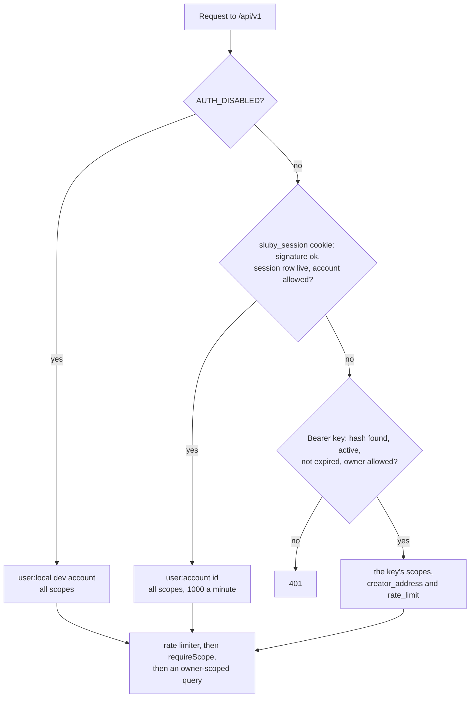

# Auth and tenancy

Every API request resolves to an identity with a set of scopes, an owner address (the `creator_address`) and whether it is an operator. Scopes decide what kind of action is allowed; the owner address decides whose data the action can touch; the operator role decides whether it sees the deployment's operations data. Identities come from API keys, Studio sessions, or, for local development only, `AUTH_DISABLED`. People are accounts (`users` rows) that sign in through a provider (GitHub today); everything an account owns carries the address `user:<account id>`.

## Resolving the caller

`/api/v1/auth/*`, `/api/v1/openapi.json` and `/api/v1/docs` are mounted before this middleware and need no credentials.

The REST API and the tus endpoint share this resolution (`resolveCaller` in `backend/src/api/auth/caller.ts`); tus additionally requires the `upload` scope. With `AUTH_DISABLED=true`, cookies and bearer keys are not consulted at all: every request acts as the local dev account. When a request carries both a live session cookie and a bearer key, the session wins.

## API keys

- **Format and storage.** A key is `sluby_` followed by 32 random bytes in base64url. Only its SHA-256 hex digest is stored, in `api_keys.key_hash`; the raw key is returned once, when the key is created or rotated. Every request hashes the bearer token and looks the hash up, then rejects keys that are inactive or past `expires_at`.
- **Keys follow their account.** A key owned by an account (`user:<id>`) works only while that account passes the allowlist, checked on every request: taking a person off `GITHUB_ALLOWED_USERS` stops their keys at once, and putting them back restores them, since nothing was deleted. Checking at use rather than revoking keys when a change is noticed means the allowlist, an environment setting, needs no event to act on, and an operator's mistake costs nobody their keys. Keys of owners made by whoever runs the server (the bootstrap key's `platform`, the platform address, `db:seed-key --address ...`) are not subject to the allowlist. A key also carries its account's [operator role](#operators), decided the same way on every request. Signing out everywhere ends sessions only; keys are revoked on the keys page or with `DELETE /api/v1/keys/:id`.
- **Scopes.** `read` covers listing and reading assets, upload status, processing status, renditions and Sia details, playback URLs (public, signed and share), listing playback ids, stats and system status. `upload` covers tus uploads and cancelling them. `manage` covers changing, deleting and retrying assets, creating and deleting playback ids, everything about webhooks (listing them too, since receiver URLs often carry credentials), everything under `/api/v1/keys`, and reconciliation. A new key gets `upload` and `read` unless the request names other scopes.
- **Creating keys.** `POST /api/v1/keys` needs `manage`, and the new key always gets the caller's own `creator_address`, so a key can only mint keys for its own account.
- **Rotation.** `POST /api/v1/keys/:id/rotate` issues a new key with the same name, scopes and rate limit and sets the old one's `expires_at` to now plus `grace_period_seconds` (0 to 7 days), in one transaction with the old row locked, and records the replacement in the old row's `replaced_by_id`. A key that already has a replacement is refused with 409, during its grace period too, so one key never yields two live replacements: rotate the replacement instead. `DELETE /api/v1/keys/:id` revokes immediately by deleting the row.
- **Rate limits.** Each key has a `rate_limit` in requests per minute (100 by default, at most `API_KEY_RATE_LIMIT_MAX`, which also caps older keys at use); Studio sessions get 1000. An account holds at most `API_KEYS_PER_ACCOUNT_MAX` usable keys, checked under a per-account advisory lock so parallel creations cannot overshoot. In front of authentication, every `/api/v1` call is counted against its client address (`req.ip`, with `TRUST_PROXY` naming the proxies to look through) and handed back once it authenticates, so only unauthenticated calls use up `API_IP_RATE_LIMIT` (`backend/src/api/rate-limiter.ts`). Both limiters count in fixed one-minute windows in memory, so the limits apply per backend process. Over a limit, the API answers 429 with `Retry-After`.
- **Browsers on other origins.** Origins in `CORS_ORIGIN` get credentialed CORS; any other origin gets CORS without credentials, or none at all while `AUTH_DISABLED` is on. A write (`POST`, `PUT`, `PATCH`, `DELETE`) whose `Origin` is neither this server nor a listed origin and that has no `Authorization` header is refused with 403 before authentication, because a page on another origin can send one without a preflight and it could only act through the cookie or `AUTH_DISABLED` (`backend/src/api/cors.ts`).
- **The first key.** `npm run db:seed-key` in `backend/` prints a new key with all three scopes for the owner you name: `--platform` for the platform address described below, which sees every tenant and the deployment-wide data, or `--address <owner>` for one owner. It refuses to run without one of them and says so when the key is cross-tenant. `BOOTSTRAP_API_KEY` seeds a given raw key with all scopes before the backend takes requests, once: deleted or rotated, it is never seeded again. Its owner is the literal address `platform`, which is an ordinary tenant, not the platform address, so it sees only what it created itself.

## Accounts and identities

An account is a `users` row (an id, a display name and a creation time). The ways it signs in are `user_identities` rows: the provider (`github`), the provider's stable id for the person (`subject`; for GitHub the numeric account id from `GET /user`, never the login) and the handle the provider reported at the last sign-in (`username`, the GitHub login, kept for display only). `(provider, subject)` is unique, so one GitHub account is always one Sluby account, whatever it is called. A GitHub login can be renamed and the freed name registered by someone else; because nothing is keyed on it, that newcomer gets an empty account of their own.

`AUTH_DISABLED` runs as a real account too: the local dev account, with the identity `local:dev`, created on first use. No sign-in provider can produce that identity, so turning sign-in on never hands the dev library to a GitHub user.

## Studio sessions

The Studio signs people in through a provider (`backend/src/api/routes/auth.ts`, GitHub in `backend/src/api/auth/providers/github.ts`):

1. `GET /api/v1/auth/github/login` picks a random `state` and stores it, with the time and where to land afterwards, in the `sluby_signin` cookie (`HttpOnly`, `SameSite=Lax`, path `/api/v1/auth`, ten minutes), then redirects to GitHub asking for `read:user`. Nothing is kept on the server, so any backend replica can finish the sign-in.
2. `GET /api/v1/auth/github/callback` accepts the sign-in only from the browser that started it: the `state` GitHub sends back must equal the one in that browser's `sluby_signin` cookie (compared in constant time) and be at most ten minutes old. A callback URL opened in another browser, the way an attacker would sign a victim into the attacker's account (login CSRF), is refused. The cookie is cleared whatever the outcome; a replay of the same code also fails at GitHub, which accepts a code once. Both GitHub calls time out after ten seconds.
3. It exchanges the code, reads the GitHub user, applies the allowlist, finds or creates the account (claiming data of older versions on the first sign-in, see below), stores a row in `studio_sessions` (account, identity, user agent, created and expiry times) and sets `sluby_session`, a cookie of the form `base64url({ sid, uid, exp }).HMAC-SHA256` signed with `SESSION_SECRET`, valid for 7 days, `HttpOnly`, `SameSite=Lax`, `Path=/`, and `Secure` when `PUBLIC_URL` is https. Run the Studio over https anywhere but on localhost: on plain http the cookie travels unencrypted, and the backend warns at startup when `PUBLIC_URL` is http on another host.
4. It redirects to the page the sign-in started from. That path is resolved against `PUBLIC_URL` the way a browser would and used only if it stays on the same origin, so `/\evil.example` (browsers read a backslash as a slash), `//evil.example`, and paths that become one of those once tabs are dropped or dot segments resolved all land on `/studio`.

Every error on the callback is a fixed `text/plain` message with `X-Content-Type-Options: nosniff`; nothing from the request or from GitHub is echoed into a page on the Studio's origin.

The signature only proves the cookie came from this server. On every request the backend also loads the session row and accepts the cookie only while the row is neither revoked nor expired and the account still passes the allowlist (`resolveSession` in `backend/src/api/auth/session.ts`, used by the API, tus uploads and `/auth/me`). So a session can be ended server-side:

- `POST /api/v1/auth/logout` revokes the current session, so a copied cookie stops working too.
- `GET /api/v1/auth/sessions` lists the account's live sessions, `DELETE /api/v1/auth/sessions/:id` ends one, and `DELETE /api/v1/auth/sessions` ends all of them. The Studio shows these under Settings, Sessions.
- Taking someone off `GITHUB_ALLOWED_USERS` ends their sessions on their next request, and stops their keys.

Ended sessions are deleted 30 days after they expire or are revoked: when the same account next signs in, and for every account by an hourly sweep in the backend. Changing `SESSION_SECRET` ends every session at once, and also invalidates every signed playback URL, since both are signed with it.

`AUTH_DISABLED=true` makes every request act as the local dev account with all scopes and no sign-in. It exists for the local quickstart; with `NODE_ENV=production` the backend refuses to start.

There are no per-account limits on how many videos an account uploads, how much it stores on Sia or how many transcodes it queues, only `MAX_UPLOAD_SIZE` per file, so an open Studio (`GITHUB_ALLOWED_USERS=*`) needs limits of its own before it faces the internet.

## The allowlist

`GITHUB_ALLOWED_USERS` is a comma-separated list (`backend/src/api/auth/allowlist.ts`):

| Entry         | Admits                                                                                                                                                                |
| ------------- | --------------------------------------------------------------------------------------------------------------------------------------------------------------------- |
| `*`           | Any GitHub account: open sign-up, on purpose.                                                                                                                         |
| `id:<number>` | The GitHub account with that numeric id (`https://api.github.com/users/<login>` shows it), whatever its login is now or later.                                        |
| a login       | Matched case-insensitively against the login GitHub reports when someone signs in. The first account that signs in with it is pinned to the entry (`allowlist_pins`). |

From then on a login entry admits only the pinned account: through its renames (`alice` renamed to `alice2` keeps getting in under the entry `alice`), and never the next owner of the freed login, who is refused even though GitHub now calls them `alice`. To hand an entry to a different account, use the `id:` form, or delete its row from `allowlist_pins` so the next sign-in with that login takes it.

Sign-in decides with GitHub's answer; every later request decides on the account's stable id and its pins only, so editing the list takes effect on the next request. The one case that waits for a sign-in is a login entry nobody has pinned yet: it admits its account from that account's next sign-in.

An empty list leaves sign-up open, as older versions did, and the backend logs a warning at startup; `*` says the same thing on purpose, without the warning. An open Studio gives anyone with a GitHub account storage and transcoding on your Sia account, with no quota, so open sign-up needs limits of its own (a reverse proxy rate limit, a watched Sia allowance).

Keys of a login-keyed owner from before the upgrade (`github:<login>`, not claimed yet) are judged by that login: they work while the list is open, or lists the login and nobody is pinned to it yet.

## Upgrading from login-keyed versions

Older versions keyed everything on `github:<login>`. Migrations `0011` and `0012` (`backend/drizzle`):

- create `users`, `user_identities`, `allowlist_pins` and `legacy_owner_claims`;
- end every Studio session, since a session row named only a login; everyone signs in once more, and that sign-in is what links their data;
- move the data of the old `AUTH_DISABLED` identity, `github:dev`, to the local dev account and record the address as claimed by it, so a GitHub user named `dev` never gets it;
- drop the stored webhook response bodies.

Every other row keeps its owner and stays reachable: a key of `github:alice` keeps working (under the allowlist rules above) and sees the same assets. When a GitHub account signs in for the first time, in the same transaction that creates its account, the backend claims the old address of the login GitHub reports for it: `legacy_owner_claims` gets the address (its primary key, so only the first claimant ever succeeds) and every asset, key, webhook endpoint and upload session under `github:<login>` moves to `user:<account id>`. The claim is atomic (one transaction, with concurrent sign-ins of one identity serialised by an advisory lock) and idempotent: an address claimed once can never be claimed by another account, and an account that already exists never claims anything, so someone who renames into a login later cannot pick up that login's old data. Rows written under a claimed address by a request that raced the claim are moved at the account's next sign-in, keys still under it act as the claiming account, and an unfinished upload whose metadata on disk names the old address is resumed and finished as the claiming account.

The old data names no numeric id, so the claim trusts the login as GitHub reports it at that first sign-in. If the original owner of a login renamed and someone else registered the name before the original owner signed in to the upgraded server, that someone would claim the data, exactly as they would have reached it before the upgrade. After the claim the data belongs to the account, not the name.

## Operators

An operator is an account that sees the deployment's operations data the way the platform identity does, without becoming the platform identity. No Studio sign-in is ever the platform address, so without operators the Studio's indexer account, storage, cache, reconciliation and analytics views are empty for everyone, a single-operator deployment included.

`OPERATOR_USERS` lists them (`backend/src/api/auth/operators.ts`). One setting serves every sign-in provider, so each entry starts with the provider and then has the syntax of that provider's allowlist:

| Entry                | Makes an operator of                                                                                     |
| -------------------- | -------------------------------------------------------------------------------------------------------- |
| `github:id:<number>` | The GitHub account with that numeric id, whatever its login is now or later.                             |
| `github:<login>`     | The account pinned to that login entry in `allowlist_pins`, matched like an allowlist login (see below). |
| `github:*`           | Every account that signs in with GitHub. Only sensible when the allowlist itself is short.               |

An entry without a provider (`octocat`, `id:583231`, `*`) stops the backend from starting, rather than being guessed: once a second provider exists, a bare handle could name two different people. An entry for a provider this server does not have logs a warning at startup and makes nobody an operator. An empty value means no operators, unlike the sign-in allowlist, where empty means open.

Matching is on stable identities only. An `id:` entry matches the provider's subject. A login entry matches through the pin, never through the login an account has now: the pins are shared with the sign-in allowlist, since both record the same fact (which account held that login when it was first seen), and a listed login nobody has pinned yet is pinned at its account's next sign-in, also when sign-up is open (`*`). After that the entry follows the account through renames and never reaches the next owner of a freed login. An unclaimed `github:<login>` owner from before the upgrade names a login only, so its keys are never operators.

The role is a property of the resolved caller (`operator` in `backend/src/api/auth/caller.ts`), decided on every request like the allowlist:

- **Studio sessions** of a listed account are operators.
- **API keys** inherit their account's role at use. Taking someone off `OPERATOR_USERS` ends the role of their sessions and keys on the next request, and putting them back restores it. Keys owned by the platform address, the bootstrap `platform` account or a `db:seed-key --address` owner are never operators; the platform address has its own, wider access.
- **`AUTH_DISABLED`**: the local dev account is an operator, since it is the only user of a local quickstart. Once sign-in is turned on it is not, and it cannot be listed.

Operators get exactly the operations data: the full `GET /api/v1/system/status` (`scope: "deployment"`), `GET /api/v1/metrics`, the whole `GET /api/v1/reconciliation` report, and `POST /api/v1/reconciliation/run`. These are guarded by `requireOperations` and `seesOperations` (`backend/src/api/middleware/api-key.ts`, `backend/src/api/ownership.ts`), which admit the platform identity or an operator, and the reference marks the guarded operations `x-required-identity: operations`. The scope checks still apply: metrics and status need `read`, reconciliation `manage`. Ownership does not change: `ownerFilter` never widens for an operator, so another account's assets, keys, webhooks, uploads and playback IDs answer 404 as for anyone else, and `GET /api/v1/stats` counts the operator's own library. `GET /api/v1/auth/me` reports `operator` so the Studio can show or hide those views.

## Adding a sign-in provider

A provider is one module implementing `SignInProvider` (`backend/src/api/auth/providers/types.ts`) and one line in `providers/index.ts`:

- `id` (stored in `user_identities.provider` and used in the routes `/api/v1/auth/<id>/login` and `/callback`) and `label`;
- `isConfigured()`, `authorizationUrl({ state, callbackUrl })` and `completeSignIn(query, { callbackUrl })`, which returns `{ subject, username, displayName }` with a stable `subject` or throws a `SignInError` with a fixed message;
- `allowlist()`, an `Allowlist` built from the provider's own setting, with the same `*`, `id:` and pinned-handle rules;
- `normalizeHandle(handle)`, how its handles compare, which `OPERATOR_USERS` entries of the provider use;
- optionally `legacyOwnerAddress` and `legacyHandle`, only for a provider whose data older versions stored under a handle (GitHub).

The handshake cookie, accounts, sessions, ownership, the allowlist rules, the operator role and the Studio's `/auth/me` are shared and name no provider. Linking a second identity to an existing account (signing in with Google to the account made with GitHub) is not built yet; a new provider's first sign-in creates a new account.

## Tenancy

Each identity carries an owner address:

| Identity                          | `creator_address`                                              |
| --------------------------------- | -------------------------------------------------------------- |
| Studio session                    | `user:` plus the account id                                    |
| `AUTH_DISABLED`                   | `user:` plus the local dev account's id                        |
| API key                           | the key's `creator_address`, inherited from whoever created it |
| API key with the platform address | `0x` followed by 64 zeros                                      |

The column keeps its name, `creator_address`, and stays text rather than a foreign key to `users`: it also holds owners that are not accounts (the platform address, the bootstrap key's `platform`, addresses chosen with `db:seed-key --address`, and `github:<login>` rows not claimed yet), and it is part of the API (`creator_address` on assets).

Assets, API keys and webhook endpoints store the owner's address. Every route that touches them, by id or as a listing (assets, keys, webhook endpoints with their test sends and delivery history, uploads and playback IDs), passes `ownerFilter(caller)` (`backend/src/api/ownership.ts`) into the query, so the lookup only matches rows of the caller's owner, and a miss answers 404, the same as a missing row, so ids of other tenants cannot be probed. The platform address is the one exception: `ownerFilter` returns no filter for it, so a platform key lists, reads, changes and deletes the assets, keys and webhook endpoints of every tenant alike; no owner-scoped route is narrower for it than another. Operators are not widened, see [Operators](#operators). An empty address is not treated as platform; it matches nothing.

Ownership is also enforced where data enters and leaves:

- **Uploads** take the owner from the authenticated identity, never from client metadata, and tus requests on another tenant's upload get a 404.
- **Webhooks** are delivered only to endpoints whose `creator_address` matches the asset's owner, and only to public addresses (see [webhooks](/api/#webhooks)).
- **Playback endpoints** under `/api/v1/playback` are owner-scoped, so minting a signed URL, or a share map through the API, requires a credential of the asset's owner. The public `/v1/share/:id` hands out a share map with no identity, under the same gate as the delivery gateway (see below).

Some things are deliberately not per tenant:

- **The delivery gateway** (`/v1/objects`, `/v1/stream`, `/v1/share`) has no identity at all. Public objects, and public assets' share maps, are served to anyone with the id, and private ones to anyone with a valid signature.
- **Reconciliation** is global: a run covers every tenant's objects, and only the platform identity or an [operator](#operators) can trigger one (only one run is ever pending). Any identity with `manage` can read the latest run, but a tenant gets only the drift of its own assets, and only the platform identity and operators get the deployment-wide counts and the full id lists (see [what each caller sees](./deletion-and-reconciliation#what-each-caller-sees)).
- **System status** (`GET /api/v1/system/status`, scope `read`) gives a tenant a health summary: whether the database, Redis and the indexer answer, and the host pool. The shared indexer account, the indexer URL, probe errors, uptime, the delivery cache and the last reconciliation go to the platform identity and operators only, as does `GET /api/v1/metrics`, which counts every tenant together. `GET /api/v1/stats` is owner-scoped.
