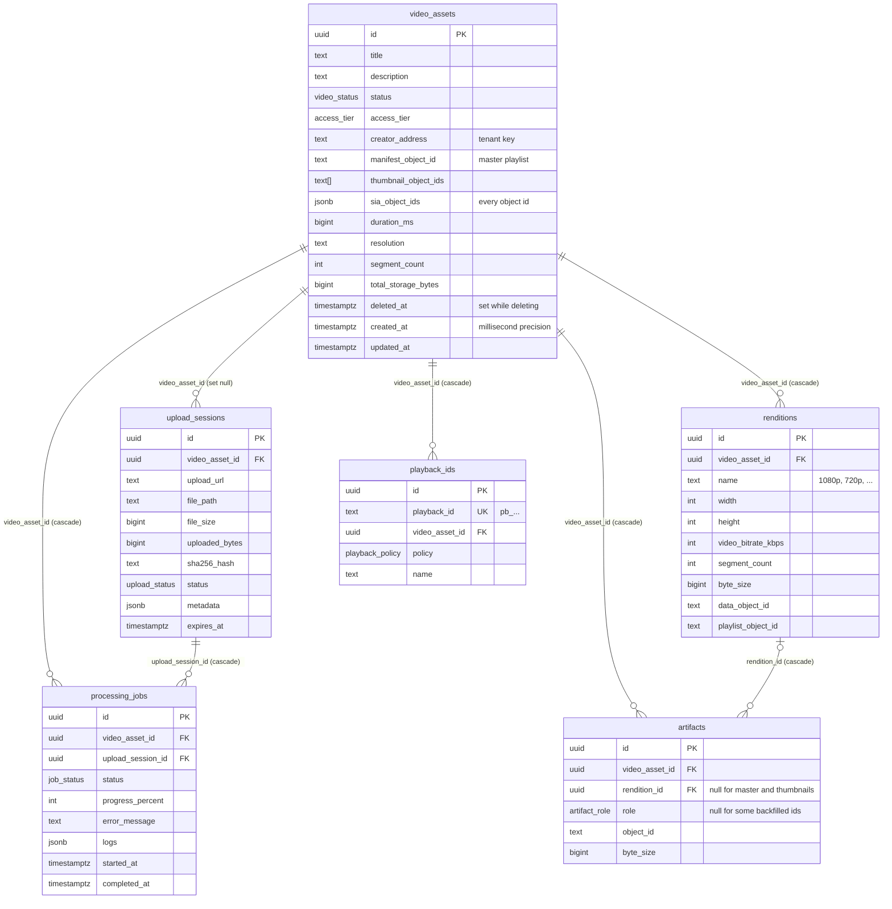
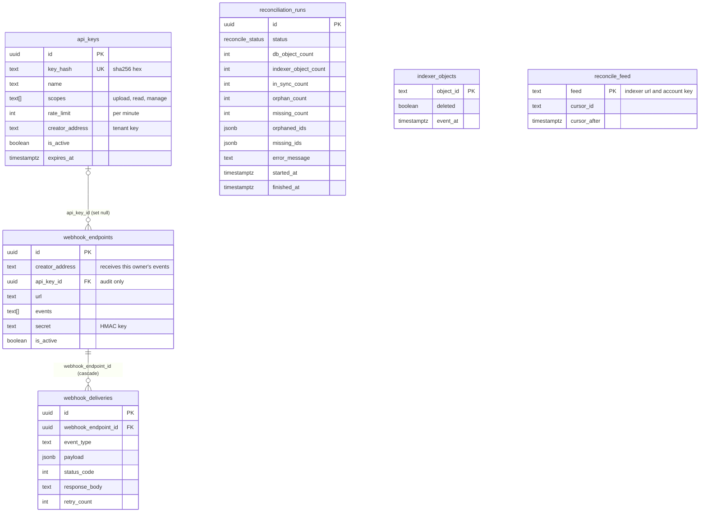

# Data model

PostgreSQL holds everything except the video bytes. The schema is defined with Drizzle in `backend/src/db/schema.ts`; the SQL migrations in `backend/drizzle/` run when the backend container starts (`node dist/db/migrate.js`), or with `npm run db:migrate` from `backend/`.

There is no users table. Ownership is a plain text `creator_address` on assets, API keys and webhook endpoints, compared by value (see [Auth and tenancy](./auth-and-tenancy)).

The diagrams show the columns that matter for understanding the system; most tables also have `created_at` (and some `updated_at`) timestamps, and `schema.ts` has the indexes.

## Assets and their storage

- **`video_assets`** is one row per video. `status` moves from `created` (set when tus creates the upload) to `processing` and then `ready` or `failed`; the enum also has `uploading`, which the tus path never sets. `deleted_at` marks an asset whose deletion is in progress; the row disappears once its objects are unpinned. The object id columns (`manifest_object_id`, `thumbnail_object_ids`, `sia_object_ids`) are written by finalize after it has written the same ids to `artifacts`, and duplicate what `artifacts` holds. Migration `0009` gave the ids of assets stored before `artifacts` existed their rows there too, so every id in these columns has an `artifacts` row for the same asset. `segment_count` is the number of segments in one rendition, and `total_storage_bytes` is the sum of the stored objects' sizes before erasure coding. `created_at` is a `timestamptz(3)`: the listing cursor carries a JavaScript date, which has millisecond precision, so the column keeps exactly that and the newest-first listing pages on the plain `(created_at, id)` pair, read from the `(created_at, id)` index for the whole platform and from a partial `(creator_address, created_at, id)` index for one owner.
- **`upload_sessions`** tracks one tus upload: size, bytes received, the SHA-256 of the finished file, and its path in `UPLOAD_DIR`. `metadata` holds the tus metadata plus the owner's `creatorAddress` and the `apiKeyId`, which the REST status and cancel routes use for owner checks.
- **`processing_jobs`** mirrors the BullMQ pipeline for the API: status, percentage, the last error and the `logs` array of `{ timestamp, stage, message }`. It also has `retry_count` and `max_retries` columns, which the workers do not update; the retry count that matters lives in BullMQ.
- **`renditions`** is one row per HLS rung, with the Sia object ids of its `data.m4s` and its rewritten playlist.
- **`artifacts`** is the authoritative map from Sia object id to asset, rendition and role, and holds every object id of every asset. Roles are `master_manifest`, `variant_playlist`, `rendition_data` and `thumbnail`. An asset with three rungs has 1 + 3 + 3 + 3 = 10 artifacts. The rows backfilled for assets stored before this table existed have no rendition, a `byte_size` of 0 and, for the playlists and data files (which the old columns did not tell apart), a null `role`. `object_id` is indexed because the gateway looks up an object's access tier by it.
- **`playback_ids`** are public `pb_` handles (a nanoid of 21 characters) that `/api/v1/playback/:id` and `/v1/stream/:id/master.m3u8` accept in place of the asset id. The `signed` policy makes the whole asset require signed URLs on the gateway, even for public assets.

## Access and integrations

- **`api_keys`** stores only the SHA-256 of each key. `expires_at` is how rotation retires the old key after its grace period.
- **`webhook_endpoints`** belong to an owner through `creator_address`. `api_key_id` records which key registered the endpoint (null when it was the Studio) and is kept for audit only: revoking the key leaves the endpoint working. The `secret` is stored in plain text because the backend needs it to sign every delivery; it is returned once, when the endpoint is created.
- **`webhook_deliveries`** logs every delivery attempt, one row per try.
- **`reconciliation_runs`** keeps one row per run, including failed ones, with the full lists of orphaned and missing object ids; only the latest 100 are kept. The API only returns those lists in full to the platform identity; a tenant gets the missing ids of its own assets (see [what each caller sees](./deletion-and-reconciliation#what-each-caller-sees)).
- **`indexer_objects`** is reconciliation's copy of the indexer's inventory: per object id, whether its latest event was a delete and when the indexer recorded it. **`reconcile_feed`** is its one row naming the indexer URL and account key the copy came from and the feed cursor it was read up to (see [reconciliation](./deletion-and-reconciliation#reconciliation)).

## Enums

| Enum               | Values                                                               |
| ------------------ | -------------------------------------------------------------------- |
| `video_status`     | `created`, `uploading`, `processing`, `ready`, `failed`              |
| `upload_status`    | `uploading`, `completed`, `cancelled`, `failed`                      |
| `job_status`       | `queued`, `processing`, `completed`, `failed`, `retrying`            |
| `access_tier`      | `public`, `private`                                                  |
| `artifact_role`    | `master_manifest`, `variant_playlist`, `rendition_data`, `thumbnail` |
| `playback_policy`  | `public`, `signed`                                                   |
| `reconcile_status` | `ok`, `drift`, `failed`                                              |
