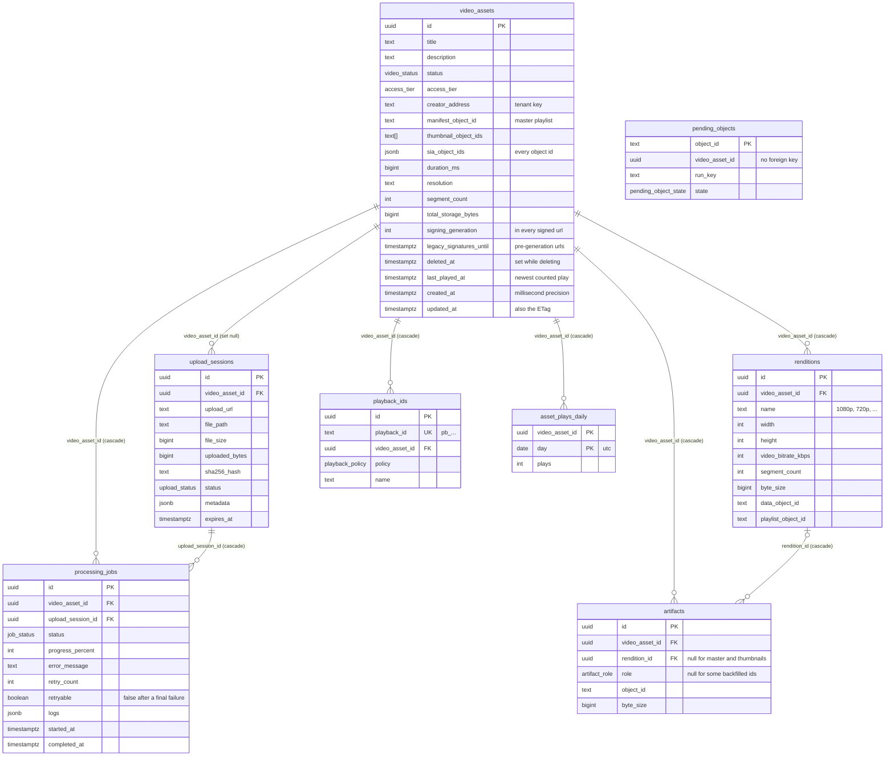
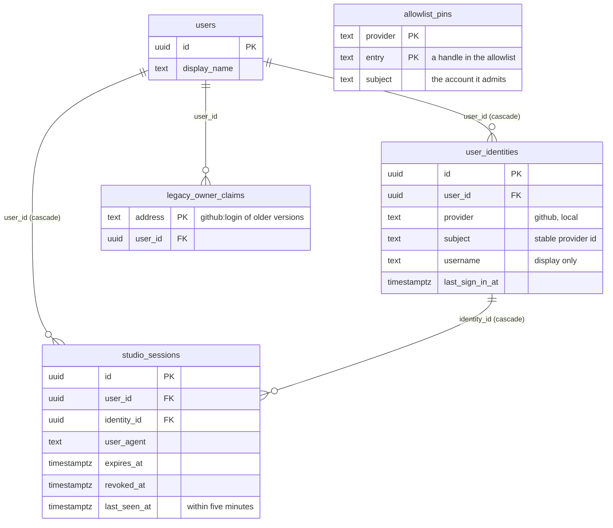
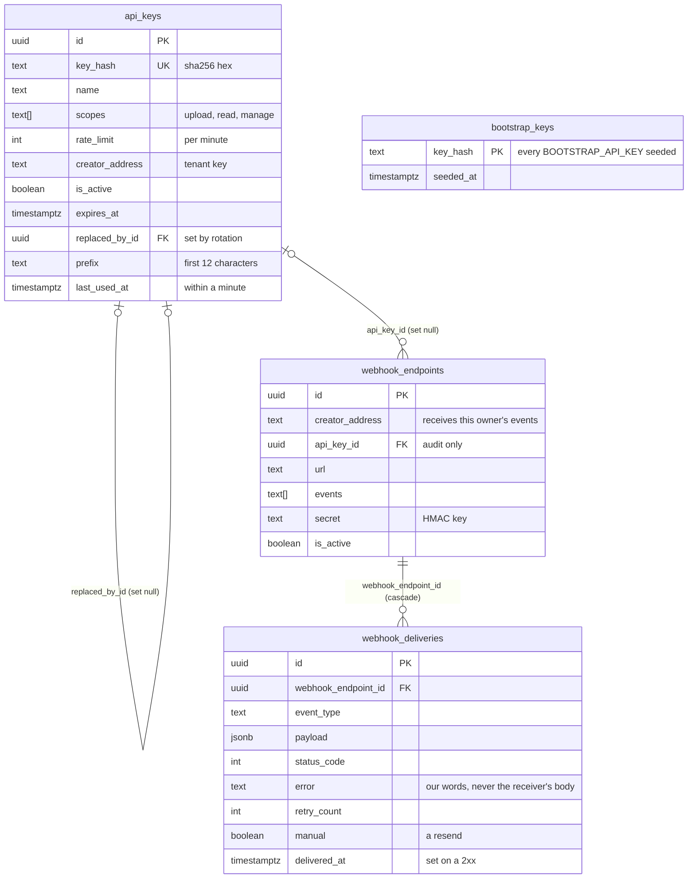
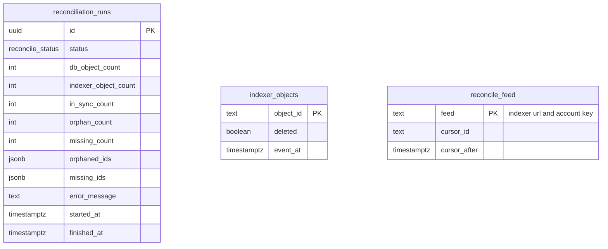

# Data model

PostgreSQL holds everything except the video bytes. The schema is defined with Drizzle in `backend/src/db/schema.ts`; the SQL migrations in `backend/drizzle/` run when the backend container starts (`node dist/db/migrate.js`), or with `npm run db:migrate` from `backend/`.

Ownership is a plain text `creator_address` on assets, API keys and webhook endpoints (and in upload sessions' metadata), compared by value. For a person it is `user:<id>` of their `users` row; other values are operator-made owners (see [Auth and tenancy](./auth-and-tenancy#tenancy)).

The diagrams show the columns that matter for understanding the system; most tables also have `created_at` (and some `updated_at`) timestamps, and `schema.ts` has the indexes.

## Assets and their storage

- **`video_assets`** is one row per video. `status` moves from `created` (set when tus creates the upload) to `uploading` when the first bytes arrive, then to `processing` once the transcode stage starts, and then `ready` or `failed`. The move to `uploading` is one conditional update that only changes a `created`, not deleted asset whose session is still receiving, so the writes after the first and a write that lands after the pipeline took over change nothing; an upload small enough to finish before the transcode stage starts still shows `uploading` until it does. `deleted_at` marks an asset whose deletion is in progress; the row disappears once its objects are unpinned. The object id columns (`manifest_object_id`, `thumbnail_object_ids`, `sia_object_ids`) are written by finalize after it has written the same ids to `artifacts`, and duplicate what `artifacts` holds. Migration `0009` gave the ids of assets stored before `artifacts` existed their rows there too, so every id in these columns has an `artifacts` row for the same asset. `segment_count` is the number of segments in one rendition, and `total_storage_bytes` is the sum of the stored objects' sizes before erasure coding. `created_at` is a `timestamptz(3)`: the listing cursor carries a JavaScript date, which has millisecond precision, so the column keeps exactly that and the newest-first listing pages on the plain `(created_at, id)` pair, read from the `(created_at, id)` index for the whole platform and from a partial `(creator_address, created_at, id)` index for one owner. `signing_generation` is part of every signed URL of the asset: a tier change or a revoke raises it, and every URL signed before stops working (see [Playback](./playback)). `legacy_signatures_until` is how long URLs signed before generations existed are still honoured; migration `0014` set it six hours ahead for the assets that existed then, the first raise of the generation clears it, and null means none are. `updated_at` is also the asset's version: the API sends it as the ETag (milliseconds since the epoch) and `PATCH` with `If-Match` applies only while the row is still at that version; an API edit always moves it at least a millisecond forward, so two edits in one millisecond are two versions. `last_played_at` is the newest counted play and is written without touching `updated_at`, so a play never changes the ETag.
- **`upload_sessions`** tracks one tus upload: size, bytes received, the SHA-256 of the finished file, and its path in `UPLOAD_DIR`. `metadata` holds the tus metadata plus the owner's `creatorAddress` and the `apiKeyId`, which the REST status and cancel routes use for owner checks. When its asset is deleted the row keeps only its file path (link and `metadata` cleared), and the hourly source sweep deletes it once the file is gone.
- **`asset_plays_daily`** counts plays per video and UTC day (migration `0020`), written in batches every 10 seconds; what counts as a play is in [Playback](./playback#plays). A video's all-time `play_count` is the sum of its rows, read with the primary key, and the per-day usage of an account joins them to its videos.
- **`processing_jobs`** mirrors the BullMQ pipeline for the API: status, percentage, the last error and the `logs` array of `{ timestamp, stage, message }`. `retryable` (migration `0019`) is set to false when a run fails in a way another run cannot fix, a source file that is not a readable video, and back to true by a manual retry; the API's `retryable` also needs the asset failed and its transcode output or original file still on disk. `retry_count` counts the retries of the asset's pipeline stages: each automatic retry BullMQ schedules and each manual retry. Migration `0013` dropped the `max_retries` column, which nothing read. `started_at` is the start of the current run, kept across BullMQ's attempts and reset by a manual retry.
- **`renditions`** is one row per HLS rung, with the Sia object ids of its `data.m4s` and its rewritten playlist.
- **`artifacts`** is the authoritative map from Sia object id to asset, rendition and role, and holds every object id of every asset. Roles are `master_manifest`, `variant_playlist`, `rendition_data` and `thumbnail`. An asset with three rungs has 1 + 3 + 3 + 3 = 10 artifacts. The rows backfilled for assets stored before this table existed have no rendition, a `byte_size` of 0 and, for the playlists and data files (which the old columns did not tell apart), a null `role`. `object_id` is indexed because the gateway looks up an object's access tier by it.
- **`playback_ids`** are public `pb_` handles (a nanoid of 21 characters) that `/api/v1/playback/:id` and `/v1/stream/:id/master.m3u8` accept in place of the asset id. A `signed` playback id needs a signed URL for its own `/v1/stream` and `/v1/share` entries, but the asset's objects follow only its `access_tier`, so a `signed` playback id on a public asset does not make the asset's bytes private (see [Playback](./playback#private-assets-and-signed-urls)).
- **`pending_objects`** holds every Sia object the pipeline has pinned but finalize has not recorded in `artifacts` yet (`uploading`, written just before the pin), and every object that is to be unpinned but has not been yet (`release`). It has no foreign key on purpose: an upload can still pin after its asset row is gone, and the row has to outlive the asset so the deletion GC sweep can unpin the object (see [retries and orphan cleanup](./upload-pipeline#retries-and-orphan-cleanup)).

## Accounts and sessions

- **`users`** is one row per account and **`user_identities`** the ways it signs in, unique on `(provider, subject)`; `subject` is the provider's stable id (GitHub's numeric account id), `username` the handle last reported, for display. **`allowlist_pins`** ties a login written in `GITHUB_ALLOWED_USERS` or `OPERATOR_USERS` to the account that first signed in with it, and **`legacy_owner_claims`** records which account took over each `github:<login>` address older versions wrote, at most one per address (see [Auth and tenancy](./auth-and-tenancy#upgrading-from-login-keyed-versions)).
- **`studio_sessions`** is one row per Studio sign-in, so a session can be revoked; the cookie carries only its id and the account id, signed. Migration `0012` dropped the `login` column the rows had before accounts existed. `last_seen_at` (migration `0018`) is the last request made with the session, written when a request finds it null or more than five minutes old, so a busy browser writes at most once in five minutes.

## Keys and webhooks

- **`api_keys`** stores only the SHA-256 of each key. `expires_at` is how rotation retires the old key after its grace period, and `replaced_by_id` points from the old key to the key that replaced it, so a key can be rotated only once. `prefix` (migration `0016`) is the first 12 characters of the raw key, `sluby_` and 6 random ones, so people can tell keys apart; it is null for keys made before it was stored. `last_used_at` is written when a key authenticates and the value is null or more than a minute old, at most once a minute per key and process, and never holds up the request.
- **`bootstrap_keys`** records the hash of every `BOOTSTRAP_API_KEY` the backend has seeded, so a bootstrap key that was deleted or rotated is never seeded again (migration `0015` backfilled the bootstrap keys earlier versions seeded).
- **`webhook_endpoints`** belong to an owner through `creator_address`. `is_active` false is a paused endpoint: nothing is sent to it, and deliveries already queued for it are dropped when their turn comes. The `secret` can be replaced (rotate secret); deliveries read it when they are sent, so queued retries use the new one. `api_key_id` records which key registered the endpoint (null when it was the Studio) and is kept for audit only: revoking the key leaves the endpoint working. The `secret` is stored in plain text because the backend needs it to sign every delivery; it is returned once, when the endpoint is created.
- **`webhook_deliveries`** logs every delivery attempt, one row per try, with the status code and, for a failure, why in our own words. Receivers' response bodies are never read or stored (migration `0012` dropped the `response_body` column), so the log cannot be used to read an internal service. `delivered_at` is set when the receiver answered 2xx. `payload` is the body that was sent, and `manual` (migration `0017`) marks the attempts of a resend, which sends the stored payload again with the same event id. The newest row of an endpoint is its last-delivery health, read with the `(webhook_endpoint_id, created_at)` index. The backend's hourly sweep deletes attempts older than 30 days, so the log does not grow forever.

## Reconciliation

- **`reconciliation_runs`** keeps one row per run, including failed ones, with the full lists of orphaned and missing object ids; only the latest 100 are kept. The API only returns those lists in full to the platform identity and operators; a tenant gets the missing ids of its own assets (see [what each caller sees](./deletion-and-reconciliation#what-each-caller-sees)).
- **`indexer_objects`** is reconciliation's copy of the indexer's inventory: per object id, whether its latest event was a delete and when the indexer recorded it. **`reconcile_feed`** is its one row naming the indexer URL and account key the copy came from and the feed cursor it was read up to (see [reconciliation](./deletion-and-reconciliation#reconciliation)).

## Enums

| Enum                   | Values                                                               |
| ---------------------- | -------------------------------------------------------------------- |
| `video_status`         | `created`, `uploading`, `processing`, `ready`, `failed`              |
| `upload_status`        | `uploading`, `completed`, `cancelled`, `failed`                      |
| `job_status`           | `queued`, `processing`, `completed`, `failed`, `retrying`            |
| `access_tier`          | `public`, `private`                                                  |
| `artifact_role`        | `master_manifest`, `variant_playlist`, `rendition_data`, `thumbnail` |
| `playback_policy`      | `public`, `signed`                                                   |
| `reconcile_status`     | `ok`, `drift`, `failed`                                              |
| `pending_object_state` | `uploading`, `release`                                               |
