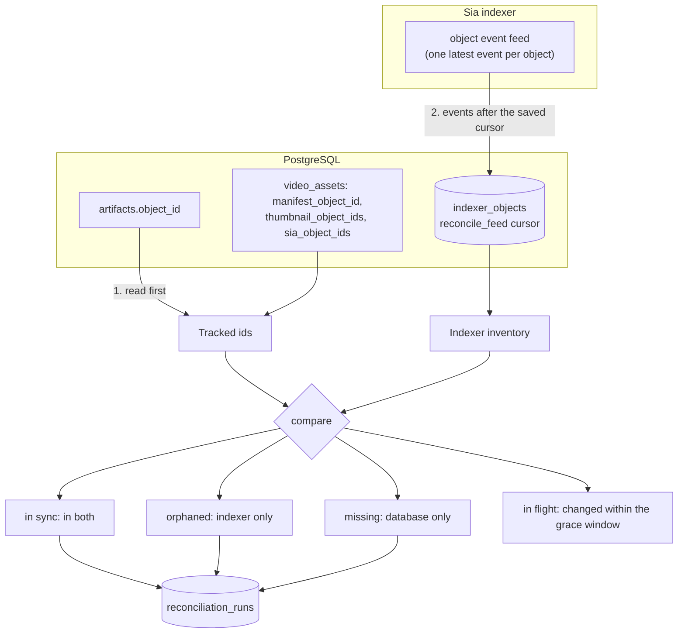

# Deletion and reconciliation

Deleting a video means unpinning every Sia object it owns, and the database is the only record of which objects those are. Sluby therefore deletes in two phases, a soft delete that hides the asset at once and a background worker that unpins and then removes the row, and it runs a separate reconciliation job that compares the database with what the indexer actually holds.

## Deleting an asset

```mermaid
sequenceDiagram
  autonumber
  participant C as Client
  participant A as backend API
  participant DB as PostgreSQL
  participant Q as Redis (deletion queue)
  participant D as deletion worker
  participant I as Sia indexer

  C->>A: DELETE /api/v1/assets/{id}
  A->>DB: set deleted_at (only if not already set, owner-scoped)
  A->>Q: add delete job (jobId delete-{id})
  A-->>C: 200 success, status deleting
  Q->>D: delete job
  D->>DB: find the asset's upload sessions
  D->>D: delete their source files from UPLOAD_DIR and the transcode output
  D->>DB: collect object ids (artifacts, pending_objects and ids on video_assets)
  loop every object
    D->>I: unpin (deleteObject; not found counts as unpinned)
    D->>DB: remove its rows and ids
    D->>D: evict it from the object and tier caches
  end
  D->>I: pruneSlabs (once no upload is in flight)
  alt every object unpinned
    D->>DB: delete the video_assets row (cascades)
  else some failed
    D-->>Q: throw, so BullMQ retries
  end
```

### Soft delete

`DELETE /api/v1/assets/:id` (scope `manage`, SDK: `assets.delete`) sets `video_assets.deleted_at`, enqueues a `delete` job and answers `{ "success": true, "status": "deleting" }`. The update only matches a row that is owned by the caller and not already being deleted, so a second `DELETE` gets a 404. Cancelling an upload with a tus `DELETE` goes through the same function.

From that moment every API read ignores the asset: lookups by id, listings and totals all filter on `deleted_at`. The delivery gateway resolves the asset's objects to `gone` and answers 404, as soon as the 60 second tier cache entry for an object expires or the worker evicts it, whichever comes first.

### The deletion worker

The `deletion` worker (`backend/src/deletion/worker.ts` and `deleter.ts`, concurrency 2) receives only the asset id. It first deletes the asset's source uploads from `UPLOAD_DIR`, found through the `file_path` of its `upload_sessions` rows (cancelled sessions are skipped, since the cancel already removed their files): the source a failed asset kept for a retry, or the partial file of an upload still in flight (which stops that upload, since tus no longer knows it). A file that cannot be removed is logged with its path and does not stop the deletion; a failed session lookup throws, so the job retries while the sessions still point at the files. It also removes the asset's transcode output, `TRANSCODE_OUTPUT_DIR/{assetId}`. It then collects the object ids itself on every attempt: the `artifacts` rows, the `pending_objects` rows (objects the pipeline pinned that finalize has not recorded yet), and `manifest_object_id`, `thumbnail_object_ids` and `sia_object_ids` on the asset, deduplicated. For each object it calls the SDK's `deleteObject`, which unpins it from the indexer. An object the indexer answers 404 for counts as unpinned: it was unpinned by an earlier attempt that died before recording it, or never pinned (an id recorded just before its pin). The SDK hands its errors over as text, so `deleteObject` in `backend/src/storage/sia-client.ts` reads the status from the `Api(404, ...)` part of the message, never from the body. One failing object does not stop the others.

Each object that was unpinned is recorded at once, before the next one: its `artifacts` and `pending_objects` rows are deleted, it is removed from the id columns on the asset in a single `UPDATE` (so two deletions of one asset cannot write back an id the other removed), and it is evicted from the gateway's object and tier caches. Then the worker asks the indexer to prune slabs that no object references any more (`pruneSlabs`): indexd only prunes when asked, and a prune requested while an upload is in flight in the backend process runs once the last upload ends, since it would otherwise strip that upload's slabs (see [the Sia storage layout](./upload-pipeline#the-sia-storage-layout)). A prune failure is only logged. If every object was unpinned, the asset row is deleted, which cascades to `renditions`, `artifacts`, `processing_jobs` and `playback_ids`, and sets `upload_sessions.video_asset_id` to null; in the same transaction the asset's upload sessions lose their tus `metadata` (title, description, owner, key id).

If any object could not be unpinned, the job throws without deleting the row. BullMQ retries it (3 attempts, exponential backoff from 30 seconds), and because unpinned objects were already removed from the database, the next attempt only works on the remainder.

### Garbage collection sweep

Jobs can still be lost, for example when the process dies mid-deletion or all retries fail while the indexer is down. A `gc` job on the same queue runs every `DELETION_GC_INTERVAL_MS` (15 minutes by default, disabled with `DELETION_GC_ENABLED=false`), from a BullMQ job scheduler (`deletion-gc-scheduled`) that the backend brings in line with these settings at every start (see [sweep schedules](#sweep-schedules)). It finds assets soft-deleted longer ago than `DELETION_STUCK_THRESHOLD_MS` (10 minutes by default) and enqueues a `delete` job for each, under the job id `redrive-{assetId}`, unless a `delete` job for that asset is still waiting, delayed or running, so two deletions of one asset never run side by side. Each re-drive replaces the previous one and counts it; from the fifth on, the sweep logs an error naming the asset, since a deletion that keeps failing needs a look at the job errors. The asset stays soft-deleted, invisible and unserved, until a run succeeds.

The same sweep cleans up after the pipeline. It marks for release the `pending_objects` still `uploading` whose asset is gone, being deleted or no longer processing (left by a crash, or a run that failed for good), and unpins every object marked for release that no artifact names, removing the rows of the ones that are gone; one whose unpin fails stays for the next sweep. It also removes the transcode output of assets that are ready, deleted or gone. Each part runs even when another fails, and the job then fails with the first error.

### What deletion does not touch

- the `upload_sessions` row, right away: it stays, with `video_asset_id` null and its `metadata` cleared, so the hourly source sweep can still remove its file if the worker could not, and that sweep deletes the row once the file is gone (see [the source file's lifecycle](./upload-pipeline#the-source-file-s-lifecycle))
- `webhook_deliveries` rows, and there is no webhook event for deletion
- copies in nginx's `proxy_cache`: a manifest or thumbnail fetched before the delete can be served from it until the entry expires (60 seconds for manifests, up to a day for thumbnails); media ranges are never cached there
- share URLs already handed to a player: Sluby does not track them, and they stay valid until they expire

### Sweep schedules

Both periodic sweeps live in Redis as BullMQ job schedulers, `deletion-gc-scheduled` on the `deletion` queue and `reconcile-scheduled` on the `reconcile` queue, so they outlive the process that registered them. At every start the backend makes them match its settings: it upserts the scheduler with the configured interval, which replaces the schedule in place when the interval changed and keeps the next run time when it did not, and it removes the scheduler, together with any run it had already made due, when the sweep is disabled. Earlier versions registered the sweeps with `queue.add(..., { repeat })`, which keys a schedule by its interval, so a changed interval used to add a second schedule and disabling a sweep left the old one running; the first start of a newer version removes those entries as well. A new or changed interval runs the sweep once right away and then every interval.

### Assets deleted while processing

The pipeline records every object id in `pending_objects` before it pins the object, so the deletion worker sees and unpins what a running upload has pinned so far. Each pipeline stage checks its asset before it starts, and the upload stage before each of its three Sia uploads: a stage whose asset was deleted stops, the upload stage unpins what it pinned (an object the deletion already unpinned answers 404, which counts as done), and finalize, which locks the asset row, finds it gone and unpins everything it was handed instead of recording it. A transcode already running when the asset is deleted is not killed; its FFmpeg run fails once the deletion removed its output directory, or it finishes and the stage then stops. Rows an upload writes after the asset row is gone are released by the GC sweep (see [retries and orphan cleanup](./upload-pipeline#retries-and-orphan-cleanup)).

## Reconciliation

The reconciliation worker (`backend/src/reconcile`) checks that the database and the indexer agree about which objects exist. It is report-only: it flags drift and never unpins or deletes anything, leaving cleanup to an operator.



How a run works:

- **When.** A scheduled job every `RECONCILE_INTERVAL_MS` (one hour by default, off with `RECONCILE_ENABLED=false`; see [sweep schedules](#sweep-schedules)), and on demand with `POST /api/v1/reconciliation/run` (scope `manage`, platform identity or an operator only, since a run scans the whole deployment). Only one run is ever pending, see [one run at a time](#one-run-at-a-time).
- **The database side** is every object id in `artifacts` plus the ids stored on `video_assets`, for every asset of every owner, including soft-deleted ones whose objects have not been unpinned yet. It is read first, before the indexer, so whatever an upload records or a deletion forgets while the run goes on shows up as a recent change on the indexer side.
- **The indexer side.** The SDK has no call that lists all objects. The indexer keeps one event per object, its latest pin or delete, and serves them as a feed (`objectEvents`) ordered by time and id after a cursor. The worker keeps a copy of that inventory in `indexer_objects` and the cursor it read up to in `reconcile_feed`, so a run reads only the events since the previous one, page by page (`RECONCILE_PAGE_SIZE`, at most the indexer's maximum of 500), applies each page together with the new cursor in one transaction, and stops on a page shorter than the limit. The saved cursor stays an hour behind the newest events: the indexer stamps an event with the start of its transaction, so an event can arrive after later-stamped ones were read, and re-reading the last hour on each run picks it up. The copy belongs to one indexer URL and account key; a run against another one starts it over from the start of the feed, as does the first run after an upgrade.
- **The grace window.** Objects the indexer pinned or unpinned within the hour before the run started are work in progress, not drift: an upload pins its objects during the Sia upload stage, minutes before finalize records them, and a deletion unpins objects moments before it forgets them. They are left out of the orphan and missing lists (the worker logs how many), and the next run looks at them again. Deleted objects are kept in `indexer_objects` only for that hour.
- **The result.** Ids in both are in sync. Ids only the indexer has are orphans: storage the account pays for that no asset references. Ids only the database has are missing: an object the database expects but the indexer does not report, which is the worrying case. The run is stored in `reconciliation_runs` with counts and the full id lists, with status `ok` when there is no drift and `drift` otherwise. Only the latest 100 runs are kept; each run deletes the ones before them.
- **Failures.** If either side cannot be read, a run with status `failed` and the error message is stored, so an outage shows up as a failed run rather than as a stale report. That includes a feed that cannot be paged: a full page whose last event is not past the cursor it was asked from (the SDK passes times at millisecond precision, so more than 500 events inside one millisecond would stall it) fails the run instead of recording every object not read yet as missing. The pages read before the failure stay applied, and the next run resumes from them.

`GET /api/v1/reconciliation` (scope `manage`) returns the latest run, and the Studio dashboard shows the status and time of the last run.

### What each caller sees

A run covers every tenant's objects, but only the platform identity and operators see the whole of it. The deployment-wide counts, orphans and a failed run's error message describe other tenants and the operator's setup, so a tenant gets only what concerns its own assets:

- **A tenant** (any identity that is neither the platform address nor an operator, which includes every Studio session of an account not in `OPERATOR_USERS`) gets `scope: "account"`: the run's id and times, `missing_ids` with only the missing ids that belong to its own assets (found through the same sources the run reads: `artifacts` plus the ids on `video_assets`, soft-deleted assets included, matched on `creator_address`), `missing_count` as their number, and a `status` about its own assets: `failed` when the run could not complete, `drift` when some of its objects are missing, `ok` otherwise. No deployment counts, no orphans (an orphan is referenced by no asset, so it belongs to no tenant) and no error text.
- **The platform identity** (an API key with the platform address, as `npm run db:seed-key -- --platform` mints, see [tenancy](./auth-and-tenancy#tenancy)) and **operators** (accounts in `OPERATOR_USERS`, their sessions and keys, see [operators](./auth-and-tenancy#operators)) get `scope: "deployment"` with the deployment-wide counts, the error message, and the full `missing_ids` and `orphaned_ids`.

The ownership of a missing id is looked up when the report is read, not when the run was made, so an asset deleted since the run no longer contributes its ids to anyone's list.

```json
{
  "id": "6f1c...",
  "started_at": "2026-10-06T10:00:00.000Z",
  "finished_at": "2026-10-06T10:00:04.000Z",
  "created_at": "2026-10-06T10:00:04.000Z",
  "scope": "account",
  "status": "drift",
  "missing_count": 1,
  "missing_ids": ["8a2f..."]
}
```

### One run at a time

Every run, manual or scheduled, is added to the `reconcile` queue under one BullMQ deduplication id (`reconcile-run`), so at most one run is waiting or active at any moment. The deduplication key is deleted when its run completes or fails, so the next trigger after that queues a new run. A fixed job id would not work here, because the queue keeps finished jobs (the last 100 completed and 100 failed) and BullMQ ignores an add whose job id it still holds; every run therefore gets an id of its own.

`POST /api/v1/reconciliation/run` answers 202 with `{ "enqueued": true, "already_pending": false }` when it queued a run, and with `{ "enqueued": false, "already_pending": true }` when a run was already waiting or running, in which case nothing is added.

The repeatable schedule does not run a pass itself. Each tick enqueues a run through the same deduplicated add, so a tick that lands while a manual run is pending is dropped, and a manual trigger while a scheduled run is pending is answered with `already_pending`. The worker has two slots so that a tick is handled while a run is active rather than waiting behind it and queuing a second run as soon as the first finishes; the deduplication keeps two runs from overlapping.

Objects the pipeline owns are in `pending_objects`, and a run reads that table first, before `artifacts` (finalize moves ids from the one to the other, so the opposite order could miss an id in both). Those ids are never reported as missing, since an id is written just before its pin and may not be pinned yet. Whether a pinned one is an orphan depends on its state:

- **`uploading`**: known, counted as in flight however old its pin. A run that takes longer than the grace window (a large upload on a slow host pool) still owns its objects until finalize records them, and when the run can no longer finish the GC sweep marks them for release.
- **`release`**: known while it was marked for release within the grace window, since the [GC sweep](#garbage-collection-sweep) unpins it within minutes. One marked longer ago and still pinned means the sweep's unpin keeps failing, so it is reported as an orphan for someone to look at, as an untracked object would be.

Because in-flight objects are in neither list, `in_sync_count` plus `orphan_count` can be less than `indexer_object_count`, and `in_sync_count` plus `missing_count` less than `db_object_count`.
