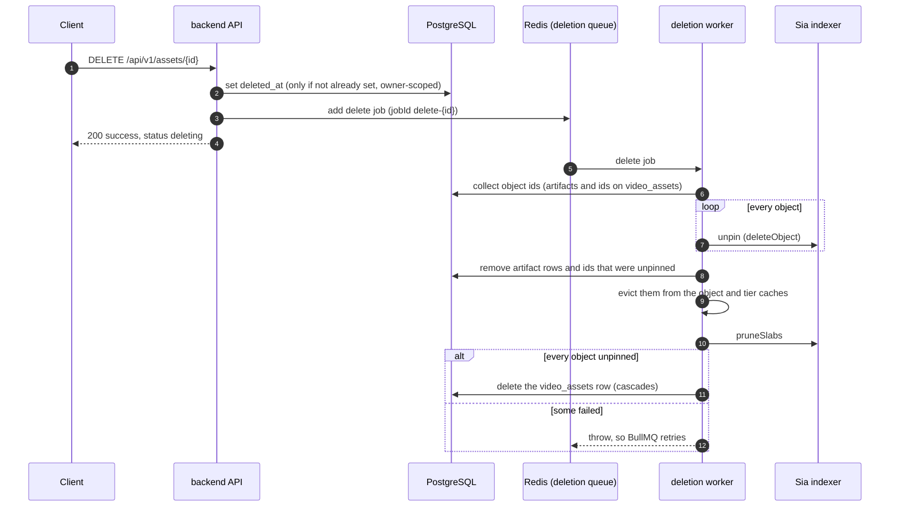
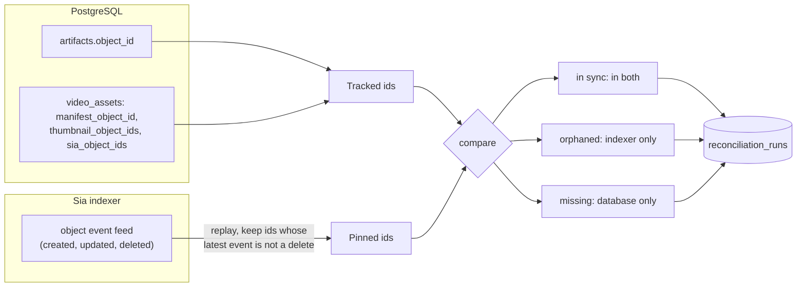

# Deletion and reconciliation

Deleting a video means unpinning every Sia object it owns, and the database is the only record of which objects those are. Sluby therefore deletes in two phases, a soft delete that hides the asset at once and a background worker that unpins and then removes the row, and it runs a separate reconciliation job that compares the database with what the indexer actually holds.

## Deleting an asset

### Soft delete

`DELETE /api/v1/assets/:id` (scope `manage`, SDK: `assets.delete`) sets `video_assets.deleted_at`, enqueues a `delete` job and answers `{ "success": true, "status": "deleting" }`. The update only matches a row that is owned by the caller and not already being deleted, so a second `DELETE` gets a 404. Cancelling an upload with a tus `DELETE` goes through the same function.

From that moment every API read ignores the asset: lookups by id, listings and totals all filter on `deleted_at`. The delivery gateway resolves the asset's objects to `gone` and answers 404, as soon as the 60 second tier cache entry for an object expires or the worker evicts it, whichever comes first.

### The deletion worker

The `deletion` worker (`backend/src/deletion/worker.ts` and `deleter.ts`, concurrency 2) receives only the asset id and collects the object ids itself on every attempt: the `artifacts` rows plus `manifest_object_id`, `thumbnail_object_ids` and `sia_object_ids` on the asset, deduplicated. For each object it calls the SDK's `deleteObject`, which unpins it from the indexer. One failing object does not stop the others.

Objects that were unpinned are recorded right away: their `artifacts` rows are deleted and they are removed from the id columns on the asset, and they are evicted from the gateway's object and tier caches. Then the worker asks the indexer to prune slabs that no object references any more (`pruneSlabs`); a failure there is only logged. If every object was unpinned, the asset row is deleted, which cascades to `renditions`, `artifacts`, `processing_jobs` and `playback_ids`, and sets `upload_sessions.video_asset_id` to null.

If any object could not be unpinned, the job throws without deleting the row. BullMQ retries it (3 attempts, exponential backoff from 30 seconds), and because unpinned objects were already removed from the database, the next attempt only works on the remainder.

### Garbage collection sweep

Jobs can still be lost, for example when the process dies mid-deletion or all retries fail while the indexer is down. A repeatable `gc` job on the same queue runs every `DELETION_GC_INTERVAL_MS` (15 minutes by default, disabled with `DELETION_GC_ENABLED=false`). It finds assets soft-deleted longer ago than `DELETION_STUCK_THRESHOLD_MS` (10 minutes by default) and enqueues a fresh `delete` job for each. The asset stays soft-deleted, invisible and unserved, until a run succeeds.

### What deletion does not touch

- the source file in `UPLOAD_DIR` and the `upload_sessions` row
- `webhook_deliveries` rows, and there is no webhook event for deletion
- copies in nginx's `proxy_cache`: a manifest or thumbnail fetched before the delete can be served from it until the entry expires (60 seconds for manifests, up to a day for thumbnails); media ranges are never cached there
- share URLs already handed to a player: Sluby does not track them, and they stay valid until they expire

### Assets deleted while processing

The deletion worker only knows objects that are in the database. An asset deleted while its upload to Sia is still running has none yet, so the worker finds nothing to unpin and removes the row. The finalize step then finds no asset and unpins everything the upload produced instead of recording it (see [retries and orphan cleanup](./upload-pipeline#retries-and-orphan-cleanup)).

## Reconciliation

The reconciliation worker (`backend/src/reconcile`) checks that the database and the indexer agree about which objects exist. It is report-only: it flags drift and never unpins or deletes anything, leaving cleanup to an operator.

How a run works:

- **When.** A repeatable job every `RECONCILE_INTERVAL_MS` (one hour by default, off with `RECONCILE_ENABLED=false`), and on demand with `POST /api/v1/reconciliation/run` (scope `manage`), which answers 202.
- **The database side** is every object id in `artifacts` plus the ids stored on `video_assets`, for every asset of every owner, including soft-deleted ones whose objects have not been unpinned yet.
- **The indexer side.** The SDK has no call that lists all objects, so the worker replays the indexer's object event feed (`objectEvents`) page by page (`RECONCILE_PAGE_SIZE`, 500 by default), keeps the latest event per object id, and treats every id whose latest event is not a deletion as pinned. It stops on a short page, or if the cursor stops advancing.
- **The result.** Ids in both are in sync. Ids only the indexer has are orphans: storage the account pays for that no asset references. Ids only the database has are missing: an object the database expects but the indexer does not report, which is the worrying case. The run is stored in `reconciliation_runs` with counts and the full id lists, with status `ok` when there is no drift and `drift` otherwise.
- **Failures.** If either side cannot be read, a run with status `failed` and the error message is stored, so an outage shows up as a failed run rather than as a stale report.

`GET /api/v1/reconciliation` (scope `manage`) returns the latest run, and the Studio dashboard shows the status and time of the last run.

Some drift is expected and temporary. Objects of an asset that is between its Sia upload and its finalize step are pinned but not yet in the database, so a run at that moment counts them as orphans. Objects from a processing run whose finalize never succeeded stay orphaned until someone removes them.
