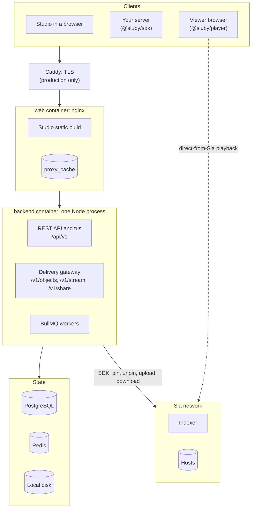
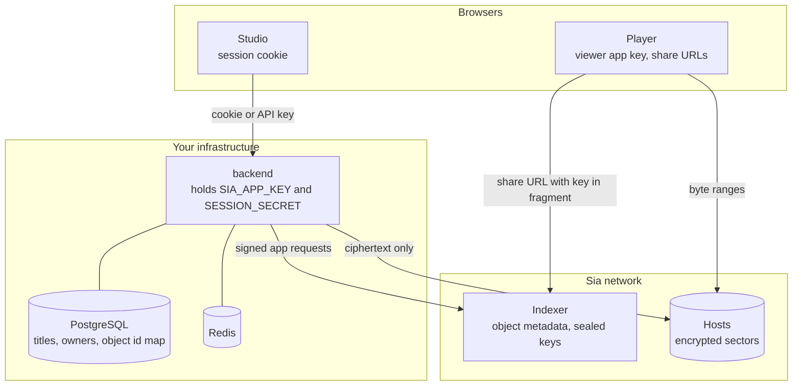

# Architecture overview

Sluby is a single backend process (an Express API, a tus upload server, a delivery gateway and the BullMQ workers) behind an nginx front door, with PostgreSQL for metadata and Redis for the job queues. Every byte of a finished video lives on the Sia network: the backend encrypts and erasure-codes it with the `@siafoundation/sia-storage` SDK and pins it through a Sia indexer.

This section describes how the pieces fit together, as implemented in the repository:

- [Upload pipeline](./upload-pipeline): tus upload, transcoding, the Sia storage layout and webhooks.
- [Playback](./playback): the HTTP gateway with its caches, signed URLs, and direct-from-Sia playback in the browser.
- [Deletion and reconciliation](./deletion-and-reconciliation): how assets are unpinned and how the database is checked against the indexer.
- [Data model](./data-model): the PostgreSQL tables.
- [Auth and tenancy](./auth-and-tenancy): API keys, Studio sessions and per-owner isolation.
- [SDK integration patterns](./sdk-patterns): how to build on `@sluby/sdk` and `@sluby/player`.

## Components

| Component      | What it does                                                                                                                                                                                                                                                                                                                                                                                                                                                                                                  | Source                                                                                                               |
| -------------- | ------------------------------------------------------------------------------------------------------------------------------------------------------------------------------------------------------------------------------------------------------------------------------------------------------------------------------------------------------------------------------------------------------------------------------------------------------------------------------------------------------------- | -------------------------------------------------------------------------------------------------------------------- |
| Caddy          | Terminates TLS and forwards everything to the web container. Only in the production override.                                                                                                                                                                                                                                                                                                                                                                                                                 | `deploy/Caddyfile`, `docker-compose.prod.yml`                                                                        |
| web (nginx)    | Serves the Studio build (`/` redirects to `/studio`, unknown paths and missing files are 404), proxies `/api/`, `/v1/` and `/health` to the backend, caches whole-object delivery responses on disk, sets the security headers and limits each client address on delivery and sign-in. It re-resolves the backend's name every 10 seconds, so a recreated backend container is followed.                                                                                                                      | `frontend/Dockerfile`, `nginx/`                                                                                      |
| backend        | One Node process on port 3000. It serves the REST API under `/api/v1` (tus uploads share the `/api/v1/uploads` path), the delivery gateway under `/v1/objects`, `/v1/stream` and `/v1/share`, `/health` and `/metrics`. The BullMQ workers for the `transcode`, `upload-segments`, `finalize`, `deletion`, `reconcile` and `webhooks` queues are imported by `index.ts` and run inside this same process, with concurrency 2, 4, 4, 2, 1 and 4. The transcode worker is also rate limited to 4 jobs a minute. | `backend/src/index.ts`, `backend/src/queue`, `backend/src/deletion`, `backend/src/reconcile`, `backend/src/webhooks` |
| PostgreSQL     | The source of truth for asset metadata and for which Sia object belongs to which asset. Also stores API keys, webhooks, processing jobs and reconciliation runs.                                                                                                                                                                                                                                                                                                                                              | `backend/src/db/schema.ts`                                                                                           |
| Redis          | Backs the BullMQ queues. Compose runs it with `appendonly yes` and `maxmemory-policy noeviction` so queued jobs survive a restart and are never evicted.                                                                                                                                                                                                                                                                                                                                                      | `docker-compose.yml`                                                                                                 |
| Local disk     | `UPLOAD_DIR` holds tus uploads until the asset is ready or deleted, `TRANSCODE_OUTPUT_DIR` holds FFmpeg output until the asset is finalized. The backend's object cache is in memory.                                                                                                                                                                                                                                                                                                                         | `backend/src/config/env.ts`                                                                                          |
| Sia indexer    | An `indexd` instance, self-hosted or hosted (such as sia.storage). The backend's app key is registered with an account on it. The indexer tracks the account's objects (slab layout, which hosts hold which sectors), pins and unpins them, publishes an object event feed, and resolves share URLs.                                                                                                                                                                                                          | `backend/src/storage/sia-client.ts`                                                                                  |
| Sia hosts      | Store the erasure-coded sectors. The SDK uploads shards to them and downloads byte ranges from them directly; the indexer is not in the data path.                                                                                                                                                                                                                                                                                                                                                            |                                                                                                                      |
| SDK and player | `@sluby/sdk` wraps the REST API and tus, verifies webhooks, and optionally runs a browser Sia session. `@sluby/player` is a React hls.js player that can stream through the gateway or directly from Sia.                                                                                                                                                                                                                                                                                                     | `packages/sdk/src`, `packages/player/src`                                                                            |

The supported deployment is one backend process. The API and the workers share it, and some of what it does relies on being the only one: the queues, the run leases of the Sia upload stage, the guard that keeps a slab prune away from uploads in flight, sessions and the sign-in handshake work across processes (Redis, PostgreSQL, a cookie), but the caches and the rate limit counters are in memory. A second replica against the same PostgreSQL and Redis starts and takes jobs. Slab prunes are safe with it: the prune gate (`SlabPruneGate` in `backend/src/storage/slab-prune-gate.ts`) keeps its upload leases and its prune lock in Redis, so a prune on one replica waits for uploads on every replica (see [the Sia storage layout](./upload-pipeline#the-sia-storage-layout)). What stays per process:

- **Tier changes, deletions and revocations lag up to 60 seconds** on the replicas that did not make the change: each keeps the asset's access state for 60 seconds and only the replica that changed it drops it at once.
- **Rate limits multiply.** The per-key and per-address counters are per process, so each replica allows the full limit.
- **Uploads and pipeline stages need the same disk.** A tus upload's bytes, and the run directory a transcode hands to the Sia upload stage, are files on `UPLOAD_DIR` and `TRANSCODE_OUTPUT_DIR`. Replicas on one host share the named volumes; replicas on different hosts need shared storage, and even then tus locks an upload only within one process.
- **Caches and metrics are per process.** The Studio's storage breakdown (30 seconds) and host list (5 minutes), the system status and the object cache are kept separately in each replica, and `/metrics` counts only the replica that answers.

The production guide says the same for operators, under "More than one backend" in [operating it](../guide/production#operating-it).

## Trust boundaries

What each party holds and can see:

- **The backend** holds `SIA_APP_KEY`, the secret behind its indexer app. The SDK signs every indexer request with it and seals every object's data key with a key derived from it, so the app key can read and delete everything the app stores. The backend also holds `SESSION_SECRET`, which signs Studio session cookies; a key derived from it signs private playback URLs, together with each asset's signing generation, so one asset's URLs can be revoked without touching anything else.
- **The indexer** stores, per object, the slab layout (which host holds which sector), sizes and timestamps, plus the object's data key sealed with XChaCha20-Poly1305 under a key derived from the app key. It sees when objects are created and deleted and how much the account stores. It never receives plaintext, and it has no way to know which objects form which video, what a video is called, or who uploaded it: that mapping exists only in PostgreSQL.
- **Hosts** store sectors of ciphertext. In the SDK, each object gets a random data key, its bytes are encrypted with it, then erasure coded, and every shard is encrypted again with a per-slab key before it leaves the backend process.
- **Share URLs** (direct-from-Sia playback) are capabilities for a single object. A share URL has the form `sia://<indexer>/objects/<id>/shared?<signature>#encryption_key=<key>`: the query is signed by the backend's app key and valid until a set time, and the fragment carries that object's data key. Anyone holding one can download and decrypt that one object until it expires. Sluby cannot revoke a share URL early, short of deleting the object, so the backend mints them per playback with a short expiry.
- **The viewer app key** used for direct-from-Sia playback is a separate app identity, registered with `backend/scripts/provision-viewer.mjs`, and it ships to every browser that plays a video. It is not the backend's key, so on its own it gives no access to the backend's objects; it only lets a browser resolve the share URLs the backend hands out. Treat it as public.
- **Browsers** authenticate to the API with an API key or the Studio session cookie. The delivery gateway itself has no login: public objects are served to anyone who knows the object id, private ones need an HMAC-signed URL. See [Auth and tenancy](./auth-and-tenancy) and [Playback](./playback).
- **PostgreSQL and Redis** are reachable only inside the Compose network in the production setup; the base Compose file publishes them on `127.0.0.1` for local development.
