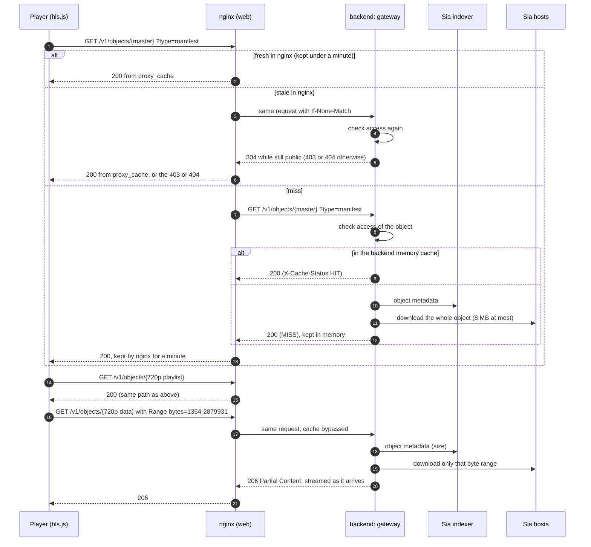
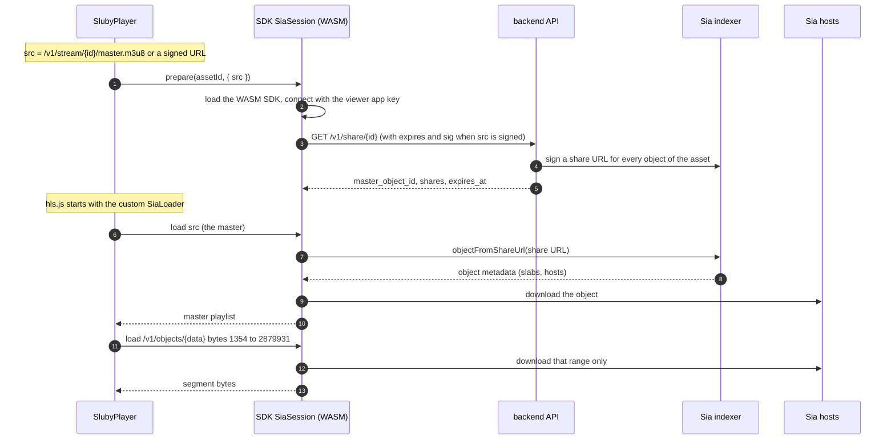

# Playback

A finished asset is a master playlist, one playlist and one `data.m4s` per rendition, and thumbnails, all stored as separate Sia objects (see [the storage layout](./upload-pipeline#the-sia-storage-layout)). The manifests point at each other with root-relative `/v1/objects/{id}` paths. Those bytes reach a player in one of two ways:

- **Gateway**: the player fetches `/v1/objects/...` over HTTP from Sluby, and the backend downloads from Sia on its behalf. Works with hls.js and with a browser's native HLS playback.
- **Direct from Sia**: the player's hls.js loader reads the object id out of each `/v1/objects/{id}` path and downloads that object from Sia hosts in the browser, using short-lived share URLs minted by the backend. The backend serves no media bytes, and a public page needs no API key for it.

Both use the same stored manifests.

## The gateway path

### Finding the manifest

`GET /api/v1/playback/:id` (scope `read`, owner-scoped, accepts an asset id or a `pb_...` playback id) answers 409 until the asset is `ready`, then returns:

```json
{
  "playback_url": "/v1/objects/<master-object-id>?type=manifest",
  "poster_url": "/v1/objects/<first-thumbnail-object-id>",
  "duration_ms": 15000,
  "resolution": "1280x720",
  "access_tier": "public"
}
```

The SDK's `playback.getUrl` resolves both paths against `deliveryBaseUrl` (which defaults to `baseUrl`). Without any API call, a public asset can also be played from `/v1/stream/{assetId or pb_...}/master.m3u8`, which looks up the master manifest by asset or playback id; the SDK builds that URL with `playback.streamUrl(id)`, without a request.

### Serving objects



`GET /v1/objects/:objectId` (`backend/src/delivery/aggregator.ts`) has no login. For each request it:

1. **Checks the id.** Anything but 64 lowercase hex characters gets a 400 without touching the database or the indexer.
2. **Decides access from the owning asset** (`backend/src/delivery/access-control.ts`), found through `artifacts`, which holds every stored object id of every asset (migration 0009 backfilled older assets). Access follows only the asset itself: an object of a `public` asset is open, an object of a `private` asset needs a valid signature, an object whose asset is being deleted gets a 404, and so does an object no asset claims (an unpinning leftover, say), without asking the indexer. Playback ids play no part here: a `signed` playback id gates its own `/v1/stream` entry, not the objects. If one object were ever claimed by two assets, the stricter claim wins. If the database cannot be read the gateway answers 503, so it neither serves nor refuses on a guess.
3. **Serves a `Range` request by streaming passthrough.** One indexer lookup gives the size and the handle the download uses. The range is parsed (`bytes=N-M`, `bytes=N-` and `bytes=-N`; anything else, such as a multi-range or inverted request, is ignored and the whole object is served, as is a range whose `If-Range` names another version), only the slabs it overlaps are fetched from the hosts, and the bytes are streamed to the client as they arrive, with the client's backpressure, as a 206. A range starting past the end gets 416. An open-ended `bytes=0-` of a large file is streamed the same way, so it is never held in memory. A range of an object already in the memory cache is cut from there.
4. **Serves a whole object by size.** Without a usable `Range`, an object of up to 8 MB (manifests, playlists, thumbnails) is read once into an in-memory LRU bounded by `CACHE_MAX_SIZE_MB` (default 256) and served from it; concurrent misses on one object share one download. A larger object is streamed from Sia uncached. The SDK may queue only four 128 KiB chunks ahead of a slow reader, so what a download holds is the SDK's own working set for the slabs in flight, measured at up to about 100 MB per download whatever the object's size, rather than the object. `HEAD` takes the same path without a body, so a large object costs only the indexer lookup. The `Content-Type` comes from the `?type=` hint (`manifest`, `playlist`, `thumbnail`, `poster`, `video`, `segment`, `data`), from the body for manifests, or from the magic bytes for images.
5. **Maps failures.** The indexer reporting no such object is a 404, any other indexer or host failure a 502, the database a 503. A stream that breaks off or ends short after the headers went out is cut, so the client sees a broken response, never wrong bytes.

Every public answer carries `ETag: "<object id>"` (objects never change under their id) and `Cache-Control: public, no-cache`: a browser, CDN or other cache must revalidate before reusing it, and the gateway answers that revalidation with 304 only after checking access again. A small whole public object also carries `X-Accel-Expires: 60`, which lets the shipped nginx keep it for a minute between checks (nginx strips that header). Ranged and large answers never carry it, so nginx keeps no media, and neither do master playlists: a master is where a play starts, so every load must reach the backend to be counted (see [Plays](#plays)). Private answers are `no-store`, and errors are never cacheable.

Both the backend and `nginx/conf.d/sia-aggregator.conf` set `Access-Control-Allow-Origin: *` on gateway responses. nginx drops the backend's CORS headers before adding its own, so a response carries each header once and players on other origins can read it.

`GET /v1/stream/:id/master.m3u8` serves the master manifest for an asset id or a `pb_...` playback id from a separate manifest cache (1000 entries, 32 MB). Its gate depends on the asset and on the handle used: a private asset, or a playback id with the `signed` policy, needs a signature over the master manifest's object id, and the child urls in the answer are then signed. A public asset reached by its id or a public playback id needs nothing, even when the asset also has a `signed` playback id: a signed handle gates only itself, so adding one never breaks another embed. It also means a signed handle on a public asset does not make the asset's bytes private, since its objects stay public under their own ids; make the asset private for that. A public answer carries the ETag of the master object and `public, no-cache`, so a browser revalidates it, but no shared cache keeps it: each load reaches the backend and counts as a play.

### Cache layers

| Layer                | Where                   | Holds                                                | Bound and lifetime                                                                                                        |
| -------------------- | ----------------------- | ---------------------------------------------------- | ------------------------------------------------------------------------------------------------------------------------- |
| nginx `proxy_cache`  | web container, on disk  | small public objects other than master playlists     | 10 GB; fresh for at most 60 s (the backend's `X-Accel-Expires`), then revalidated against the backend's access check      |
| backend object LRU   | backend process, memory | whole objects of up to 8 MB                          | `CACHE_MAX_SIZE_MB` (default 256); objects never change, so entries leave only by eviction or when the object is unpinned |
| backend manifest LRU | backend process, memory | master manifests for `/v1/stream`                    | 1000 entries, 32 MB                                                                                                       |
| share map cache      | backend process, memory | minted share maps, per asset, master and expiry slot | 5000 entries, each kept until its share URLs expire                                                                       |
| object owners cache  | backend process, memory | object id to the assets that claim it                | 50000 entries, 5 minutes (1 minute for an id no asset claims)                                                             |
| asset access cache   | backend process, memory | an asset's tier, deletion and signing state          | 20000 entries, 60 s, dropped at once by a tier edit, a revoke or a delete made through this process                       |

nginx keys its cache on the method and the path, plus the `type` hint for `/v1/objects/` and `expires_in` for `/v1/share/` (the only parts of the query that change an answer), so a junk query string cannot force a miss. A request with a `Range` header or a `sig` bypasses the cache both ways: many segments share one object URL and differ only by range, and a signed request is answered per request. nginx never serves a stale entry in place of an answer, not even when the backend is down, streams what it does not keep through its memory buffers only, and sets its own `X-Cache-Status` (HIT, MISS, REVALIDATED, BYPASS, ...) in place of the backend's.

When finalize marks an asset ready it warms the backend object LRU with the master playlist, the variant playlists and the thumbnails, and the manifest LRU with the master. The large `data.m4s` objects are never cached whole; their bytes are fetched from Sia per range on every request, and nginx does not keep them either. So on the gateway path, every segment a viewer plays is downloaded from Sia hosts by the backend. (Caching media segments, promised for milestone 2, is a recorded deviation.)

### How long an access change takes

| Change                                    | The backend                                  | Copies in nginx                                                                              | Browsers and other caches       |
| ----------------------------------------- | -------------------------------------------- | -------------------------------------------------------------------------------------------- | ------------------------------- |
| `PATCH` to `private`                      | at once                                      | at most 60 s for playlists and thumbnails (masters are never kept), then 403 on revalidation | revalidate on every use, so 403 |
| `DELETE`                                  | at once (404 while the objects are unpinned) | at most 60 s, then 404                                                                       | the same                        |
| revoke, or a tier change, for signed URLs | at once: every older signature is refused    | signed requests are never cached                                                             | private answers are `no-store`  |
| a `signed` playback id added              | its own `/v1/stream` entry needs a signature | nothing changes: the asset and its other entries stay public, by design                      | nothing changes                 |

"At once" holds for the backend process that handled the change; another backend process notices within its 60 second asset cache. The integration test in `backend/src/__tests__/nginx-delivery.integration.test.ts` runs the real backend behind the shipped nginx config and checks the 403 and 404 after the window. Share URLs already handed out for direct-from-Sia playback are not covered by any of this: they keep working until they expire (see below).

### Private assets and signed URLs

An object is gated when its asset's `access_tier` is `private` (set at upload or with `PATCH /api/v1/assets/:id`). The `/v1/stream` and `/v1/share` entries are also gated when reached through a playback id with the `signed` policy. Gated requests need `expires` and `sig` query parameters (`backend/src/delivery/signed-url.ts`):

- `sig` is the hex HMAC-SHA256 of `v2:{objectId}:{expires}:{generation}` under a key derived from `SESSION_SECRET` with HKDF for this use alone, so a signature can never stand in for a session cookie or the other way round. Rotating `SESSION_SECRET` still voids every signed URL as well as every session.
- `generation` is the asset's signing generation (`video_assets.signing_generation`). It goes up when the asset's tier changes (in the same statement as the change) and when someone calls `POST /api/v1/playback/:id/signed/revoke` (scope `manage`). Every URL signed under an older generation, and every child URL signed from one, is refused from then on, while other assets are untouched.
- `expires` is a unix time no more than six hours ahead. A URL whose expiry lies further out is refused even with a valid signature, so no URL outlives the cap whatever minted it.

The signature is checked in constant time before the expiry, so the error cannot be used to learn which object ids exist.

`GET /api/v1/playback/:id/signed?expires_in=N` (SDK: `playback.getSignedUrl`) returns an absolute URL for the master manifest built on `PUBLIC_URL`, signed until now plus `N` seconds. `N` defaults to 3600 and is kept between 60 and 21600 (six hours); a value that is not a whole number gets a 400. The answer also has `poster_url`, the first thumbnail signed the same way (null when there is none), so a player can show a poster for a private video. One signature covers the whole asset: when the gateway serves a gated manifest, it adds `expires` and `sig` to every `/v1/objects/` path inside it, using the expiry the request proved and the asset's current generation. The variant playlists are signed the same way when they are fetched, and the segment URLs in them carry valid signatures. Because every URL in the tree shares the original expiry, a player has to fetch a new signed URL before it passes; `SlubyPlayer` does so itself, a minute before the expiry (or halfway through a shorter lifetime), when it signed the URL, and for a signed `src` it was given when the page passes `refreshSrc`; either way it continues from the same position.

URLs signed by versions before signing generations (the session secret itself over `{objectId}:{expires}`, with no cap) keep working for six hours after migration 0014, never past their own expiry, and only for assets that existed then (`video_assets.legacy_signatures_until`). The children of a manifest served through one are signed no further than that window, and raising the asset's generation closes it at once. After six hours no such URL works any more, so a long-lived link minted before the upgrade cannot outlive it.

## The direct-from-Sia path

Direct playback needs a viewer identity: an app registered with an indexer once per deployment with `npm run provision-viewer` in `backend/` (`backend/scripts/provision-viewer.mjs`), which prints an indexer URL, an app id and an app key. They go into the SDK client as `sia: { indexerUrl, appId, appKey }`; for the Studio they are build arguments (`VITE_SLUBY_SIA_*`). The key ships to the browser, so it must be this separate viewer app, never the backend's `SIA_APP_KEY`.



### Minting share URLs

Two endpoints return the same share map, minted by the same code (`backend/src/delivery/share-urls.ts`) under the same expiry rules (`backend/src/delivery/share-expiry.ts`):

- `GET /v1/share/:id` is public and lives in the delivery namespace next to `/v1/stream` (`backend/src/delivery/aggregator.ts`). It accepts an asset id or a `pb_...` playback id and is gated exactly like `/v1/stream`: a public asset by its id or a public playback id needs nothing, while a private asset or a `signed` playback id needs the `expires` and `sig` of its signed master URL. A missing, invalid, expired or revoked signature gets 403, an asset that is unknown, not ready or being deleted gets 404. This is what the SDK uses when the player has a playback URL, so a public page plays direct from Sia without a key.
- `GET /api/v1/playback/:id/share` (scope `read`, owner-scoped, `backend/src/api/routes/playback.ts`) answers 409 until the asset is ready. It treats the asset as gated only when it is private. The SDK uses it when it has no playback URL (`client` and `assetId` without `src`), with the caller's key or session.

Both read `expires_in` from the query (default 3600 seconds) and clamp it to 60 seconds at least and 6 hours at most, or 1 hour at most when the asset is gated. On the public endpoint the share URLs of a signed request also never outlive the signature's `expires`. The expiry is then rounded up to a five-minute slot (or down, if rounding up would pass the limit), and one `sia://` share URL is minted per object of the asset (master, playlists, data files and thumbnails) through the SDK, all valid until that moment:

```json
{
  "master_object_id": "<master-object-id>",
  "shares": { "<object-id>": "sia://...", "...": "..." },
  "expires_at": "2026-10-06T17:00:00.000Z"
}
```

Minting needs one indexer lookup per object, and the public endpoint lets anyone call it, so the map is cached per asset, master object and expiry slot until its URLs expire, and concurrent requests for a slot that is still being minted wait for that one mint. However often it is called and with whichever `expires_in`, an asset is minted at most once per slot: about 73 slots inside the six-hour cap, 13 inside the one-hour gated cap, plus one for a signature that is within a few minutes of expiring. A gated map is sent with `Cache-Control: private, no-store` and a public one with `no-store`: minting a map is how a direct-from-Sia play reaches the server, so no cache may answer in its place. The per-slot cache above keeps that cheap. If the indexer fails during minting, both endpoints answer 502; if the database fails, 503.

A share URL bypasses the HMAC gateway entirely: whoever holds it can fetch and decrypt that object until it expires, and it cannot be revoked earlier, not by a tier change, a revoke or a delete (until the delete unpins the objects). A viewer who fetched the map of a public asset can therefore keep playing it for up to six hours after the asset is made private. That is why the map is minted per playback, with the shorter cap for gated assets.

### The browser side

`SiaSession` (`packages/sdk/src/sia-session.ts`, available as `client.sia` when `sia` is configured) does the Sia work:

- **Lazy WASM.** `@siafoundation/sia-storage` (about 1.7 MB of WASM) is imported on the first `connect()`, so clients that never play directly never load it. It connects with `Builder.connected(appKey)` and fails with a clear error if the viewer key is not registered.
- **Where the map comes from.** `prepare`, `resolveObjectId` and `masterObjectId` take an optional `{ src }`, the playback URL being played. With it, the map comes from `GET /v1/share/:id` on the same delivery base as `src` (any path prefix before `/v1/` is kept), carrying the `expires` and `sig` of `src`, sent with no `Authorization` header and `credentials: 'omit'`. Without it, the map comes from `GET /api/v1/playback/:id/share` with the client's key or cookie.
- **Which share id.** For a `/v1/stream/{id}/master.m3u8` `src` the map is asked for by the `{id}` in that URL (the asset or playback id it was issued for); for a `/v1/objects/{id}` `src` it is the `assetId`.
- **Share map cache.** Maps are cached per asset and source, with one request in flight per pair, and fetched again 60 seconds before `expires_at`, so a long watch keeps working. A map that was already fetched inside those 60 seconds (the map of a signed `src` never outlives the signature) is used until it expires instead of being fetched on every resolve.
- **Object resolution.** `resolveObjectId(assetId, objectId, source)` turns a share URL into an SDK object handle with `objectFromShareUrl`. Handles are cached per asset and object, at most 64, and the least recently used one is freed first; `dispose()` frees them all and the WASM SDK. If the object is not in the map, the map is fetched again once. If resolving fails while the map is within 60 seconds of its expiry, the map is fetched again and the resolve retried with the fresh URL; any other failure goes to the caller, since a share URL only goes bad by expiring.
- **Byte ranges.** `download(object, { offset, length })` streams the range from the hosts.

The player (`packages/player/src/SlubyPlayer.tsx` and `SiaLoader.ts`) plugs this into hls.js as a custom `loader`. For every playlist and segment hls.js asks for, the loader takes the object id out of the `/v1/objects/{id}` path (for a `/v1/stream/{id}/master.m3u8` URL it asks the session for the master object id instead), resolves it through the session, and downloads either the whole object or, for a byte-range segment, `length = rangeEnd - rangeStart` bytes from `rangeStart` (hls.js treats `rangeEnd` as exclusive). It honours hls.js's load timeout and abort.

### Fallbacks

The player attempts direct-from-Sia in two cases. With `src`, `assetId` and a client that has a Sia session, it plays `src` through the loader, with the share map from `/v1/share/:id`; it does not start a gateway load before the session is ready. With `client` and `assetId` and no `src`, it first resolves the gateway URL through the API (the address the loader reads object ids from) and uses the authenticated share route. In both cases it uses the gateway when:

- no `sia` config is set, so `client.sia` is undefined
- hls.js is not supported (the browser has no Media Source Extensions) but the browser plays HLS natively; a custom loader cannot apply to native playback, so the `<video>` element gets the gateway URL
- `client.sia.prepare` fails, for example when the WASM SDK cannot load, the viewer key is not registered, or the share endpoint errors (a 403 for a missing signature included); the player logs a warning and continues on the gateway

`onDeliveryChange` reports `sia` or `gateway` for each load. The decision is made once per load: if a download fails after playback has started in Sia mode, the player does not switch to the gateway. hls.js reports the error and the player's usual recovery applies (up to `maxNetworkRetries` reloads, then the error overlay with a Retry button, which resolves everything again).

## Plays

The backend counts a play where it can see one: one player load of a video.

- **Gateway.** A 200 `GET` of the master playlist, at `/v1/stream/{id}/master.m3u8` (video id or playback id, public or signed) or at `/v1/objects/{master object id}`, where signed playback URLs point. Variant playlists, segments and thumbnails are not plays.
- **Direct from Sia.** A 200 `GET /v1/share/{id}`. Such a player never fetches the master from the gateway, so the share map is the only request of its load the server sees.

Not counted: `HEAD`, 304 and range requests; refused or failed ones (403, 404, 502, 503); the share map refresh a long watch makes before the map lapses, which the SDK marks `renew=1`; the authenticated `GET /api/v1/playback/{id}/share`; and previews in the Studio, recognised by a `Referer` that is a `/studio` page of this server. One viewer (client address and user agent, kept only as a hash) loading the same video again within 30 minutes counts once, which also covers a player that reloads its master after an error. A browser that revalidates a master it still holds gets a 304 and is not counted.

Counts are buffered in memory and written every 10 seconds as one upsert into `asset_plays_daily` (one row per video and UTC day) plus `video_assets.last_played_at`, so a play costs no database write of its own; a crash or a kill without a clean shutdown loses at most the last 10 seconds of plays, and a clean shutdown writes them. The dedupe memory is per backend process, so two replicas behind a load balancer can each count one viewer once. Bytes served are not counted: direct-from-Sia bytes never pass the server. The API reports `play_count` and `last_played_at` on every asset and `GET /api/v1/stats/usage` per day for the account.

## Choosing a path

|                            | Gateway                                                                                                          | Direct from Sia                                                                                             |
| -------------------------- | ---------------------------------------------------------------------------------------------------------------- | ----------------------------------------------------------------------------------------------------------- |
| Who downloads from hosts   | the backend, with its own indexer app                                                                            | each viewer's browser, with the viewer app; the viewer app's account pays the egress, so it needs a balance |
| Server bandwidth           | every byte passes through the backend and nginx                                                                  | one share map request per playback; no media bytes                                                          |
| Caching                    | manifests and thumbnails in memory, playlists and thumbnails in nginx; segments are fetched from Sia per request | no shared cache; every viewer downloads every segment from hosts                                            |
| Access control             | checked on every request, cached copies within a minute; private bytes are `no-store`                            | bearer share URLs valid until they expire, at most 1 hour for gated assets                                  |
| Browser support            | any browser with hls.js or native HLS                                                                            | needs hls.js (Media Source Extensions); not used on native-only HLS                                         |
| Client cost                | none beyond hls.js                                                                                               | about 1.7 MB of WASM, loaded on first use                                                                   |
| Credentials in the browser | none for public assets via `/v1/stream/{pb_...}/master.m3u8`; a signed URL for private ones                      | the same: none for public assets, the signed URL for private ones (`/v1/share` checks its signature)        |
