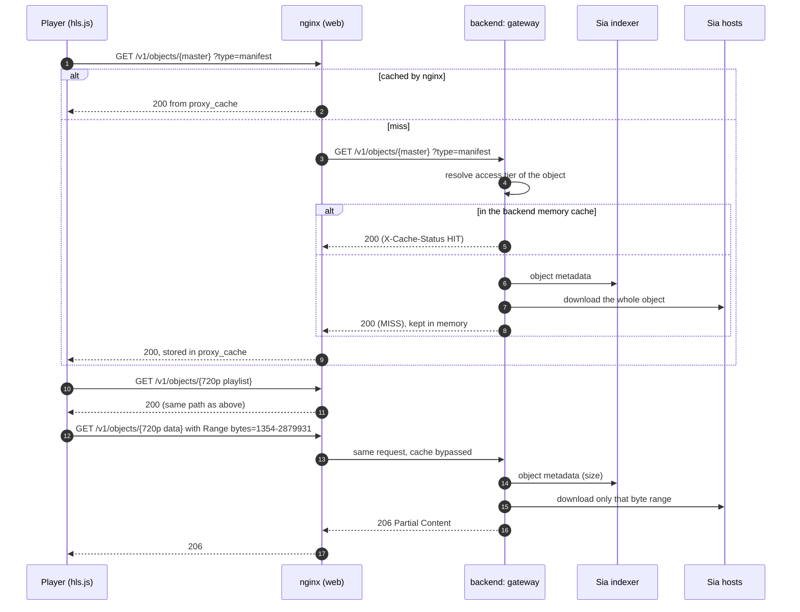
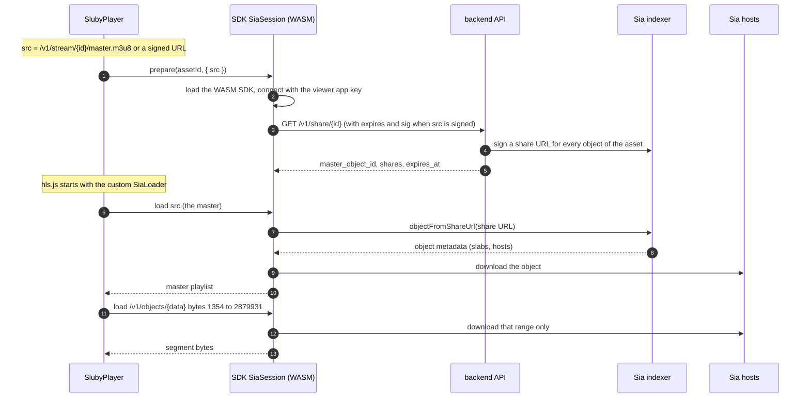

# Playback

A finished asset is a master playlist, one playlist and one `data.m4s` per rendition, and thumbnails, all stored as separate Sia objects (see [the storage layout](./upload-pipeline#the-sia-storage-layout)). The manifests point at each other with root-relative `/v1/objects/{id}` paths. Those bytes reach a player in one of two ways:

- **Gateway**: the player fetches `/v1/objects/...` over HTTP from Sluby, and the backend downloads from Sia on its behalf. Works with hls.js and with a browser's native HLS playback.
- **Direct from Sia**: the player's hls.js loader reads the object id out of each `/v1/objects/{id}` path and downloads that object from Sia hosts in the browser, using short-lived share URLs minted by the backend. The backend serves no media bytes, and a public page needs no API key for it.

Both use the same stored manifests.

## The gateway path

### Finding the manifest

`GET /api/v1/playback/:id` (scope `read`, owner-scoped, accepts an asset id or a `pb_...` playback id) answers 409 until the asset is `ready`, then returns:

```json
{
  "playback_url": "/v1/objects/<master-object-id>?type=manifest",
  "poster_url": "/v1/objects/<first-thumbnail-object-id>",
  "duration_ms": 15000,
  "resolution": "1280x720",
  "access_tier": "public"
}
```

The SDK's `playback.getUrl` resolves both paths against `deliveryBaseUrl` (which defaults to `baseUrl`). Without any API call, a public asset can also be played from `/v1/stream/{assetId or pb_...}/master.m3u8`, which looks up the master manifest by asset or playback id; the SDK builds that URL with `playback.streamUrl(id)`, without a request.

### Serving objects



`GET /v1/objects/:objectId` (`backend/src/delivery/aggregator.ts`) has no login. For each request it:

1. **Resolves the object's access tier** (`backend/src/delivery/access-control.ts`) by mapping the object id back to its asset through `artifacts` and the ids stored on `video_assets`. An object whose asset is being deleted is `gone` and gets a 404. An object of a `private` asset, or of any asset that has a playback id with the `signed` policy, needs a valid signature. Anything else, including an object no asset claims, is served openly. If the database lookup fails, the gateway answers 404 rather than serving bytes that might be private. Results are cached for 60 seconds.
2. **Serves a `Range` request by passthrough.** It asks the indexer for the object's size, parses the range (`bytes=N-M`, `bytes=N-` and `bytes=-N`; anything else, such as a multi-range request, is ignored and the whole object is served), downloads only those bytes from the hosts, and answers 206. A range starting past the end gets 416. Ranged responses are never cached by the backend. HLS segment reads are always ranged, since every segment is a byte range of one `data.m4s`.
3. **Serves a full `GET` from memory.** Without a `Range` header, the whole object goes through an in-memory LRU cache bounded by `CACHE_MAX_SIZE_MB` (entries live up to 24 hours). This is meant for manifests and thumbnails, which are small. The `Content-Type` comes from the `?type=` hint (`manifest`, `playlist`, `thumbnail`, `poster`, `video`, `segment`, `data`), from the body for manifests, or from the magic bytes for images.

Response caching headers: manifests are `public, max-age=60`, thumbnails and media `public, max-age=86400`, and anything private is `no-store`.

Both the backend and `nginx/conf.d/sia-aggregator.conf` set `Access-Control-Allow-Origin: *` on gateway responses. nginx drops the backend's CORS headers before adding its own, so a response carries each header once and players on other origins can read it.

`GET /v1/stream/:id/master.m3u8` serves the master manifest for an asset id or a `pb_...` playback id from a separate manifest cache (1000 entries, 60 seconds). It applies the same gate: a private asset, or a playback id with the `signed` policy, needs a signature over the master manifest's object id.

### Cache layers

| Layer                | Where                   | Holds                                                                  | Bound and lifetime                                                                                                                                               |
| -------------------- | ----------------------- | ---------------------------------------------------------------------- | ---------------------------------------------------------------------------------------------------------------------------------------------------------------- |
| nginx `proxy_cache`  | web container, on disk  | 200 responses of `/v1/objects/`, `/v1/stream/` and public `/v1/share/` | 10 GB, entries dropped after 24 h without a hit; honours the backend's `Cache-Control`, so manifests expire after 60 s and `no-store` responses are never stored |
| backend object LRU   | backend process, memory | whole objects fetched without `Range`                                  | `CACHE_MAX_SIZE_MB` (default 10240), 24 h                                                                                                                        |
| backend manifest LRU | backend process, memory | master manifests for `/v1/stream`                                      | 1000 entries, 60 s                                                                                                                                               |
| share map cache      | backend process, memory | minted share maps, per asset, master and expiry slot                   | 5000 entries, each kept until its share URLs expire                                                                                                              |
| access tier cache    | backend process, memory | object id to `public`, `private`, `gone` or `unknown`                  | 10000 entries, 60 s                                                                                                                                              |

nginx keys its cache on the full URI including the query string, so signed and unsigned requests never share an entry, and it neither caches nor serves cached copies for requests with a `Range` header: many segments share one object URL and differ only by range. It also sets its own `X-Cache-Status` (HIT, MISS, BYPASS, ...) in place of the backend's.

When finalize marks an asset ready it warms the backend object LRU with the master playlist, the variant playlists and the thumbnails, and the manifest LRU with the master. The large `data.m4s` objects are never cached whole; their bytes are fetched from Sia per range on every request that misses nginx, and nginx does not cache ranges either. So on the gateway path, every segment a viewer plays is downloaded from Sia hosts by the backend.

### Private assets and signed URLs

An asset is gated when its `access_tier` is `private` (set at upload or with `PATCH /api/v1/assets/:id`), or when it has a playback id with the `signed` policy. Gated objects need `expires` and `sig` query parameters, where `sig` is the hex HMAC-SHA256 of `{objectId}:{expires}` under `SESSION_SECRET` (`backend/src/delivery/signed-url.ts`). The signature is checked in constant time before the expiry, so an attacker cannot use the error to learn which object ids exist.

`GET /api/v1/playback/:id/signed?expires_in=N` (SDK: `playback.getSignedUrl`) returns an absolute URL for the master manifest built on `PUBLIC_URL`, signed until now plus `N` seconds (3600 when omitted). One signature covers the whole asset: when the gateway serves a gated manifest, it adds `expires` and `sig` to every `/v1/objects/` path inside it, using the same expiry the request proved. The variant playlists are then signed the same way when they are fetched, and the segment URLs in them carry valid signatures. Because every URL in the tree shares the original expiry, a viewer still watching when it passes gets a 403 on the next segment; pick an expiry longer than the video.

Changing an asset's tier with `PATCH` clears the tier cache for its objects immediately. It does not purge nginx: a manifest or thumbnail that nginx cached while the asset was public stays servable from nginx until its entry expires (60 seconds for manifests, up to a day for thumbnails). Media segments are not affected, since ranged reads are never cached. Adding a `signed` playback id does not clear the tier cache, so it takes effect within 60 seconds.

## The direct-from-Sia path

Direct playback needs a viewer identity: an app registered with an indexer once per deployment with `npm run provision-viewer` in `backend/` (`backend/scripts/provision-viewer.mjs`), which prints an indexer URL, an app id and an app key. They go into the SDK client as `sia: { indexerUrl, appId, appKey }`; for the Studio they are build arguments (`VITE_SLUBY_SIA_*`). The key ships to the browser, so it must be this separate viewer app, never the backend's `SIA_APP_KEY`.



### Minting share URLs

Two endpoints return the same share map, minted by the same code (`backend/src/delivery/share-urls.ts`) under the same expiry rules (`backend/src/delivery/share-expiry.ts`):

- `GET /v1/share/:id` is public and lives in the delivery namespace next to `/v1/stream` (`backend/src/delivery/aggregator.ts`). It accepts an asset id or a `pb_...` playback id and is gated exactly like `/v1/stream`: a public asset with a public playback id needs nothing, while a private asset, a `signed` playback id, or a public asset that has a `signed` playback id (whose objects the gateway gates) needs the `expires` and `sig` of its signed master URL. A missing, invalid or expired signature gets 403, an asset that is unknown, not ready or being deleted gets 404. This is what the SDK uses when the player has a playback URL, so a public page plays direct from Sia without a key.
- `GET /api/v1/playback/:id/share` (scope `read`, owner-scoped, `backend/src/api/routes/playback.ts`) answers 409 until the asset is ready. The SDK uses it when it has no playback URL (`client` and `assetId` without `src`), with the caller's key or session.

Both read `expires_in` from the query (default 3600 seconds) and clamp it to 60 seconds at least and 6 hours at most, or 1 hour at most when the asset is gated. On the public endpoint the share URLs of a signed request also never outlive the signature's `expires`. The expiry is then rounded up to a five-minute slot (or down, if rounding up would pass the limit), and one `sia://` share URL is minted per object of the asset (master, playlists, data files and thumbnails) through the SDK, all valid until that moment:

```json
{
  "master_object_id": "<master-object-id>",
  "shares": { "<object-id>": "sia://...", "...": "..." },
  "expires_at": "2026-10-06T17:00:00.000Z"
}
```

Minting needs one indexer lookup per object, and the public endpoint lets anyone call it, so the map is cached per asset, master object and expiry slot until its URLs expire, and concurrent requests for a slot that is still being minted wait for that one mint. However often it is called and with whichever `expires_in`, an asset is minted at most once per slot: about 73 slots inside the six-hour cap, 13 inside the one-hour gated cap, plus one for a signature that is within a few minutes of expiring. A gated map is sent with `Cache-Control: private, no-store`. A public map from `/v1/share` may be cached for at most 60 seconds, and never so long that a cached copy would be handed out within two minutes of the shares expiring; nginx follows that header. If the indexer fails during minting, both endpoints answer 502.

A share URL bypasses the HMAC gateway entirely: whoever holds it can fetch and decrypt that object until it expires, and it cannot be revoked earlier. That is why the map is minted per playback, with the shorter cap for gated assets.

### The browser side

`SiaSession` (`packages/sdk/src/sia-session.ts`, available as `client.sia` when `sia` is configured) does the Sia work:

- **Lazy WASM.** `@siafoundation/sia-storage` (about 1.7 MB of WASM) is imported on the first `connect()`, so clients that never play directly never load it. It connects with `Builder.connected(appKey)` and fails with a clear error if the viewer key is not registered.
- **Where the map comes from.** `prepare`, `resolveObjectId` and `masterObjectId` take an optional `{ src }`, the playback URL being played. With it, the map comes from `GET /v1/share/:id` on the same delivery base as `src` (any path prefix before `/v1/` is kept), carrying the `expires` and `sig` of `src`, sent with no `Authorization` header and `credentials: 'omit'`. Without it, the map comes from `GET /api/v1/playback/:id/share` with the client's key or cookie.
- **Share map cache.** Maps are cached per asset and source and fetched again 60 seconds before `expires_at`, so a long watch keeps working.
- **Object resolution.** `resolveObjectId(assetId, objectId, source)` turns a share URL into an SDK object handle with `objectFromShareUrl`, cached per asset, source and object. If the object is not in the map, or resolving fails, the map is fetched again once and the resolve retried with the fresh URL.
- **Byte ranges.** `download(object, { offset, length })` streams the range from the hosts.

The player (`packages/player/src/SlubyPlayer.tsx` and `SiaLoader.ts`) plugs this into hls.js as a custom `loader`. For every playlist and segment hls.js asks for, the loader takes the object id out of the `/v1/objects/{id}` path (for a `/v1/stream/{id}/master.m3u8` URL it asks the session for the master object id instead), resolves it through the session, and downloads either the whole object or, for a byte-range segment, `length = rangeEnd - rangeStart` bytes from `rangeStart` (hls.js treats `rangeEnd` as exclusive). It honours hls.js's load timeout and abort.

### Fallbacks

The player attempts direct-from-Sia in two cases. With `src`, `assetId` and a client that has a Sia session, it plays `src` through the loader, with the share map from `/v1/share/:id`; it does not start a gateway load before the session is ready. With `client` and `assetId` and no `src`, it first resolves the gateway URL through the API (the address the loader reads object ids from) and uses the authenticated share route. In both cases it uses the gateway when:

- no `sia` config is set, so `client.sia` is undefined
- hls.js is not supported (the browser has no Media Source Extensions) but the browser plays HLS natively; a custom loader cannot apply to native playback, so the `<video>` element gets the gateway URL
- `client.sia.prepare` fails, for example when the WASM SDK cannot load, the viewer key is not registered, or the share endpoint errors (a 403 for a missing signature included); the player logs a warning and continues on the gateway

`onDeliveryChange` reports `sia` or `gateway` for each load. The decision is made once per load: if a download fails after playback has started in Sia mode, the player does not switch to the gateway. hls.js reports the error and the player's usual recovery applies (up to `maxNetworkRetries` reloads, then the error overlay with a Retry button, which resolves everything again).

## Choosing a path

|                            | Gateway                                                                                     | Direct from Sia                                                                                             |
| -------------------------- | ------------------------------------------------------------------------------------------- | ----------------------------------------------------------------------------------------------------------- |
| Who downloads from hosts   | the backend, with its own indexer app                                                       | each viewer's browser, with the viewer app; the viewer app's account pays the egress, so it needs a balance |
| Server bandwidth           | every byte passes through the backend and nginx                                             | one share map request per playback; no media bytes                                                          |
| Caching                    | manifests and thumbnails in memory and in nginx; segments are fetched from Sia per request  | no shared cache; every viewer downloads every segment from hosts                                            |
| Access control             | checked on every request; private bytes are `no-store`                                      | bearer share URLs valid until they expire, at most 1 hour for gated assets                                  |
| Browser support            | any browser with hls.js or native HLS                                                       | needs hls.js (Media Source Extensions); not used on native-only HLS                                         |
| Client cost                | none beyond hls.js                                                                          | about 1.7 MB of WASM, loaded on first use                                                                   |
| Credentials in the browser | none for public assets via `/v1/stream/{pb_...}/master.m3u8`; a signed URL for private ones | the same: none for public assets, the signed URL for private ones (`/v1/share` checks its signature)        |
