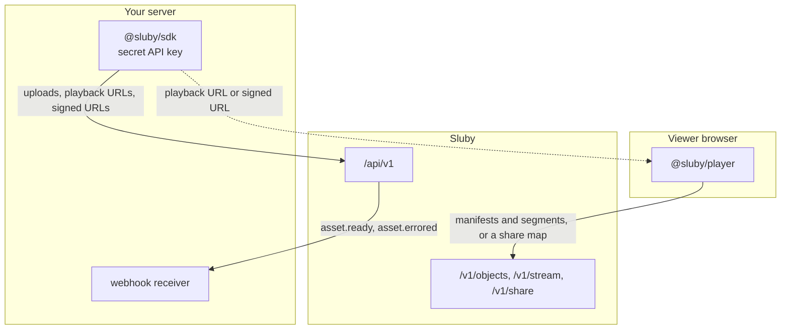

# SDK integration patterns

`@sluby/sdk` wraps the REST API, tus uploads and webhook verification; `@sluby/player` is a React player built on hls.js. This page shows how they fit into an application, given how the backend behaves. The code uses the real signatures from `packages/sdk/src` and `packages/player/src`.

The general shape: keep API keys on your server, do uploads and URL minting there, and give the browser only what it needs to play.



## Server-side upload with a secret key

```ts
import { readFile } from 'node:fs/promises';
import { SlubyClient } from '@sluby/sdk';

const sluby = new SlubyClient({
  baseUrl: 'https://video.example.com',
  apiKey: process.env.SLUBY_API_KEY!,
});

const file = await readFile('talk.mp4');
const upload = sluby.uploads.upload(file, {
  title: 'Conference talk',
  accessTier: 'public',
  onProgress: (percent) => console.log(`uploaded ${percent}%`),
});

const assetId = await upload.assetId;
const uploadId = await upload.uploadId;
await upload;
```

- The key needs the `upload` scope, and `read` as well to poll the asset afterwards. Create a dedicated key per service in the Studio or with `POST /api/v1/keys`.
- `upload()` returns at once. `upload.assetId` resolves as soon as the server has created the asset, which is right after the upload starts, so you can store the id before the bytes finish; awaiting `upload` itself waits for the last byte. `upload.uploadId` is the last segment of the tus upload URL, which `sluby.uploads.getStatus(uploadId)` and `sluby.uploads.cancel(uploadId)` take.
- `upload()` takes a `Blob` (a browser `File` included) or a `Uint8Array` (a Node `Buffer` included). A `Buffer` holds the whole file in memory; in Node, `await openAsBlob(path)` from `node:fs` gives a `Blob` that the SDK reads chunk by chunk from disk instead.
- The upload is resumable: tus retries failed chunks after 0, 1, 3 and 5 seconds by default (`retryDelays`), and the handle has `pause()`, `resume()` and `abort()`. `abort()`, or a `signal` passed in the options, terminates an unfinished upload, the backend deletes the asset it created, and the handle rejects with an `AbortError`; once the upload has finished, `abort()` does nothing, so cleanup code that always calls it never deletes a finished asset. In a browser an unfinished upload of the same file, metadata and key is resumed after a page reload unless `resume: false`; a finished one is never resumed, so uploading the same file again creates a new asset.
- `accessTier: 'private'` makes the asset need signed URLs from the start. The tier can be changed later with `sluby.assets.update(assetId, { accessTier })`.

## Knowing when an asset is ready

Processing takes from seconds to many minutes depending on the video length and the Sia network, so the result arrives asynchronously. There are two ways to learn about it.

### Polling

```ts
import { TimeoutError } from '@sluby/sdk';

try {
  const asset = await sluby.assets.waitForReady(assetId, {
    pollInterval: 10_000,
    timeout: 30 * 60_000,
  });
  console.log('ready', asset.id, asset.durationMs);
} catch (err) {
  if (err instanceof TimeoutError) {
    console.log('still processing, check again later');
  } else {
    const job = await sluby.assets.processing(assetId);
    console.error('processing failed at', job.stage, job.errorMessage);
  }
}
```

`waitForReady` calls `GET /api/v1/assets/:id` every `pollInterval` milliseconds (5 seconds by default) until the status is `ready`. It rejects with a `ProcessingFailedError` carrying the asset when the asset becomes `failed`, with `TimeoutError` after `timeout` (10 minutes by default), and with an `AbortError` when its `signal` fires. Each poll counts against the key's rate limit, 100 requests a minute by default. `assets.processing(assetId)` returns the stage, percentage, error and log lines, which is what to show a user while they wait.

Polling needs nothing but outbound HTTP, so it suits scripts, CLIs and servers that cannot receive inbound requests.

### Webhooks

Webhook endpoints are registered with `sluby.webhookEndpoints` (the REST `POST /api/v1/webhooks`) or in the Studio, with a key that has the `manage` scope:

```ts
const { id, secret } = await sluby.webhookEndpoints.create({
  url: 'https://app.example.com/hooks/sluby',
  events: ['asset.ready', 'asset.errored'],
});
```

The response contains the endpoint's `secret` once; store it. The endpoint receives the events of every asset owned by the key's account, whichever key uploaded it. Verify every delivery against the raw body before trusting it:

```ts
import express from 'express';
import { WebhookManager } from '@sluby/sdk';

const webhooks = new WebhookManager();
const app = express();

const handled = new Set<string>(); // use your database in a real receiver

app.post('/hooks/sluby', express.text({ type: 'application/json' }), async (req, res) => {
  const valid = await webhooks.verifyRequestAsync(
    req.body,
    req.headers,
    process.env.SLUBY_WEBHOOK_SECRET!,
  );
  if (!valid) {
    res.sendStatus(401);
    return;
  }
  const event = webhooks.parseEvent(req.body);
  if (event.id && handled.has(event.id)) {
    res.sendStatus(204);
    return;
  }
  if (event.id) handled.add(event.id);
  if (event.event === 'asset.ready') {
    console.log('ready to play', event.data.video_asset_id);
  } else if (event.event === 'asset.errored') {
    console.error('failed at', event.data.stage, event.data.error);
  }
  res.sendStatus(204);
});
```

- `X-Sluby-Signature-V1` is an HMAC-SHA256 of `X-Sluby-Timestamp`, a `.` and the exact bytes sent, so parse the body as text (`express.text`), not JSON, or re-serializing may change it. `verifyRequest` also refuses a timestamp more than five minutes from now (`toleranceSeconds` changes that), so a captured delivery cannot be replayed later.
- `verifyRequestAsync` runs on Web Crypto and works in Node, browsers and edge runtimes. The synchronous `verifyRequest` works on Node only and throws elsewhere. The older `verifySignature` methods check the body-only `X-Sluby-Signature` header, which binds no time; move receivers to `verifyRequest`.
- Answer within 10 seconds with a 2xx; only the status counts, and a redirect is a failure. Failed deliveries are retried after 10 seconds, 1 minute and 5 minutes with the same body and the same event `id`, and a delivery in flight when the backend stopped can arrive twice, so drop ids you have handled.
- The receiver must be on a public address; the backend refuses loopback, private and metadata addresses unless the operator allows the network (see [webhooks](/api/#webhooks)). `POST /api/v1/webhooks/:id/test` sends a signed `webhook.test` event to check a receiver.
- Pending deliveries and retries are kept in the backend's Redis queue and survive a backend restart. After the last retry fails, the event is not sent again, so for anything that must not be missed while your receiver is down for more than a few minutes, keep a slow poll as a backstop, for example re-checking assets that have been processing for longer than expected.

|                | Polling                             | Webhooks                           |
| -------------- | ----------------------------------- | ---------------------------------- |
| Needs          | outbound HTTP only                  | a public HTTPS endpoint            |
| Latency        | up to one poll interval             | seconds after finalize             |
| Cost           | one API call per interval per asset | one request per event              |
| Missed results | none, the next poll sees them       | possible if all four attempts fail |
| Detail         | full asset and processing log       | the event payload                  |

## Managing the account from a server

Everything the Studio's settings do is also on the client, for a key with the `manage` scope (reading renditions and stats needs `read`):

```ts
// api keys: cursor-paged list, create, rotate with a grace period, revoke
const page = await sluby.keys.list({ limit: 100 });
const created = await sluby.keys.create({ name: 'encoder', scopes: ['upload', 'read'] });
const rotated = await sluby.keys.rotate(created.id, { gracePeriodSeconds: 3600 });
await sluby.keys.revoke(rotated.rotatedFrom);

// webhook endpoints: the secret is returned once, by create
const endpoint = await sluby.webhookEndpoints.create({
  url: 'https://app.example.com/hooks/sluby',
  events: ['asset.ready'],
});
const test = await sluby.webhookEndpoints.test(endpoint.id);
const attempts = await sluby.webhookEndpoints.deliveries(endpoint.id, { limit: 20 });

// playback ids, renditions and library totals
const handle = await sluby.playbackIds.create(assetId, { policy: 'public', name: 'embed' });
const renditions = await sluby.assets.renditions(assetId);
const stats = await sluby.assets.stats();
console.log(page.hasMore, test.delivered, attempts.length, handle.playbackId, renditions, stats);
```

`client.webhookEndpoints` manages registered endpoints over the API; `client.webhooks` is only the signature verifier and needs no key. A rotated key keeps working until its grace period ends, and a key can be rotated once (rotate its replacement after that; a second rotation rejects with `ConflictError`).

## Errors, cancelling and paging

Every SDK error is a `SlubyError` with the HTTP status in `statusCode`: `ValidationError` (400, 422), `AuthenticationError` (401), `PermissionError` (403, a missing scope or an operations-only route), `NotFoundError` (404, 410), `ConflictError` (409), `RateLimitError` (429, with `retryAfter` in seconds), and a plain `SlubyError` for other statuses. `TimeoutError` and `AbortError` report a request the client gave up on, and `ProcessingFailedError` carries the failed asset from `waitForReady`. A network failure before any answer stays the runtime's own `TypeError`.

Every request method takes `{ signal }`, an `AbortSignal` that cancels it with an `AbortError`, and `timeoutMs` in the client's config bounds every request, its body included, with a `TimeoutError`:

```ts
const client = new SlubyClient({
  baseUrl: 'https://video.example.com',
  apiKey: process.env.SLUBY_API_KEY!,
  timeoutMs: 15_000,
});

const ids: string[] = [];
let cursor: string | undefined;
do {
  const page = await client.assets.list({
    limit: 100,
    cursor,
    signal: AbortSignal.timeout(60_000),
  });
  ids.push(...page.data.map((asset) => asset.id));
  cursor = page.nextCursor ?? undefined;
} while (cursor);
```

`assets.list` pages by cursor with the default newest-first order: pass `nextCursor` back as `cursor` until it is null (`hasMore` says the same). With another `sort` or `order` there is no cursor, and `page` numbers are used instead. `keys.list` pages by cursor the same way.

## Playing in the browser

How the player gets its URL depends on whether the browser may hold a credential.

### Public pages without credentials

For a public asset, resolve the playback URL on your server and hand only the URL to the page. The key never reaches the browser:

```ts
const { playbackUrl, posterUrl } = await sluby.playback.getUrl(assetId);
```

```tsx
import { SlubyPlayer } from '@sluby/player';

export function Watch({
  playbackUrl,
  posterUrl,
}: {
  playbackUrl: string;
  posterUrl: string | null;
}) {
  return <SlubyPlayer src={playbackUrl} poster={posterUrl ?? undefined} width="100%" />;
}
```

`playbackUrl` points at the master manifest on the gateway (`/v1/objects/{id}?type=manifest`, made absolute with `deliveryBaseUrl`), and every object of a public asset is served without credentials. An alternative is a playback id: create one with `sluby.playbackIds.create(assetId, { policy: 'public' })` (the REST `POST /api/v1/assets/:id/playback-ids`, scope `manage`) and use `https://video.example.com/v1/stream/{playback_id}/master.m3u8` as `src`. Deleting the playback id later stops that URL, but not the asset's object URLs. `sluby.playback.streamUrl(id)` builds that kind of URL (for an asset id or a playback id) without a request.

The player uses the browser's native HLS when hls.js is not supported (no Media Source Extensions) and the browser can play HLS itself, and retries network errors up to `maxNetworkRetries` times (3 by default) before it shows an error with a Retry button.

### Signed playback for private assets

For a private asset, mint a signed URL on the server, after checking that the viewer may watch it:

```ts
await sluby.assets.update(assetId, { accessTier: 'private' });

const { signedUrl, expiresAt } = await sluby.playback.getSignedUrl(assetId, {
  expiresIn: 4 * 60 * 60,
});
```

```tsx
export function PrivateWatch({ signedUrl }: { signedUrl: string }) {
  return <SlubyPlayer src={signedUrl} width="100%" />;
}
```

The URL authorizes the whole asset until `expiresAt`: the gateway signs the playlists and segments inside the manifests with the same expiry, and caps every signed URL at six hours (one hour by default). Segments requested after the expiry get 403, so either choose `expiresIn` longer than the video plus pauses, or give the player a `refreshSrc` function that returns a freshly signed URL; the player calls it shortly before the expiry and continues from the same position:

```tsx
export function RenewingWatch({ signedUrl }: { signedUrl: string }) {
  return (
    <SlubyPlayer
      src={signedUrl}
      refreshSrc={async () => {
        // your own endpoint, which checks the viewer and signs a new url
        const res = await fetch('/api/watch-url');
        return ((await res.json()) as { url: string }).url;
      }}
    />
  );
}
```

Anyone holding the URL can watch until it expires, so mint one per viewer and session. `POST /api/v1/playback/:id/signed/revoke` (scope `manage`; the SDK has no method for it) stops every URL signed for the asset so far, and so does a tier change; all signed URLs also stop working if `SESSION_SECRET` changes.

### Apps where the browser holds a credential

The player can also resolve URLs itself from a `client` and an `assetId`. That calls `/api/v1/playback/:id` from the browser, so the browser needs a credential with `read` scope (a Studio session or a key). The Studio does this with its session cookie: it is served from the same origin as the API and creates its client without an API key.

```tsx
const sluby = new SlubyClient({
  baseUrl: window.location.origin,
  sia: {
    indexerUrl: import.meta.env.VITE_SLUBY_SIA_INDEXER_URL,
    appId: import.meta.env.VITE_SLUBY_SIA_APP_ID,
    appKey: import.meta.env.VITE_SLUBY_SIA_APP_KEY,
  },
});

export function LibraryPlayer({ assetId }: { assetId: string }) {
  return (
    <SlubyPlayer
      client={sluby}
      assetId={assetId}
      onDeliveryChange={(mode) => console.log('delivery:', mode)}
    />
  );
}
```

Add `signed` (and optionally `expiresIn`) to have the player request a signed URL instead. Do not put an API key in a public page's bundle to make this work: a `read` key lists and reads the whole account's library. A public page does not need one, direct from Sia included; see the next section.

### Direct from Sia or through the gateway

The `sia` option above turns on direct-from-Sia playback: the player streams playlists and segments from Sia hosts with the viewer app key, and the backend only mints a share map per playback (see [Playback](./playback#the-direct-from-sia-path)). Without `sia`, or when hls.js is unavailable or the Sia session cannot start, it uses the gateway.

A public page plays direct from Sia with no API key: give the player the playback URL, the asset id and a keyless client with the viewer identity. The share map then comes from the public `GET /v1/share/:id`, gated like the gateway by the URL's own signature.

```tsx
const viewer = new SlubyClient({
  baseUrl: 'https://video.example.com',
  sia: { indexerUrl, appId, appKey },
});

// public asset: the stream url, built without a request
export function PublicWatch({ assetId }: { assetId: string }) {
  return <SlubyPlayer src={viewer.playback.streamUrl(assetId)} client={viewer} assetId={assetId} />;
}
```

For a private asset, pass the signed URL your server minted for this viewer as `src` instead:

```tsx
export function PrivateSiaWatch({ assetId, signedUrl }: { assetId: string; signedUrl: string }) {
  return <SlubyPlayer src={signedUrl} client={viewer} assetId={assetId} />;
}
```

Things to weigh:

- **Egress.** On the gateway, the backend downloads from hosts with its own indexer account, and the nginx and memory caches absorb repeat requests for manifests and thumbnails. Direct, every viewer downloads every segment from hosts with the viewer app, and that app's account pays the egress; there is no shared cache.
- **Your bandwidth.** The gateway sends every media byte through your server. Direct playback sends none.
- **Credentials.** None in the browser. With `src`, the share map comes from `/v1/share/:id`, which asks for nothing on a public asset and for the signed URL's `expires` and `sig` on a private one. Only the `client` and `assetId` pattern without `src` uses `/api/v1/playback/:id/share`, which needs `read` scope on the asset's owner.
- **Access control.** Share URLs are bearer capabilities: whoever has one can download that object until it expires (at most 1 hour for private or signed assets, 6 hours otherwise, and never past a signed URL's expiry). The gateway checks every request.
- **Weight.** Direct playback loads about 1.7 MB of WASM on first use and needs hls.js, so browsers that only play HLS natively use the gateway.

`onDeliveryChange` tells you which path each load took.
