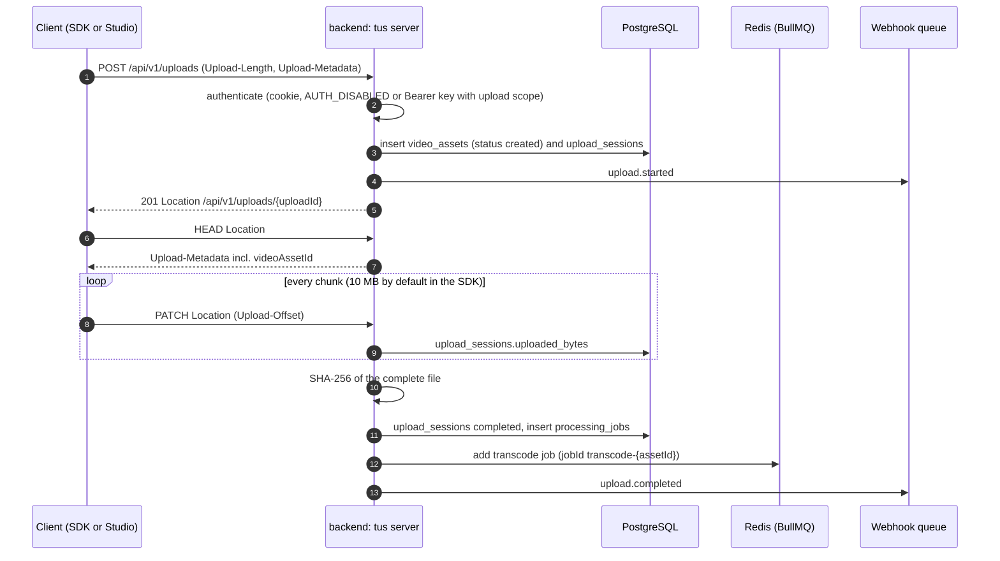
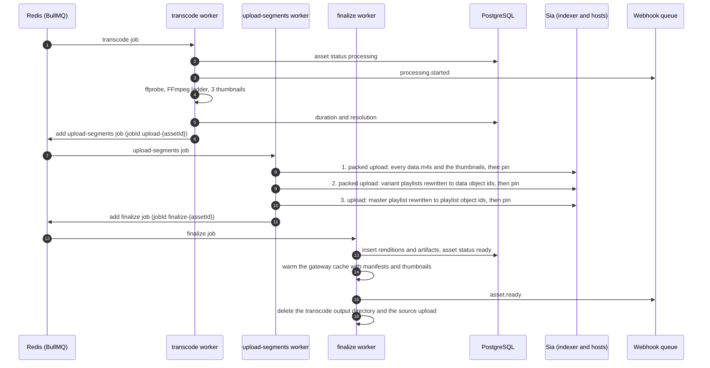
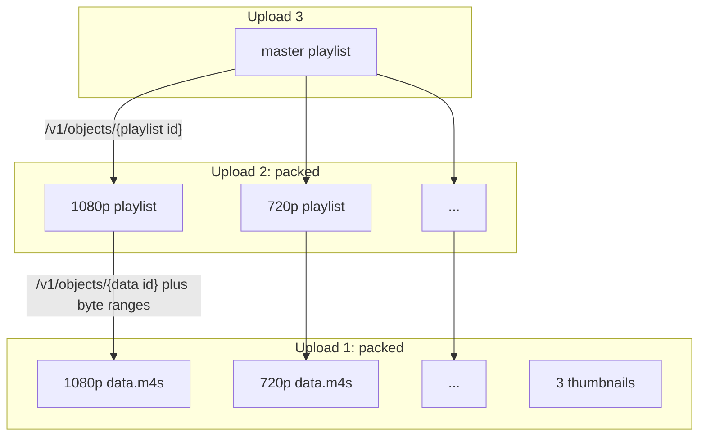

# Upload pipeline

An upload goes through four steps: the file arrives over tus, FFmpeg turns it into an HLS ladder, the output is stored on Sia in three packed uploads, and a finalize step records everything in PostgreSQL and marks the asset ready. The last three steps are BullMQ jobs on the `transcode`, `upload-segments` and `finalize` queues, each enqueued by the step before it.

## Receiving the file over tus



The tus server (`backend/src/upload/tus-server.ts`, built on `@tus/server` with a `@tus/file-store` store in `UPLOAD_DIR`, see `backend/src/upload/upload-store.ts`) shares the `/api/v1/uploads` path with two REST routes. A request goes to tus when it carries a `Tus-Resumable` header or uses `PATCH`, `HEAD` or `OPTIONS`; a plain `GET` or `DELETE` on `/api/v1/uploads/:id` falls through to the REST status and cancel routes (`backend/src/upload/tus-dispatch.ts`).

Details worth knowing:

- **Ownership comes from the caller, never from the metadata.** The asset's `creator_address` is the authenticated identity's address, even if the client puts a different one in `Upload-Metadata`. Requests on an existing upload by another tenant get a 404, the same answer as for an unknown id.
- **Metadata.** The SDK sends `filename`, `filetype`, `title`, `description` and `accessTier`. A `filetype` that does not start with `video/` is rejected with 415. Uploads larger than `MAX_UPLOAD_SIZE` (10 GiB by default) are refused by tus.
- **Asset id.** The asset and the upload session are created in the tus creation hook, and their ids are written back into the tus upload's metadata. The creation response only carries a `Location`, so the SDK sends one `HEAD` to read `videoAssetId` from `Upload-Metadata`; that is what resolves the `assetId` promise on the SDK's upload handle.
- **Progress.** While an upload is in progress, `GET /api/v1/uploads/:id` reports the bytes the tus store holds on disk. The session's `uploaded_bytes` column is also updated from tus's post-receive event, but that event is throttled to once a second and dropped at the end of each `PATCH`, so the column alone lags behind.
- **Ids.** The tus upload id is a uuid, and the upload session row takes the same id, so the last segment of the tus `Location` (`<PUBLIC_URL>/api/v1/uploads/<id>`, built from `PUBLIC_URL` rather than request headers) is also the id of `GET` and `DELETE /api/v1/uploads/:id`.
- **Checks at creation.** `onUploadCreate` refuses an empty upload, a file type other than `video/*`, an access tier other than `public` or `private`, and a title or description that breaks the rules of an asset edit (`backend/src/api/validation.ts`), each with a 400 before any row is written. `upload.started` is sent from the `POST_CREATE` event, once the file store has created the upload; if the store fails after the rows were written, the session is marked `failed` and the asset is deleted.
- **Cancelling.** A tus `DELETE` on an unfinished upload cancels the session and soft-deletes the asset it created, which then goes through the normal [deletion](./deletion-and-reconciliation) path. The file store deletes the upload's data file and its `{uploadId}.json` metadata file as part of the `DELETE`. A REST `DELETE /api/v1/uploads/:id` does the same for an upload still in progress. A finished upload cannot be cancelled either way (`disableTerminationForFinishedUploads`): it is the source of an asset that is processing or kept for a retry, and deleting that asset takes the `manage` scope.
- **Failure at the end.** If hashing, completing the session or enqueuing fails, the asset is marked `failed` and an `upload.failed` webhook is sent.
- **The source file is kept only while it can still be needed.** See [the source file's lifecycle](#the-source-file-s-lifecycle) below.

### The source file's lifecycle

The tus file store keeps two files per upload in `UPLOAD_DIR`: the data under the tus upload id, and a `{uploadId}.json` file next to it with the upload's size, metadata and creation time. The data file's path is recorded in `upload_sessions.file_path` when the upload is created. Both files are removed together, at the first of these points:

| When                                 | Who removes them                                               | Why then                                                                        |
| ------------------------------------ | -------------------------------------------------------------- | ------------------------------------------------------------------------------- |
| the asset becomes `ready`            | the finalize worker, after the transcode output is deleted     | nothing transcodes the source again once the asset is ready                     |
| the asset is deleted                 | the deletion worker, before it unpins anything                 | covers a failed asset that kept its source, and an upload that is still running |
| the uploader cancels                 | the tus file store on a tus `DELETE`, or the REST cancel route | a cancelled upload is never resumed                                             |
| an incomplete upload is 24 hours old | the expiry sweep                                               | an abandoned upload would otherwise stay forever                                |

The expiry sweep also closes the rows of an abandoned upload: every session still `uploading` past its 24 hour expiry is marked `failed`, and an asset that never got past the upload (`created` or `uploading`) is deleted, so it does not stay in the library as an empty video (`buildUploadExpiry` in `backend/src/app.ts`).

A `failed` asset keeps its source, because a [manual retry](#retries-and-orphan-cleanup) that has to transcode again reads it from `UPLOAD_DIR`. The expiry sweep leaves it alone too, since the upload itself is complete; it goes when the asset is retried to `ready` or deleted.

**Expiry.** The file store is created with a 24 hour expiry (`UPLOAD_EXPIRY_MS` in `backend/src/upload/upload-store.ts`), counted from the upload's creation as the tus expiration extension defines it. Creation and `PATCH` responses for an unfinished upload carry an `Upload-Expires` header, and after that time `HEAD` and `PATCH` answer 410, so the client has to start over. The backend calls `@tus/server`'s `cleanUpExpiredUploads()` once at startup and then every hour (`UPLOAD_SWEEP_INTERVAL_MS`), and logs how many uploads it removed. The stock `FileStore` decides whether an upload is complete from the offset in its `.json` file, which it writes once at creation and never updates, so it would delete finished uploads too. Sluby's store (`UploadFileStore`) reads the offset from the size of the data file instead, the same way tus answers a `HEAD`, and only removes uploads that are both expired and incomplete.

**Sweep of finished sources.** On the same hourly timer, the backend lists `UPLOAD_DIR` and removes every source whose upload session belongs to an asset that is `ready` or was deleted (`sweepFinishedSources` in `backend/src/upload/source-files.ts`). That catches sources left by a removal that failed, and sources of assets that were `ready` before this cleanup existed. A file that no upload session records is left alone and counted in the log line, since it may be an upload whose session row is still being written; the expiry sweep removes it if it never completes.

**Failures.** Removing a source never fails the step that asked for it: an error is logged with the path of the file, the asset still becomes `ready`, and a deletion still completes. The next hourly sweep tries again.

## Processing



Progress is written to `processing_jobs.progress_percent` as the job moves: the transcode maps FFmpeg's progress onto 0 to 60 percent and reaches 65 once thumbnails exist, the Sia uploads move it from 65 to 90, and finalize takes it to 100.

### Transcoding

`backend/src/transcode/ffmpeg-runner.ts` probes the source with `ffprobe`, then runs a single FFmpeg command that scales the video into every rung of the ladder at once:

| Rung  | Box       | Video bitrate (max) | Audio |
| ----- | --------- | ------------------- | ----- |
| 1080p | 1920x1080 | 6000k (6420k)       | 192k  |
| 720p  | 1280x720  | 3500k (3745k)       | 128k  |
| 540p  | 960x540   | 1800k (1926k)       | 128k  |
| 360p  | 640x360   | 800k (856k)         | 96k   |

Rungs taller than the source are dropped, so a 720p source produces 720p, 540p and 360p; the 360p rung is always kept. Each rung is scaled to fit its box and padded, encoded with libx264 (`ultrafast` preset, a keyframe forced every 2 seconds, no scene-cut keyframes) and, when the source has audio, AAC stereo at 48 kHz.

The output is HLS with fMP4 segments of 6 seconds (`-hls_segment_type fmp4 -hls_time 6 -hls_playlist_type vod`) and the `single_file` flag. With `single_file`, each rung is one `data.m4s` file holding the init segment followed by every media segment, and its playlist addresses segments by byte range instead of by file name. For a 15 second 720p test clip the transcoder writes `master.m3u8`, three thumbnails, and for each rung a `playlist.m3u8` and a `data.m4s`. The 720p playlist looks like this:

```
#EXTM3U
#EXT-X-VERSION:7
#EXT-X-TARGETDURATION:6
#EXT-X-MEDIA-SEQUENCE:0
#EXT-X-PLAYLIST-TYPE:VOD
#EXT-X-INDEPENDENT-SEGMENTS
#EXT-X-MAP:URI="data.m4s",BYTERANGE="1354@0"
#EXTINF:6.000000,
#EXT-X-BYTERANGE:2878578@1354
data.m4s
#EXTINF:6.000000,
#EXT-X-BYTERANGE:2716869@2879932
data.m4s
#EXTINF:3.000000,
#EXT-X-BYTERANGE:1347948@5596801
data.m4s
#EXT-X-ENDLIST
```

The thumbnails (`backend/src/transcode/thumbnail-extractor.ts`) are JPEG frames at 25, 50 and 75 percent of the duration, scaled and padded to 640x360. They stay on disk and go up to Sia with the media.

### The Sia storage layout

Every Sia upload sends at least one full slab, however little it holds. With the SDK's default of 10 data and 20 parity shards, a slab carries up to 40 MiB of data and is stored as 30 shards of 4 MiB each. A 400 byte playlist uploaded on its own still sends all 30 shards. For short videos the number of uploads, not the number of bytes, decides how long storage takes, so the uploader packs objects together: a packed upload puts several objects into the same slabs and returns one Sia object per input.

Packing cannot go all the way down to one upload, because a manifest has to contain the object ids of what it points at, and an object id only exists once that object has been uploaded. That gives three dependent uploads (`backend/src/storage/segment-uploader.ts`):

1. every rung's `data.m4s` plus the thumbnails, in one packed upload
2. the variant playlists, rewritten to point at the data object ids, in one packed upload
3. the master playlist, rewritten to point at the playlist object ids



After each upload the objects are pinned with the indexer, in parallel. If any pin in a packed batch fails, the objects of that batch that were pinned are unpinned again before the error is raised, since the caller never learns their ids.

The erasure coding settings are left to the SDK unless both `SIA_DATA_SHARDS` and `SIA_PARITY_SHARDS` are set; then they are passed to every upload. A smaller ratio only makes sense for a small test network such as Zen.

### Manifest rewriting

`backend/src/transcode/manifest-rewriter.ts` replaces file names with gateway paths before a manifest is uploaded. In a variant playlist, `data.m4s` becomes `/v1/objects/{data object id}`, both in the `EXT-X-MAP` URI and on every segment line; the `BYTERANGE` attribute and the `EXT-X-BYTERANGE` lines are left exactly as FFmpeg wrote them. In the master playlist, each `720p/playlist.m3u8` style line becomes `/v1/objects/{playlist object id}`. The rewritten 720p playlist from the example above reads:

```
#EXT-X-MAP:URI="/v1/objects/<data-object-id>",BYTERANGE="1354@0"
#EXTINF:6.000000,
#EXT-X-BYTERANGE:2878578@1354
/v1/objects/<data-object-id>
```

The paths are written without a host. A player resolves them against the URL it loaded the manifest from, so the same stored manifest works behind any domain, and the direct-from-Sia loader can read the object id straight out of each path (see [Playback](./playback)).

### Finalize

The finalize worker (`backend/src/queue/processors.ts`) writes the storage graph in one transaction: a `renditions` row per rung (name, dimensions and bandwidth from the master's `EXT-X-STREAM-INF` lines, segment count, data and playlist object ids) and an `artifacts` row per stored object with its role (`master_manifest`, `variant_playlist`, `rendition_data`, `thumbnail`). Earlier rows for the asset are deleted first, so a retried finalize writes a clean set. Only then is the asset updated to `ready` with its `manifest_object_id`, `thumbnail_object_ids` and `sia_object_ids`.

It then loads the master playlist, the variant playlists and the thumbnails into the gateway's memory cache so the first playback does not wait on Sia, sends `asset.ready`, deletes `TRANSCODE_OUTPUT_DIR/{assetId}`, and deletes the source upload from `UPLOAD_DIR`.

## Retries and orphan cleanup

| Queue             | Job id                | Attempts | Backoff               | Worker concurrency    |
| ----------------- | --------------------- | -------- | --------------------- | --------------------- |
| `transcode`       | `transcode-{assetId}` | 3        | exponential from 30 s | 2, at most 4 a minute |
| `upload-segments` | `upload-{assetId}`    | 3        | exponential from 30 s | 4                     |
| `finalize`        | `finalize-{assetId}`  | 3        | exponential from 10 s | 4                     |

- **Deterministic job ids.** Each stage enqueues the next one under a job id derived from the asset id. BullMQ ignores an add whose job id already exists, so a stage that runs twice (after a stall, say) does not enqueue its successor twice: the media is not uploaded and pinned a second time, and `asset.ready` is not sent twice. BullMQ also keeps failed jobs, so a manual retry starts a new run: its jobs carry a run id (`upload-{assetId}-retry-{time}`, `finalize-{assetId}-retry-{time}`) that the failed attempt's jobs cannot shadow.
- **Inner retries.** The first Sia upload, which carries all the media, is retried up to 5 times inside the job, waiting 2, 4, 8 and 16 seconds, before the job itself fails.
- **Unpin on failure.** If anything fails after the first upload, the uploader unpins every object it pinned in that attempt before rethrowing, so the BullMQ retry starts clean. Unpin failures during this cleanup are logged, not raised.
- **Deleted while processing.** If the asset was deleted while it was being processed, finalize finds no asset, unpins every object it was handed, and stops without writing anything.
- **Giving up.** When a stage fails its last attempt, the asset becomes `failed`, the processing job records the error, and `asset.errored` is sent with the failing stage (`transcode`, `upload` or `finalize`). Earlier failed attempts set the processing job to `retrying`.
- **Manual retry.** `POST /api/v1/assets/:id/retry` (SDK: `assets.retry`) restarts a failed asset. If the transcode output is still in `TRANSCODE_OUTPUT_DIR`, it re-enqueues the Sia upload with the thumbnails found on disk; otherwise it transcodes again from the source file in `UPLOAD_DIR`, or answers 410 when that file is gone.
- **What can still leak.** Objects uploaded by a run whose finalize never succeeds are pinned but never recorded in PostgreSQL. The [reconciliation](./deletion-and-reconciliation#reconciliation) report lists them as orphans.

## Webhooks and processing logs

The pipeline emits six events, each delivered only to the webhook endpoints of the account that owns the asset (`backend/src/webhooks/dispatcher.ts` queues them, `backend/src/webhooks/delivery.ts` sends them):

| Event                | Sent when                                        | `data` fields                                                                                                                                 |
| -------------------- | ------------------------------------------------ | --------------------------------------------------------------------------------------------------------------------------------------------- |
| `upload.started`     | tus creates the upload                           | `upload_id`, `session_id`, `video_asset_id`, `file_size`                                                                                      |
| `upload.completed`   | the last byte arrived and transcoding was queued | `upload_id`, `session_id`, `video_asset_id`, `sha256`, `file_size`                                                                            |
| `upload.failed`      | finishing the upload failed                      | `upload_id`, `session_id`, `video_asset_id`, `error`                                                                                          |
| `processing.started` | a transcode attempt starts                       | `video_asset_id`                                                                                                                              |
| `asset.ready`        | finalize completed                               | `video_asset_id`, `manifest_object_id`, `thumbnail_object_ids`, `duration_ms`, `resolution`, `segment_count`, `total_storage_bytes`, `status` |
| `asset.errored`      | a stage failed its last attempt                  | `video_asset_id`, `stage`, `error`                                                                                                            |

Emitting an event only queues it: the dispatcher builds the body once and adds one job per subscribed endpoint to the `webhooks` BullMQ queue, holding the endpoint id, the event and that exact body (ids are left to BullMQ, so a repeated event is never dropped as a duplicate). The `webhooks` worker, which runs in the backend process like the pipeline workers with concurrency 4, delivers each job as a `POST` with the JSON body `{ "event", "timestamp", "data" }`, an `X-Sluby-Event` header, and an `X-Sluby-Signature` header holding the hex HMAC-SHA256 of the exact body under the endpoint's secret. The request times out after 10 seconds. A non-2xx answer or a network error fails the job, and BullMQ retries it up to 3 more times, after 10 seconds, 1 minute and 5 minutes (a custom backoff on the worker), always with the same body. The jobs live in Redis, so a delivery or retry that is pending when the backend stops is sent once it runs again. An attempt that was in flight when the process died is picked up as a stalled job, about a minute later with BullMQ's default lock and stall settings, and sent again without counting as a retry, so a receiver can get the same body twice. Before every attempt the worker reads the endpoint again: once it is deleted or deactivated, the delivery is dropped without a request or a record. The secret is read at that point too and is never stored in Redis. Every attempt is stored in `webhook_deliveries` with the status code, the first 1000 characters of the response and the number of earlier attempts. A failed delivery, or one that cannot be queued, never fails the pipeline step that sent it.

Each worker also appends `{ timestamp, stage, message }` entries to `processing_jobs.logs`, tagged `transcode`, `upload` or `finalize`. `GET /api/v1/assets/:id/processing` (SDK: `assets.processing`) returns the job status, the current stage (taken from the latest log entry, or `completed` and `failed` for finished jobs), the percentage, the error message and the full log.
