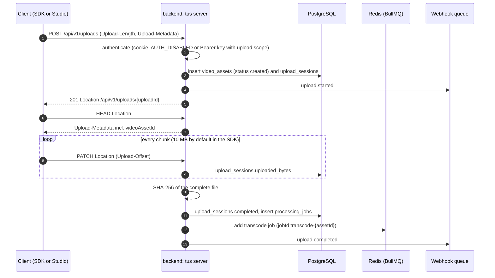
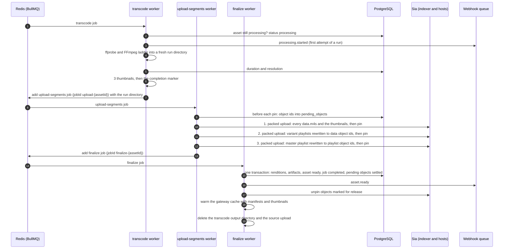
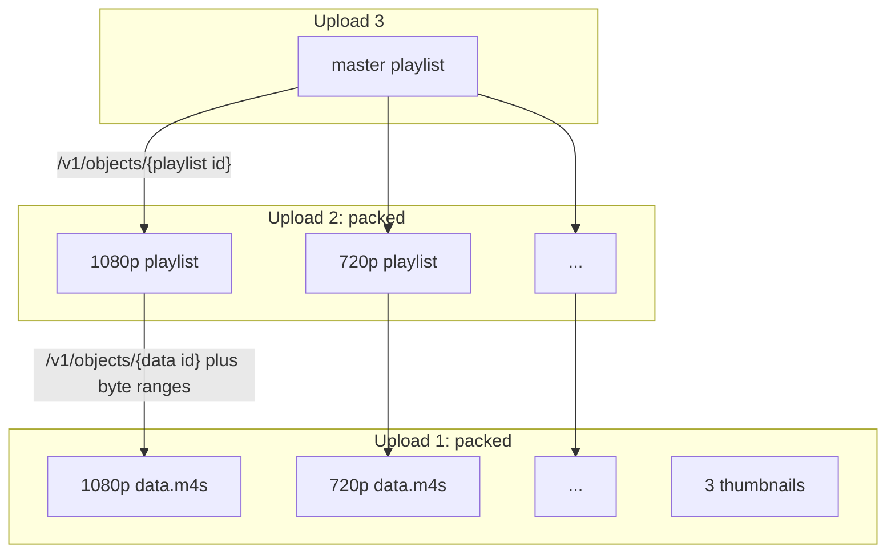

# Upload pipeline

An upload goes through four steps: the file arrives over tus, FFmpeg turns it into an HLS ladder, the output is stored on Sia in three packed uploads, and a finalize step records everything in PostgreSQL and marks the asset ready. The last three steps are BullMQ jobs on the `transcode`, `upload-segments` and `finalize` queues, each enqueued by the step before it.

## Receiving the file over tus



The tus server (`backend/src/upload/tus-server.ts`, built on `@tus/server` with a `@tus/file-store` store in `UPLOAD_DIR`, see `backend/src/upload/upload-store.ts`) shares the `/api/v1/uploads` path with two REST routes. A request goes to tus when it carries a `Tus-Resumable` header or uses `PATCH`, `HEAD` or `OPTIONS`; a plain `GET` or `DELETE` on `/api/v1/uploads/:id` falls through to the REST status and cancel routes (`backend/src/upload/tus-dispatch.ts`).

Details worth knowing:

- **Ownership comes from the caller, never from the metadata.** The asset's `creator_address` is the authenticated identity's address, even if the client puts a different one in `Upload-Metadata`. Requests on an existing upload by another tenant get a 404, the same answer as for an unknown id.
- **Metadata.** The SDK sends `filename`, `filetype`, `title`, `description` and `accessTier`. A `filetype` that does not start with `video/` is rejected with 415. Uploads larger than `MAX_UPLOAD_SIZE` (10 GiB by default) are refused by tus.
- **Asset id.** The asset and the upload session are created in the tus creation hook, and their ids are written back into the tus upload's metadata. The creation response only carries a `Location`, so the SDK sends one `HEAD` to read `videoAssetId` from `Upload-Metadata`; that is what resolves the `assetId` promise on the SDK's upload handle.
- **Progress.** While an upload is in progress, `GET /api/v1/uploads/:id` reports the bytes the tus store holds on disk. The session's `uploaded_bytes` column is also updated from tus's post-receive event, but that event is throttled to once a second and dropped at the end of each `PATCH`, so the column alone lags behind.
- **Ids.** The tus upload id is a uuid, and the upload session row takes the same id, so the last segment of the tus `Location` (`<PUBLIC_URL>/api/v1/uploads/<id>`, built from `PUBLIC_URL` rather than request headers) is also the id of `GET` and `DELETE /api/v1/uploads/:id`.
- **Checks at creation.** `onUploadCreate` refuses an empty upload, a file type other than `video/*`, an access tier other than `public` or `private`, and a title or description that breaks the rules of an asset edit (`backend/src/api/validation.ts`), each with a 400 before any row is written. `upload.started` is sent from the `POST_CREATE` event, once the file store has created the upload; if the store fails after the rows were written, the session is marked `failed` and the asset is deleted.
- **Asset status while bytes arrive.** The file store reports the first chunk of every write (a `PATCH`, or a creation that carries data) before storing it, and the asset moves from `created` to `uploading` with one conditional update (`markAssetUploading` in `backend/src/db/queries/assets.ts`), so the Studio shows a transfer as Uploading rather than Created. It hooks the store's stream rather than tus's `POST_RECEIVE` event, which is throttled to fire after a second and so never fires for a short `PATCH`. If the update fails, the bytes are stored anyway and a warning is logged.
- **Cancelling.** A tus `DELETE` on an unfinished upload cancels the session and soft-deletes the asset it created, which then goes through the normal [deletion](./deletion-and-reconciliation) path. The file store deletes the upload's data file and its `{uploadId}.json` metadata file as part of the `DELETE`. A REST `DELETE /api/v1/uploads/:id` does the same for an upload still in progress. A finished upload cannot be cancelled either way (`disableTerminationForFinishedUploads`): it is the source of an asset that is processing or kept for a retry, and deleting that asset takes the `manage` scope.
- **Failure at the end.** If hashing, completing the session or enqueuing fails, the asset is marked `failed` and an `upload.failed` webhook is sent.
- **The source file is kept only while it can still be needed.** See [the source file's lifecycle](#the-source-file-s-lifecycle) below.

### The source file's lifecycle

The tus file store keeps two files per upload in `UPLOAD_DIR`: the data under the tus upload id, and a `{uploadId}.json` file next to it with the upload's size, metadata and creation time. The data file's path is recorded in `upload_sessions.file_path` when the upload is created. Both files are removed together, at the first of these points:

| When                                 | Who removes them                                               | Why then                                                                        |
| ------------------------------------ | -------------------------------------------------------------- | ------------------------------------------------------------------------------- |
| the asset becomes `ready`            | the finalize worker, after the transcode output is deleted     | nothing transcodes the source again once the asset is ready                     |
| the asset is deleted                 | the deletion worker, before it unpins anything                 | covers a failed asset that kept its source, and an upload that is still running |
| the uploader cancels                 | the tus file store on a tus `DELETE`, or the REST cancel route | a cancelled upload is never resumed                                             |
| an incomplete upload is 24 hours old | the expiry sweep                                               | an abandoned upload would otherwise stay forever                                |

The expiry sweep also closes the rows of an abandoned upload: every session still `uploading` past its 24 hour expiry is marked `failed`, and an asset that never got past the upload (`created` or `uploading`) is deleted, so it does not stay in the library as an empty video (`buildUploadExpiry` in `backend/src/app.ts`).

A `failed` asset keeps its source, because a [manual retry](#retries-and-orphan-cleanup) that has to transcode again reads it from `UPLOAD_DIR`. The expiry sweep leaves it alone too, since the upload itself is complete; it goes when the asset is retried to `ready` or deleted.

**Expiry.** The file store is created with a 24 hour expiry (`UPLOAD_EXPIRY_MS` in `backend/src/upload/upload-store.ts`), counted from the upload's creation as the tus expiration extension defines it. Creation and `PATCH` responses for an unfinished upload carry an `Upload-Expires` header, and after that time `HEAD` and `PATCH` answer 410, so the client has to start over. The backend calls `@tus/server`'s `cleanUpExpiredUploads()` once at startup and then every hour (`UPLOAD_SWEEP_INTERVAL_MS`), and logs how many uploads it removed. The stock `FileStore` decides whether an upload is complete from the offset in its `.json` file, which it writes once at creation and never updates, so it would delete finished uploads too. Sluby's store (`UploadFileStore`) reads the offset from the size of the data file instead, the same way tus answers a `HEAD`, and only removes uploads that are both expired and incomplete.

**Sweep of finished sources.** On the same hourly timer, the backend lists `UPLOAD_DIR` and removes every source whose upload session belongs to an asset that is `ready` or was deleted (`sweepFinishedSources` in `backend/src/upload/source-files.ts`). That catches sources left by a removal that failed, and sources of assets that were `ready` before this cleanup existed. A file that no upload session records is left alone and counted in the log line, since it may be an upload whose session row is still being written; the expiry sweep removes it if it never completes. Last, the sweep deletes the upload sessions of deleted assets whose files are no longer in `UPLOAD_DIR`, so those rows do not pile up.

**Failures.** Removing a source never fails the step that asked for it: an error is logged with the path of the file, the asset still becomes `ready`, and a deletion still completes. The next hourly sweep tries again.

## Processing



Every stage first checks that its asset still exists, is not being deleted and is processing; if not, it stops without doing its work (and removes the asset's transcode output when the asset is gone), so a deleted asset is not transcoded or uploaded any further. The upload stage checks again before each of its three Sia uploads.

Progress is written to `processing_jobs.progress_percent` as the job moves: the transcode maps FFmpeg's progress onto 0 to 60 percent and reaches 65 once thumbnails exist, the Sia uploads move it from 65 to 90, and finalize takes it to 100.

### Transcoding

`backend/src/transcode/ffmpeg-runner.ts` probes the source with `ffprobe`, then runs a single FFmpeg command that scales the video into every rung of the ladder at once:

| Rung  | Landscape size | Video bitrate (max) | Audio | Made                                 |
| ----- | -------------- | ------------------- | ----- | ------------------------------------ |
| 2160p | 3840x2160      | 15000k (16050k)     | 192k  | with `TRANSCODE_MAX_RENDITION=2160p` |
| 1440p | 2560x1440      | 9000k (9630k)       | 192k  | with `1440p` or `2160p`              |
| 1080p | 1920x1080      | 6000k (6420k)       | 192k  | by default                           |
| 720p  | 1280x720       | 3500k (3745k)       | 128k  | by default                           |
| 540p  | 960x540        | 1800k (1926k)       | 128k  | by default                           |
| 360p  | 640x360        | 800k (856k)         | 96k   | always                               |

`TRANSCODE_MAX_RENDITION` sets the tallest rung (see [Configuration](../guide/configuration)): the default `1080p` makes the four rungs from 1080p down, `1440p` or `2160p` add the taller ones, and a lower value such as `720p` drops rungs. The 1440p and 2160p bitrates continue the 720p to 1080p step, and every rung has the same 7% maxrate headroom and 1.5x buffer.

A rung's name is its short side. Rungs whose short side is larger than the source's are dropped, so a 720p source produces 720p, 540p and 360p, and the 360p rung is always kept. Each rung keeps the source's aspect ratio with square pixels, so a 1080x1920 phone video gets a 1080x1920 "1080p" rung rather than a pillarboxed 1920x1080 frame. Rotation metadata is applied before scaling, and the asset's `resolution` is the size as shown (a portrait clip recorded as rotated 1920x1080 reads `1080x1920`).

Before scaling, frames flagged as interlaced are deinterlaced (`bwdif`), and the source is scaled once to the tallest rung's size. HDR sources (PQ or HLG transfer, typically 10-bit HEVC from phones) are then tone-mapped to SDR BT.709: the ladder is 8-bit H.264, which browsers and players treat as SDR, so the HDR signal passed through unchanged would look grey and washed out. The tone mapping uses `zscale` (linear light with 1.0 at 203 nits, the BT.2408 HDR reference white) and the `mobius` curve, which keeps darks and mid-tones and rolls highlights off; it needs an FFmpeg built with zimg, which the backend image's Debian FFmpeg is. Every rung is converted to 8-bit 4:2:0 and encoded with libx264 (High profile, `veryfast` preset, a keyframe forced every 2 seconds, no scene-cut keyframes), so 10-bit and 4:2:2 sources work as well. When the source has audio, one track is kept (the default track, else the first) and encoded as AAC stereo at 48 kHz. If the audio runs on more than half a second past the last video frame, the output ends where the video ends, and the asset's duration is the video stream's.

FFmpeg and ffprobe only read local files through a fixed list of container demuxers (MP4 and MOV, Matroska and WebM, AVI, MPEG-TS and PS, ASF, FLV, Ogg, MXF, DV, RealMedia, NUT, IVF and raw H.264, HEVC and MPEG video), so an upload that is really a playlist or an `ffconcat` file cannot make them open other files. They print errors only, and a failure is reported with FFmpeg's first error lines, for example `FFmpeg exited with code 234: [libx264] ...`. A transcode is killed if its output time stops moving for 10 minutes, or after 30 minutes plus 60 times the video's length; ffprobe and each thumbnail get 60 seconds. FFmpeg gets the CPU cores divided by the two transcodes the worker runs at once as its encoder threads.

A transcode costs CPU in proportion to the pixels decoded and encoded. Measured on 10 seconds of video with two cores (Docker on an Apple Silicon Mac, FFmpeg 7.1.5): an SDR 4K H.264 source into the 2160p ladder took 92 seconds, a 10-bit HLG 4K HEVC source into the 2160p ladder 149 seconds, and the same HLG source into the default ladder 62 seconds, most of it decoding the 4K HEVC.

The output is HLS with fMP4 segments of 6 seconds (`-hls_segment_type fmp4 -hls_time 6 -hls_playlist_type vod`) and the `single_file` flag. With `single_file`, each rung is one `data.m4s` file holding the init segment followed by every media segment, and its playlist addresses segments by byte range instead of by file name. For a 15 second 720p test clip the transcoder writes `master.m3u8`, three thumbnails, and for each rung a `playlist.m3u8` and a `data.m4s`. The 720p playlist looks like this:

```
#EXTM3U
#EXT-X-VERSION:7
#EXT-X-TARGETDURATION:6
#EXT-X-MEDIA-SEQUENCE:0
#EXT-X-PLAYLIST-TYPE:VOD
#EXT-X-INDEPENDENT-SEGMENTS
#EXT-X-MAP:URI="data.m4s",BYTERANGE="1373@0"
#EXTINF:6.000000,
#EXT-X-BYTERANGE:2726877@1373
data.m4s
#EXTINF:6.000000,
#EXT-X-BYTERANGE:2731149@2728250
data.m4s
#EXTINF:3.000000,
#EXT-X-BYTERANGE:1363688@5459399
data.m4s
#EXT-X-ENDLIST
```

The thumbnails (`backend/src/transcode/thumbnail-extractor.ts`) are JPEG frames at 25, 50 and 75 percent of the video's duration, deinterlaced and tone-mapped like the renditions, scaled and padded to 640x360. They are best effort: a shot that fails or comes out empty is logged and skipped, so the asset still finishes with fewer thumbnails. They stay on disk and go up to Sia with the media. The duration and resolution are saved to the asset right after FFmpeg succeeds, before the thumbnails.

### Run directories and the completion marker

Each execution of the transcode stage writes into a directory of its own, `TRANSCODE_OUTPUT_DIR/{assetId}/{time}-{random}` (`backend/src/queue/output-dirs.ts`). BullMQ can run a job a second time while the first execution is still going (after a lost lock or a stall), and with a shared directory the second FFmpeg run would truncate and rewrite the files the upload stage of the first one is reading. The upload job carries the exact directory it reads, and nothing writes to a directory once it is finished.

A run directory counts as a finished transcode only once it holds `transcode-complete.json`, written (by rename) after FFmpeg exited 0 and the thumbnails were taken; it holds the duration, the resolution and the thumbnail file names. FFmpeg writes a master playlist on some failures too, header only or complete looking after an interrupt, so the playlists prove nothing. A later attempt of the transcode stage that finds a finished run reuses it instead of running FFmpeg again, and so does a [manual retry](#retries-and-orphan-cleanup). The upload stage also refuses output whose master lists no variants, or whose variant playlists have no segments or no `#EXT-X-ENDLIST`.

When two executions finish, the first to queue the upload job wins (its job id is fixed); the other sees a different directory on the queued job and removes its own.

### The Sia storage layout

Every Sia upload sends at least one full slab, however little it holds. With the SDK's default of 10 data and 20 parity shards, a slab carries up to 40 MiB of data and is stored as 30 shards of 4 MiB each. A 400 byte playlist uploaded on its own still sends all 30 shards. For short videos the number of uploads, not the number of bytes, decides how long storage takes, so the uploader packs objects together: a packed upload puts several objects into the same slabs and returns one Sia object per input.

Packing cannot go all the way down to one upload, because a manifest has to contain the object ids of what it points at, and an object id only exists once that object has been uploaded. That gives three dependent uploads (`backend/src/storage/segment-uploader.ts`):

1. every rung's `data.m4s` plus the thumbnails, in one packed upload
2. the variant playlists, rewritten to point at the data object ids, in one packed upload
3. the master playlist, rewritten to point at the playlist object ids



After each upload the objects are pinned with the indexer, in parallel. Their ids are written to `pending_objects` first, before any pin, so an object is on record from the moment it is pinned, whatever happens to the process after that. If any pin in a packed batch fails, the objects of that batch that were pinned are unpinned again before the error is raised.

The SDK pins each slab as soon as it is stored and the objects only at the end, so a failed or cancelled upload leaves slabs pinned that no object uses. A failed upload is cancelled (which stops its slab uploads still running) and then asks for a slab prune. indexd prunes only when asked (`POST /slabs/prune`, every slab of the account no object references), and a prune during an upload would strip that upload's slabs before its objects exist, so prunes and uploads are kept apart in the backend process: a prune requested while an upload is in flight runs when the last one ends, and an upload waits for a running prune. This assumes one backend process per Sia app key, which is how the compose files run it.

A packed upload that stores no shard for 10 minutes is cancelled and fails. The SDK limits each host write (90 seconds) and each indexer call (45 seconds), but not an upload as a whole, which can otherwise wait on hosts forever.

The erasure coding settings are left to the SDK unless both `SIA_DATA_SHARDS` and `SIA_PARITY_SHARDS` are set; then they are passed to every upload. A smaller ratio only makes sense for a small test network such as Zen.

### Manifest rewriting

`backend/src/transcode/manifest-rewriter.ts` replaces file names with gateway paths before a manifest is uploaded. In a variant playlist, `data.m4s` becomes `/v1/objects/{data object id}`, both in the `EXT-X-MAP` URI and on every segment line; the `BYTERANGE` attribute and the `EXT-X-BYTERANGE` lines are left exactly as FFmpeg wrote them. In the master playlist, each `720p/playlist.m3u8` style line becomes `/v1/objects/{playlist object id}`. The rewritten 720p playlist from the example above reads:

```
#EXT-X-MAP:URI="/v1/objects/<data-object-id>",BYTERANGE="1373@0"
#EXTINF:6.000000,
#EXT-X-BYTERANGE:2726877@1373
/v1/objects/<data-object-id>
```

The paths are written without a host. A player resolves them against the URL it loaded the manifest from, so the same stored manifest works behind any domain, and the direct-from-Sia loader can read the object id straight out of each path (see [Playback](./playback)).

### Finalize

The finalize worker (`backend/src/queue/pipeline.ts`, `finalizeAssetStorage` in `backend/src/db/queries/storage-records.ts`) does all its writes in one transaction, after locking the asset row: a `renditions` row per rung (name, dimensions and bandwidth from the master's `EXT-X-STREAM-INF` lines, segment count, data and playlist object ids), an `artifacts` row per stored object with its role (`master_manifest`, `variant_playlist`, `rendition_data`, `thumbnail`), the asset as `ready` with its `manifest_object_id`, `thumbnail_object_ids` and `sia_object_ids`, and the processing job as completed. The run's objects leave `pending_objects`. Objects the asset referenced before and no longer does, and every other pending object of the asset (left by an earlier attempt or a duplicate execution), are marked for release in the same transaction, so nothing is dropped from the records while it is pinned. Because the row is locked, a deletion either sees the finished records or makes finalize see the asset as gone, in which case finalize unpins everything it was handed and writes nothing.

After the commit it sends `asset.ready`, unpins the objects marked for release, loads the master playlist, the variant playlists and the thumbnails into the gateway's memory cache so the first playback does not wait on Sia, deletes `TRANSCODE_OUTPUT_DIR/{assetId}`, and deletes the source upload from `UPLOAD_DIR`. None of these can fail the job. A finalize that runs again for an asset it already made ready repeats them, so `asset.ready` is sent at least once.

## Retries and orphan cleanup

| Queue             | Job id                | Attempts | Backoff               | Worker concurrency |
| ----------------- | --------------------- | -------- | --------------------- | ------------------ |
| `transcode`       | `transcode-{assetId}` | 3        | exponential from 30 s | 2                  |
| `upload-segments` | `upload-{assetId}`    | 3        | exponential from 30 s | 4                  |
| `finalize`        | `finalize-{assetId}`  | 3        | exponential from 10 s | 4                  |

The pipeline workers hold a job's lock for 5 minutes between renewals, instead of BullMQ's 30 second default, so one slow renewal on a loaded host does not hand a long transcode to a second worker; a crashed worker's job is picked up again after that long.

BullMQ renews the lock from a timer in the backend process, and Redis expires it by the wall clock. When the whole host freezes for longer than the lock (a laptop that sleeps, a Docker VM that stalls), the wall clock jumps over the freeze, so the lock has expired by the time the process runs again, and BullMQ's stalled check hands the job to a second execution while the first is still going; a second freeze then fails the job with "job stalled more than allowable limit". For the Sia upload stage a second execution would upload and pin the whole video again, so each run of the stage holds a lease in Redis (`{prefix}:upload-segments:{jobId}:lease`, renewed every 10 seconds and lasting 30) while it uploads. An execution that finds the lease held waits until it is free; one that BullMQ redelivered first waits 15 seconds, and longer after a wake-up that came late, so an execution that was frozen with it can renew its lease before it is taken. Once it holds the lease it checks again whether its asset is still processing and whether finalize was already queued, and only uploads if there is still something to do. An execution whose lease was taken over stops at its next checkpoint and releases what it pinned. While it waits and uploads, the stage also extends its own BullMQ lock: BullMQ tracks lock renewal by job id and stops renewing once any execution of the job in the worker ends, which would otherwise leave a duplicate that carries on after the first one without a lock. Lock renewal failures are logged as `Pipeline worker error`.

- **Deterministic job ids.** Each stage enqueues the next one under a job id derived from the asset id. BullMQ ignores an add whose job id already exists, so a stage that runs twice (after a stall, say) does not enqueue its successor twice, and a stage whose successor is already queued stops at once. BullMQ also keeps failed jobs, so a manual retry starts a new run: its jobs carry a run id (`upload-{assetId}-retry-{time}`, `finalize-{assetId}-retry-{time}`) that the failed attempt's jobs cannot shadow.
- **Inner retries.** The first Sia upload, which carries all the media, is retried up to 5 times inside the job, waiting 2, 4, 8 and 16 seconds, before the job itself fails.
- **Objects stay on record until they are unpinned.** Every object id goes into `pending_objects` before its pin (state `uploading`). A failed or stopped upload stage marks the objects it pinned for release (state `release`) and unpins them; finalize promotes the run's objects to `artifacts` and marks the rest for release. An unpin that fails leaves the row in place, and the deletion GC sweep (see [deletion](./deletion-and-reconciliation)) retries it, and also releases `uploading` objects whose asset is gone or no longer processing (a crash, or a run that failed for good). An object an artifact still names is never released.
- **A failure after the upload.** When queueing finalize fails after the upload succeeded, the objects stay recorded as `uploading`, the next attempt uploads again, and its finalize releases the first set.
- **Deleted while processing.** A stage that finds its asset deleted stops; the upload stage releases what it pinned, and finalize unpins everything it was handed. The [deletion](./deletion-and-reconciliation) of the asset unpins its pending objects too, and removes its transcode output.
- **Giving up.** BullMQ decides when a job has failed for good: after its last attempt, or at once for an error it does not retry, which includes a job that stalled more often than its stall limit (twice, by default). The asset then becomes `failed`, the processing job records the error, and `asset.errored` is sent with the failing stage (`transcode`, `upload` or `finalize`). These writes are retried for about two minutes, since the database is a likely reason the job failed, and they only touch an asset that is still being processed, so a stale execution failing after its asset became ready changes nothing. Earlier failed attempts set the processing job to `retrying` and count one more in its `retry_count`.
- **Manual retry.** `POST /api/v1/assets/:id/retry` (SDK: `assets.retry`) restarts a failed asset. The move from `failed` to `processing` is one conditional update, so of two retries at once only one starts a run; the other gets a 400. If a finished transcode (a run directory with the completion marker) is in `TRANSCODE_OUTPUT_DIR`, the retry re-enqueues the Sia upload with that directory and its thumbnails; otherwise it transcodes again from the source file in `UPLOAD_DIR`, found through the asset's finished upload session, or answers 410 when that file is gone. If the job cannot be queued, the asset goes back to `failed`. A retry counts in `retry_count` and starts the run's `started_at` afresh; BullMQ's own attempts keep it, so the processing duration covers them.
- **Transcode output.** It is removed when the asset becomes ready, when it is deleted, and by the GC sweep for assets that are ready or gone. A failed asset keeps it for a retry until it is deleted.

## Webhooks and processing logs

The pipeline emits six events, each delivered only to the webhook endpoints of the account that owns the asset (`backend/src/webhooks/dispatcher.ts` queues them, `backend/src/webhooks/delivery.ts` sends them):

| Event                | Sent when                                        | `data` fields                                                                                                                                 |
| -------------------- | ------------------------------------------------ | --------------------------------------------------------------------------------------------------------------------------------------------- |
| `upload.started`     | tus creates the upload                           | `upload_id`, `session_id`, `video_asset_id`, `file_size`                                                                                      |
| `upload.completed`   | the last byte arrived and transcoding was queued | `upload_id`, `session_id`, `video_asset_id`, `sha256`, `file_size`                                                                            |
| `upload.failed`      | finishing the upload failed                      | `upload_id`, `session_id`, `video_asset_id`, `error`                                                                                          |
| `processing.started` | a processing run starts                          | `video_asset_id`                                                                                                                              |
| `asset.ready`        | finalize completed                               | `video_asset_id`, `manifest_object_id`, `thumbnail_object_ids`, `duration_ms`, `resolution`, `segment_count`, `total_storage_bytes`, `status` |
| `asset.errored`      | a stage failed its last attempt                  | `video_asset_id`, `stage`, `error`                                                                                                            |

`processing.started` is sent once per processing run: by the first attempt of the transcode stage, or of the upload stage when a manual retry resumes there. BullMQ's own retries and stalled re-runs of a stage do not send it again; a manual retry starts a new run and sends it again, as a separate event with its own `id`. Retries of one delivery of an event keep its `id`, so a receiver that drops ids it has handled sees each event once.

Emitting an event only queues it: the dispatcher builds the body once and adds one job per subscribed endpoint to the `webhooks` BullMQ queue, holding the endpoint id, the event and that exact body (ids are left to BullMQ, so a repeated event is never dropped as a duplicate). The `webhooks` worker, which runs in the backend process like the pipeline workers with concurrency 4, delivers each job as a `POST` with the JSON body `{ "id", "event", "timestamp", "data" }` (`id` names the event and is the same on every retry and for every endpoint) and the headers described in [webhooks](/api/#webhooks): `X-Sluby-Event`, `X-Sluby-Delivery`, `X-Sluby-Timestamp`, `X-Sluby-Signature-V1` (the HMAC of `<timestamp>.<body>`) and the deprecated body-only `X-Sluby-Signature`. Before connecting, the worker resolves the receiver's host and refuses any address that is not public unless the operator listed its network in `WEBHOOK_ALLOWED_NETWORKS`, then connects to exactly the addresses it checked (`backend/src/webhooks/egress.ts`). It never follows a redirect, judges the attempt on the status line and never reads the response body. The status line must arrive within 10 seconds, DNS included. A non-2xx answer (a 3xx too) or a network error fails the job, and BullMQ retries it up to 3 more times, after 10 seconds, 1 minute and 5 minutes (a custom backoff on the worker), always with the same body. The jobs live in Redis, so a delivery or retry that is pending when the backend stops is sent once it runs again. An attempt that was in flight when the process died is picked up as a stalled job, about a minute later with BullMQ's default lock and stall settings, and sent again without counting as a retry, so a receiver can get the same body twice. Before every attempt the worker reads the endpoint again: once it is deleted or deactivated, the delivery is dropped without a request or a record. The secret is read at that point too and is never stored in Redis. Every attempt is stored in `webhook_deliveries` with the status code, for a failure the reason in our own words, and the number of earlier attempts; `GET /api/v1/webhooks/:id/deliveries` lists them. A failed delivery, or one that cannot be queued, never fails the pipeline step that sent it.

Each worker also appends `{ timestamp, stage, message }` entries to `processing_jobs.logs`, tagged `transcode`, `upload` or `finalize`. `GET /api/v1/assets/:id/processing` (SDK: `assets.processing`) returns the job status, the current stage (taken from the latest log entry, or `completed` and `failed` for finished jobs), the percentage, the error message and the full log.
