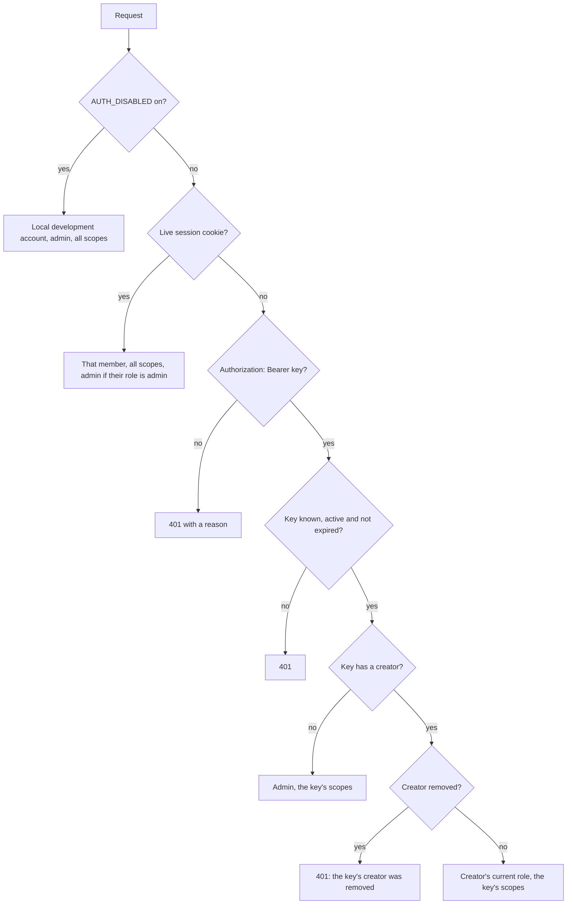

This page explains who can do what on a Sluby server: how one install maps to one team, what the admin and member roles allow, how the backend decides who made a request, and how sign-in, Studio sessions, the setup code, invite links and reset links work. For the Studio screens that manage members, see [Invite and manage members](/studio/members). For how an operator sets up sign-in, see [Set up sign-in](/self-hosting/sign-in).

## One install is one team [#one-install-is-one-team]

A Sluby install serves one team, called the workspace. Every video, API key, webhook endpoint and upload belongs to the workspace, and every caller (a member's Studio session, an API key, or the local development account) acts as the workspace. Each person who can sign in is a row in the `users` table with a role. The role decides what a person can do, not which videos they see: every member sees the whole library.

## Roles and what each can do [#roles]

There are two roles, `admin` and `member`.

| Capability                                                               | Admin                                                                                                                    | Member                                                                                                                            |
| ------------------------------------------------------------------------ | ------------------------------------------------------------------------------------------------------------------------ | --------------------------------------------------------------------------------------------------------------------------------- |
| Upload, list, edit, retry and delete videos                              | Yes                                                                                                                      | Yes                                                                                                                               |
| Create and revoke playback ids, mint signed URLs and share URLs          | Yes                                                                                                                      | Yes                                                                                                                               |
| Create, list, rotate and revoke the workspace's API keys                 | Yes                                                                                                                      | Yes                                                                                                                               |
| Create and manage webhook endpoints, read their delivery logs            | Yes                                                                                                                      | Yes                                                                                                                               |
| Read library stats and daily play counts                                 | Yes                                                                                                                      | Yes                                                                                                                               |
| Read system status (`GET /api/v1/system/status`)                         | Full status: database, Redis, the Sia indexer's account usage and hosts, the last reconciliation run, the delivery cache | Health summary only: overall status, version, database, Redis and indexer health, the indexer's network and its host pool summary |
| Read the reconciliation report (`GET /api/v1/reconciliation`)            | The whole deployment                                                                                                     | Missing objects of the workspace's videos only                                                                                    |
| Start a reconciliation run                                               | Yes                                                                                                                      | No                                                                                                                                |
| Read process metrics as JSON (`GET /api/v1/metrics`)                     | Yes                                                                                                                      | No                                                                                                                                |
| List members, change roles, remove and restore members, make reset links | Yes                                                                                                                      | No                                                                                                                                |
| Create, list and withdraw invites                                        | Yes                                                                                                                      | No                                                                                                                                |

An endpoint reserved for admins answers a member with `403` and `Only an admin may use this endpoint`. [API conventions](/developers/reference/api-conventions#scopes) lists the scopes an API key needs for each endpoint. [Deletion and reconciliation](/developers/concepts/deletion-and-reconciliation) describes the reconciliation report.

The backend reads the role on every request. A role change applies to the member's sessions and API keys on their next request.

## Who a request acts as [#callers]

Every request under `/api/v1` (except the `/api/v1/auth` routes, the OpenAPI document at `/api/v1/openapi.json` and the reference page at `/api/v1/docs`) and every tus upload request goes through the same check, in this order:

- **Studio session.** A valid session cookie wins over an API key. A session carries all three scopes (`upload`, `read` and `manage`), and acts as an admin when the member's role is `admin`.
- **API key.** A key carries the scopes it was created with. It acts with its creator's role as it stands at that request. Removing the creator stops the key with `401` and `This API key's creator was removed from this workspace`; restoring the creator makes the key work again. A key with no creator acts as an admin: these are keys made on the server itself, from [`BOOTSTRAP_API_KEY`](/self-hosting/configuration#bootstrap_api_key) or the [seed script](/self-hosting/sign-in#create-an-admin-api-key-from-the-command-line).
- **AUTH_DISABLED.** With `AUTH_DISABLED` on, every request acts as one local development account with the admin role and all scopes. A server with `NODE_ENV=production` refuses to start with it (see [Configuration](/self-hosting/configuration#auth_disabled)).

## Sign-in methods [#sign-in-methods]

A member can have more than one way to sign in. Each way is a row in `user_identities`, linked to the member's `users` row.

### Email and password

- The server trims and lowercases the email, and each email belongs to a single account.
- A new password must have 10 to 256 characters.
- The server stores passwords as scrypt hashes (N=32768, r=8, p=1, 16-byte random salt).
- A wrong email and a wrong password get the same answer, `401` with `Wrong email or password`. An unknown email costs the same hashing time as a known one, so response timing does not reveal which emails exist.
- A removed member's correct password gets `403` with `This account was removed from this workspace`.
- Changing the password (`POST /api/v1/auth/password/change`) needs the current password, and ends every other session of the account while keeping the current one. A member who signs in with GitHub only has no password yet and gets `409` with `This account has no password yet. Ask an admin for a reset link to set one.`

### GitHub

The server offers GitHub sign-in only when it has both `GITHUB_CLIENT_ID` and `GITHUB_CLIENT_SECRET` set. `GET /api/v1/auth/config` reports it in `methods.github`.

- Sluby asks GitHub for the `read:user` scope only.
- Sluby identifies a GitHub account by its numeric account id, not its login, so renaming a GitHub login does not change who it signs in as. Sluby stores the login for display and refreshes it at each sign-in.
- Signing in with GitHub never creates an account. Sign-in refuses a GitHub account that belongs to no member (`not_a_member`). A person joins with GitHub through an invite link, and an existing member adds GitHub from their account settings.
- The sign-in keeps its state in a cookie named `sluby_signin` in the browser that started it (path `/api/v1/auth`, HttpOnly, valid for 10 minutes). The callback accepts only the state that cookie holds, so it refuses a callback opened in another browser, or after 10 minutes, with `expired_handshake`.

## Sessions and cookies [#sessions]

Each Studio sign-in creates a row in `studio_sessions` with the member, the sign-in method used, the browser's user agent (first 500 characters) and its expiry.

The browser gets the `sluby_session` cookie ([its attributes](/developers/reference/api-conventions#session-cookie)). The cookie value holds the session row id, the account id and the expiry, signed with HMAC-SHA256 using `SESSION_SECRET`.

On every request the backend checks the signature and the expiry, then that the session row is neither ended nor expired, then that the member is not removed. Because the backend checks the row each time, the server can end a session at any moment.

- **Lifetime.** A session lasts 7 days from sign-in. Using it does not extend it.
- **Last seen.** The backend updates the session's `last_seen_at` at most once every 5 minutes. The Settings page shows it in the list of signed-in browsers.
- **Ending sessions.** A session ends when the member signs out (`POST /api/v1/auth/logout`), ends one session (`DELETE /api/v1/auth/sessions/{id}`), signs out everywhere (`DELETE /api/v1/auth/sessions`, which leaves API keys untouched), changes their password (every other session ends), uses a reset link (every session ends), or is removed by an admin (every session ends).
- **Why a session stopped working.** A request with a cookie that no longer works gets `401` with a `reason`: `missing` (no cookie, or a cookie this server did not sign), `expired`, `revoked` (signed out here or elsewhere), or `not_allowed` (the member was removed).
- **Cleanup.** Ended sessions keep their rows for 30 days, then the hourly sweep deletes them.
- **Changing SESSION_SECRET.** The backend signs every cookie with `SESSION_SECRET`, so changing it signs every member out. [Security model](/developers/concepts/security#session-secret) lists what else depends on it.

## First admin and the setup code [#setup-code]

A fresh install has no admin. While sign-in is on and no admin who can sign in exists, the backend writes a setup code to its log at every start, and `GET /api/v1/auth/config` reports `setup_required: true`. An admin counts as able to sign in when the account is not removed and has at least one sign-in method; the local development account of an `AUTH_DISABLED` run does not count.

- The backend derives the code from `SESSION_SECRET` with HMAC-SHA256, so only someone who can read the server's logs or environment has it. It is 10 characters from the Crockford base32 alphabet, shown as `XXXXX-XXXXX`.
- When checking a typed code, the server ignores case, spaces and dashes, and reads `I` and `L` as `1` and `O` as `0`.
- `POST /api/v1/auth/setup` takes the code, a name, an email and a password, creates the first admin and signs them in. Once an admin who can sign in exists, setup answers `409` with `This server already has an admin. Sign in instead.`, so the code stops working the moment it is used.

[Set up sign-in](/self-hosting/sign-in) describes where the operator finds the code.

## Invites and reset links [#invites-and-reset-links]

Admins hand out two kinds of single-use links. Both are rows in the `invites` table and share these rules:

- The token is 32 random bytes in base64url (43 characters). The server stores only its SHA-256 hash, so the table alone is not enough to join or to take over an account.
- The full URL appears once, in the response that creates it. No later response shows it again.
- A link works for 7 days and works once. Using it locks its row for the transaction, so two browsers using the same link cannot both succeed.
- A link that does not exist answers `404` with `This link does not exist. Ask an admin for a new one.` A used, expired or withdrawn link answers `410` with `This link was already used.`, `This link has expired.` or `This link was withdrawn.`, each followed by `Ask an admin for a new one.`

### Invite links

An admin creates an invite with a role (`POST /api/v1/invites`, [endpoint reference](/developers/reference/api/members/post-invites)). The link has the form `https://sluby.example.com/studio/join/<token>`. The new member joins with a name, email and password, or with GitHub. A GitHub account that already belongs to a member cannot join a second time, and the invite then stays unused. Admins can list pending invites and withdraw one before it is used.

### Reset links

A reset link lets one member set a new password. An admin creates it for a member (`POST /api/v1/members/{id}/reset-link`, [endpoint reference](/developers/reference/api/members/post-members-id-reset-link)), and an operator who is locked out can print one on the server for an account that signs in with an email ([Make a reset link from the command line](/self-hosting/sign-in#make-a-reset-link-from-the-command-line)). The link has the form `https://sluby.example.com/studio/reset/<token>`.

- A member who already has a password sets a new one.
- A member who signs in with GitHub only sets their first password and chooses the email they will sign in with.
- Using the link ends every session the member had, then signs the current browser in.
- The API refuses a reset link for a removed member with `403` and `This account was removed from this workspace`.

## Removing members and the last-admin protection [#removing-members]

Admins remove members rather than delete them:

- **Remove.** The member's row stays, so their API keys and history keep a name. They can no longer sign in, every session they have ends at once, and their API keys stop working. An admin cannot remove themselves; the API answers `409` with `You cannot remove yourself. Ask another admin.`
- **Restore.** The member comes back with the role they had, and their API keys work again.

The API refuses a role change or a removal that would leave the workspace with no admin who can sign in, with `409` and `This is the last admin who can sign in. Make someone else an admin first.` These changes run one at a time, so two admins demoting each other at the same moment cannot both succeed.
