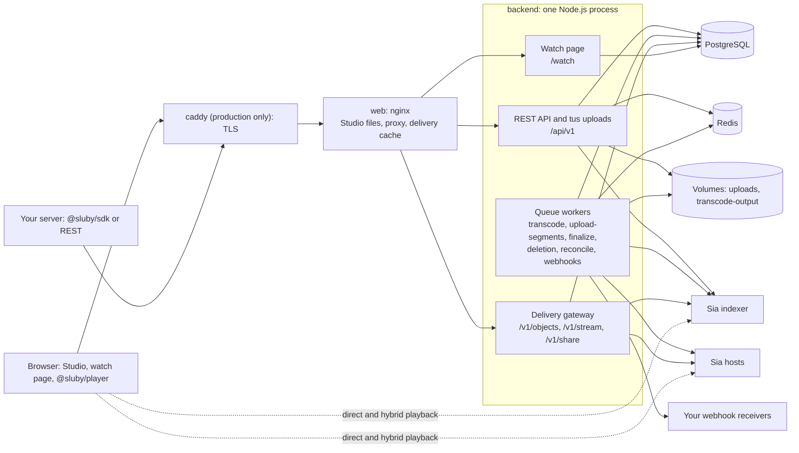

A Sluby server is a small set of containers: a web proxy, one backend process, PostgreSQL and Redis. The backend stores every video on the Sia network through a Sia indexer. This page explains what each part does and how they connect.

## The parts at a glance

Without the production override there is no caddy container: browsers and your server talk to the `web` container directly, which publishes its port on `127.0.0.1` (`http://localhost:8080` by default). With `docker-compose.prod.yml`, caddy is the only container that publishes ports (80 and 443) and terminates TLS for your domain. See [Run in production](/self-hosting/production).

Two Sia terms appear throughout:

- A **host** is a storage provider on the Sia network. The Sia SDK uploads the encoded pieces of each file to hosts and downloads them from hosts.
- An **indexer** is the Sia service that Sluby registers with as an app. It keeps the list of objects (stored files) that Sluby has pinned on its account and tells the SDK which hosts hold them. Sluby connects to `https://sia.storage` or to another indexer URL you configure.

[Storage on Sia](/developers/concepts/storage-on-sia) explains objects, pinning and redundancy in detail.

## The web proxy (nginx)

The `web` container runs nginx with the Studio build baked into the image. It does three jobs:

- **Serves the Studio.** `/` redirects to `/studio`, and every route under `/studio` answers with the single-page app.
- **Proxies to the backend.** `/api/`, `/v1/`, `/watch/` and `/health` go to the backend on port 3000. nginx never caches anything under `/api/`, sets no body size limit there and forwards request bodies without buffering them, so large uploads stream straight to the backend.
- **Caches delivery.** Responses under `/v1/objects/`, `/v1/stream/` and `/v1/share/` pass through an on-disk cache, and per-client rate limits apply to `/v1/` and `/api/v1/auth/`. [Playback and delivery](/developers/concepts/playback) describes what the cache keeps and for how long.

nginx passes the client address and the `X-Forwarded-Proto` header that caddy sends on to the backend. The backend uses the address for its per-client API rate limit and the scheme to recognize write requests that come from its own origin. nginx re-resolves the backend's address every 10 seconds, so a recreated backend container is found without restarting the proxy.

## The backend process

The backend is one Node.js process (Express). The same process serves HTTP and runs every queue worker, so one `backend` container handles both requests and background jobs.

On start, the container first runs the database migrations, then starts the server. Before it accepts requests the process loads the session secret it keeps in the database when `SESSION_SECRET` is not set, seeds `BOOTSTRAP_API_KEY` when you set one, takes over the access settings of an older version once, and, with sign-in on, logs the setup code when the install has no admin yet. It then listens on `PORT` (3000 in the compose files) and, when `SIA_APP_KEY` is set, connects to the Sia indexer.

### HTTP surfaces

| Path                                                                             | What it serves                                                                                                                                                                                                                                                                            |
| -------------------------------------------------------------------------------- | ----------------------------------------------------------------------------------------------------------------------------------------------------------------------------------------------------------------------------------------------------------------------------------------- |
| `/api/v1`                                                                        | The REST API used by the Studio, `@sluby/sdk` and your own code. See [API conventions](/developers/reference/api-conventions).                                                                                                                                                            |
| `/api/v1/uploads`                                                                | Resumable uploads over the [tus protocol](https://tus.io). A request that carries the `Tus-Resumable` header, or uses `HEAD`, `PATCH` or `OPTIONS`, goes to the tus server. Any other request, such as the upload status `GET`, goes to the REST routes.                                  |
| `/v1/objects/:objectId`, `/v1/stream/:videoAssetId/master.m3u8`, `/v1/share/:id` | The delivery gateway: HLS manifests and media read from Sia, and share maps for direct playback.                                                                                                                                                                                          |
| `/watch/:id`                                                                     | The public watch page that other sites can embed in an iframe.                                                                                                                                                                                                                            |
| `/health`                                                                        | The health check. The Docker health checks of both the `backend` and the `web` container call it (the `web` one through nginx).                                                                                                                                                           |
| `/metrics`                                                                       | Prometheus metrics. A scraper inside the Docker network reaches it on the backend's port 3000. nginx forwards it too, but without [`METRICS_TOKEN`](/self-hosting/configuration#metrics_token) the backend answers a forwarded request `404`; with it, every request must send the token. |

### Queues and workers

The backend uses [BullMQ](https://docs.bullmq.io) queues stored in Redis. The backend process runs a worker for every queue.

| Queue             | What a job does                                                                                                          | Who adds jobs                                                                           |
| ----------------- | ------------------------------------------------------------------------------------------------------------------------ | --------------------------------------------------------------------------------------- |
| `transcode`       | Runs FFmpeg on an uploaded source to produce the HLS renditions and thumbnails.                                          | The tus server, when an upload completes, and the retry endpoint.                       |
| `upload-segments` | Uploads a finished transcode to Sia.                                                                                     | The `transcode` worker, and the retry endpoint when a finished transcode can be reused. |
| `finalize`        | Records the uploaded objects on the video, marks it `ready` and sends `asset.ready`.                                     | The `upload-segments` worker.                                                           |
| `deletion`        | Unpins a deleted video's Sia objects and removes its rows. A repeating `gc` job re-drives deletions that never finished. | Deleting a video, cancelling or abandoning an upload, and the `gc` schedule.            |
| `reconcile`       | Compares the objects Sluby tracks with the objects pinned on the indexer.                                                | A repeating schedule and the manual trigger.                                            |
| `webhooks`        | Sends one event to one webhook endpoint, with retries.                                                                   | Every place that emits an event, and a manual resend of an earlier delivery.            |

Each pipeline stage hands off to the next under a fixed job id, so a stage that runs twice starts its successor once. [Upload pipeline](/developers/concepts/upload-pipeline) follows a video through the three processing queues, and [Deletion and reconciliation](/developers/concepts/deletion-and-reconciliation) covers the `deletion` and `reconcile` queues.

The process also runs an hourly timer that removes expired incomplete uploads and their rows, removes finished source files, prunes ended Studio sessions and drops old webhook delivery logs.

### Local files

Two Docker volumes hold files that live only on the backend's disk:

- `uploads` (`UPLOAD_DIR`): incoming tus uploads and their source files.
- `transcode-output` (`TRANSCODE_OUTPUT_DIR`): FFmpeg output waiting to be uploaded to Sia.

Once processing finishes, the backend serves the video from Sia, not from these volumes.

## PostgreSQL and Redis

PostgreSQL holds the durable state: videos, renditions, the map from every Sia object id to its video, accounts, sessions, API keys, webhooks and reconciliation runs. [Data model](/developers/concepts/data-model) describes the tables.

Redis holds the BullMQ queues, the schedules of the repeating jobs, and short-lived leases. One lease stops a second execution of an upload job (BullMQ starts one when the job's lock expires) from uploading the same video to Sia while the first execution is still running; the others hold back a slab prune (the cleanup of stored Sia data that no object uses any more) while any upload is in flight. The compose file starts Redis with append-only persistence and the `noeviction` memory policy, so queued jobs survive a restart and are never evicted.

## Sia

The backend talks to Sia through the official `@siafoundation/sia-storage` SDK. It connects to the indexer at `SIA_INDEXER_URL` with the app key from `SIA_APP_KEY`, which the connect step prints when you register the server with the indexer (see [Connect Sia storage](/self-hosting/sia-storage)). The SDK uploads the pieces of each file to hosts and reports, for each piece, the host that stored it.

Two paths read from Sia:

- **The delivery gateway** looks each object up on the indexer, downloads the requested bytes from hosts, and streams them to the viewer through nginx.
- **The browser** can download from Sia itself. The player fetches a share map from `/v1/share/:id`, which lists a time-limited `sia://` share URL for each object of the video, then uses the Sia SDK in the browser with a separate viewer identity to download from the indexer and hosts. The backend stays out of the byte path.

[Playback and delivery](/developers/concepts/playback) explains the gateway, direct and hybrid modes, and [Stream from Sia in the browser](/self-hosting/direct-playback) shows how to turn on the browser path.

## Webhook receivers

The `webhooks` worker sends HTTP requests from the backend to the URLs you register. See [Receive webhooks](/developers/guides/webhooks) and [Webhook events](/developers/reference/webhook-events).
