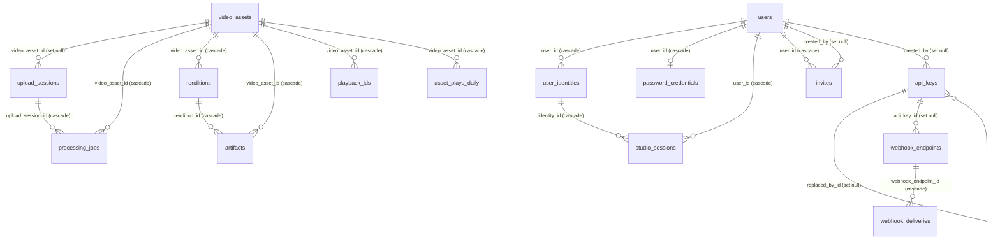

Sluby keeps its durable state in PostgreSQL. Video bytes live on Sia; the database holds the records that describe each video and map it to the Sia objects it is stored as, plus accounts, keys, webhooks and reconciliation history. This page describes the tables and how they relate. `backend/src/db/schema.ts` defines the schema with Drizzle.

A Sia **object** is one stored file on the Sia network, identified by an object id. Every manifest, playlist, media file and thumbnail of a video is its own object. **Pinning** an object keeps it stored under Sluby's account on the Sia indexer; unpinning it releases it. [Storage on Sia](/developers/concepts/storage-on-sia) explains objects in detail.

## Ownership

One install is one team's workspace. Every video, API key and webhook endpoint carries the owner address `workspace` in its `creator_address` column (an upload carries it in its metadata), and every caller acts as that owner. What a caller can do depends on their role, not on which rows they own. See [Accounts, roles and sessions](/developers/concepts/accounts-and-roles).

## How the tables relate

The diagram shows every foreign key in the schema. Tables without foreign keys are listed after it.

The label on each line names the foreign key column and what happens to the row when the referenced row is deleted: `cascade` deletes it, `set null` clears the column.

Tables without foreign keys: `pending_objects`, `reconciliation_runs`, `indexer_objects`, `reconcile_feed`, `bootstrap_keys`, `instance_meta` and `allowlist_pins`.

## Videos

### video_assets

One row per video: title, description, duration, resolution, status, access tier (`public` or `private`), the owner, and the Sia objects the video is stored as (`manifest_object_id`, `thumbnail_object_ids`, `sia_object_ids`), with `segment_count` and `total_storage_bytes`.

The `status` column is `created`, `uploading`, `processing`, `ready` or `failed`. [Asset status](/developers/concepts/upload-pipeline#asset-status) lists when each one is set.

Other columns worth knowing:

- `signing_generation` is part of every signed URL of the video. Raising it invalidates every URL signed before. [Playback and delivery](/developers/concepts/playback) explains signed URLs and revocation.
- `deleted_at` marks a deletion in progress. While it is set, every API read leaves the video out; the deletion worker removes the row once the video's Sia objects are unpinned. See [Deletion and reconciliation](/developers/concepts/deletion-and-reconciliation).
- `last_played_at` records the newest counted play. It is written without touching `updated_at`, so a play never changes the video's ETag.

### upload_sessions

One row per tus upload: the file path on the backend's disk, the file size, bytes received so far, the SHA-256 of the finished file, an expiry time and a status (`uploading`, `completed`, `cancelled` or `failed`). `video_asset_id` is cleared, not deleted, when its video row is removed.

### processing_jobs

The record of a video's processing run, which the API reads for progress: `status` (`queued`, `processing`, `completed`, `failed` or `retrying`), `progress_percent`, `error_message`, `retry_count`, a `retryable` flag (false when the source is not a readable video) and `logs`, a list of timestamped messages per stage. The queue jobs themselves live in Redis; this table mirrors their state. See [Upload pipeline](/developers/concepts/upload-pipeline).

### renditions

One row per quality level of a video: `name`, `width`, `height`, `video_bitrate_kbps`, `segment_count`, `byte_size`, and two object ids: `data_object_id` (the rendition's single media file) and `playlist_object_id` (its variant playlist). [Upload pipeline](/developers/concepts/upload-pipeline) describes the ladder of renditions.

### artifacts

The map from every stored Sia object id to its video, its rendition when it has one, and its role. The role is empty only for objects of videos stored before this table existed.

| Role               | Object                    |
| ------------------ | ------------------------- |
| `master_manifest`  | The HLS master playlist.  |
| `variant_playlist` | A rendition's playlist.   |
| `rendition_data`   | A rendition's media file. |
| `thumbnail`        | A thumbnail image.        |

Every object id in a video's `manifest_object_id`, `thumbnail_object_ids` and `sia_object_ids` has a row here. The delivery gateway finds the video behind a requested object id in this table to decide access, the per-video storage breakdown reads it, deletion collects the object ids to unpin from it, and reconciliation compares its object ids with the indexer's.

### pending_objects

Sia objects that are pinned but not recorded in `artifacts`, and objects waiting to be unpinned. The upload stage writes a row right before it pins each object, and `finalize` moves the object into `artifacts`. `state` is `uploading` while the run that pinned the object can still record it, and `release` once nothing will and the object must be unpinned. The table has no foreign key on purpose: a row has to outlive its video, because an upload can still pin an object after the video row is gone, and the deletion `gc` sweep unpins what is left here.

### playback_ids

Public handles for a video, each with a `playback_id` value of the form `pb_...`, a `policy` (`public` or `signed`) and a `name`. You can create several per video and delete one without changing the video. See [Playback and delivery](/developers/concepts/playback).

### asset_plays_daily

Play counts per video and UTC day, one row per video and day (primary key `video_asset_id`, `day`).

## Accounts and access

### users

One row per member of the workspace: `display_name`, `role` (`admin` or `member`) and `disabled_at`, set when an admin removes the member. A removed member's row stays, so their keys and history still point at a name and restoring them is one update.

### user_identities

The ways an account signs in. Each row has a `provider`, the provider's stable `subject` for the person (for GitHub, the numeric account id) and the `username` reported at the last sign-in, kept for display. The pair `provider`, `subject` is unique.

### password_credentials

The email and password hash of an account that signs in with a password. The email is lowercase and unique.

### studio_sessions

One row per Studio sign-in. The signed session cookie names its row ([Sessions and cookies](/developers/concepts/accounts-and-roles#sessions)), so the server can end a session on sign-out, from the sessions list, or when an admin removes the member. Each row records the account, the identity used to sign in, the user agent, `expires_at`, `revoked_at` and `last_seen_at`.

### invites

Single-use links an admin hands out. `kind` is `invite` (a new person joins with `role`) or `reset` (the member `user_id` sets a new password). The table stores only the SHA-256 hash of the token, so nobody can sign in with what it holds. Each row has `expires_at`, `used_at` and `revoked_at`.

### api_keys

API keys, stored as SHA-256 hashes. The API returns the raw key once, at creation. Each row has a `name`, `scopes`, a `rate_limit`, `is_active`, an optional `expires_at`, `prefix` (the first 12 characters of the raw key), `last_used_at`, `created_by` (the member who made the key) and `replaced_by_id` (the key that replaced it in a rotation). A key acts with its maker's current role and stops working while the maker is removed; a key with no maker, such as one seeded from the server, acts as an admin. [API conventions](/developers/reference/api-conventions) describes scopes.

### bootstrap_keys

The hash of every `BOOTSTRAP_API_KEY` ever seeded. A hash listed here is never seeded again, so deleting or rotating away the bootstrap key stays in effect across restarts while the variable is still set.

## Webhooks

### webhook_endpoints

The workspace's webhook URLs: `url`, `events` (the event types the endpoint receives), its signing `secret`, `is_active`, and `api_key_id`, the key it was registered with (empty when someone registered it from the Studio). The link records who registered it, not who owns it, so revoking the key keeps the endpoint.

### webhook_deliveries

One row per delivery attempt: `event_type`, `payload`, the receiver's `status_code`, an `error` message written by Sluby, `delivered_at`, `retry_count` and `manual` (a resend someone asked for). Sluby never stores the receiver's response body. Retries wait in Redis, not in this table. See [Delivery log](/developers/reference/webhook-events#delivery-log).

## Reconciliation

### reconciliation_runs

One row per reconciliation pass: start and finish time, `status` (`ok`, `drift` or `failed`), object counts (`db_object_count`, `indexer_object_count`, `in_sync_count`, `orphan_count`, `missing_count`), the full lists `orphaned_ids` and `missing_ids`, and `error_message` for a failed run.

### indexer_objects and reconcile_feed

`indexer_objects` is reconciliation's copy of the indexer's object inventory: for each object id, whether its latest event was a deletion and when that event happened. `reconcile_feed` is a single row naming the indexer feed (the indexer URL and account key) that copy was built from, and a cursor for where the next run resumes reading. A run against a different feed starts the copy over. See [Deletion and reconciliation](/developers/concepts/deletion-and-reconciliation).

## Install state

- `instance_meta` stores one-off facts about the install as key and JSON value pairs, such as the session secret the install generated when `SESSION_SECRET` is not set, and whether the access settings of an older version were already adopted.
- `allowlist_pins` ties a GitHub login from the old allowlist setting to the account that held it. Startup reads it only to adopt an install that used the allowlist.

## Migrations

Migrations live in `backend/drizzle` as SQL files. The backend container runs them on every start before it starts the server; the `__drizzle_migrations` table records the applied migrations, so the step changes nothing in a database that is up to date. The migration step takes a PostgreSQL advisory lock first, so several backend containers starting together migrate one at a time.
