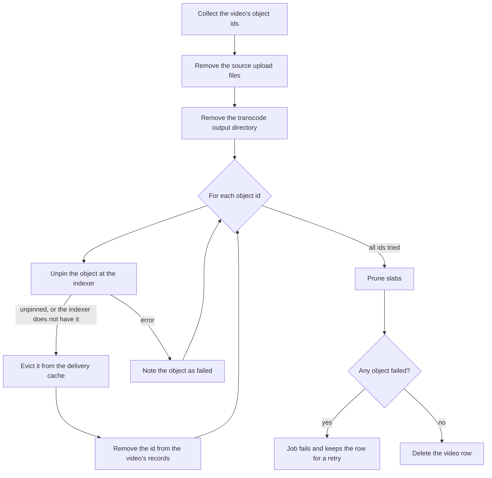

This page explains what Sluby does, step by step, when you delete a video, how a background sweep finishes deletions that stopped part way, and how reconciliation compares the objects Sluby records in PostgreSQL with the objects the Sia indexer holds for your account.

Two Sia terms appear throughout. The **indexer** is the Sia service Sluby stores data through: a self-hosted `indexd` or the hosted `sia.storage`. An **object** is one stored file (a playlist, a media segment, a thumbnail), named by a 64-character hex object id. While an object is **pinned**, the indexer keeps it for your account; **unpinning** tells the indexer to drop it. For the full storage model, see [Storage on Sia](/developers/concepts/storage-on-sia).

## What starts a deletion

Every path below calls the same deleter:

- `DELETE /api/v1/assets/{id}` with the `manage` scope ([endpoint reference](/developers/reference/api/assets/delete-assets-id)). The Studio and the `@sluby/sdk` method `assets.delete()` both call this endpoint.
- Cancelling an upload that is still in progress, with a `DELETE` request on the upload URL of the tus resumable upload protocol, or with `DELETE /api/v1/uploads/{id}` ([endpoint reference](/developers/reference/api/uploads/delete-uploads-id)). The deleter removes the video the upload created.
- An upload that expires before it finishes. The hourly upload sweep marks the upload session `failed` and deletes the video when its status is still `created` or `uploading`.
- An upload creation request that fails after Sluby created the video row.

## Step 1: the video disappears at once

The deleter sets the video's `deleted_at` timestamp in the same request. From that moment:

- Every read in the API treats the video as gone. `GET /api/v1/assets/{id}` and the playback routes answer `404`.
- The response to `DELETE /api/v1/assets/{id}` is `200` with `{"success": true, "status": "deleting"}`. The `deleting` status tells you the rest of the work runs in the background.
- A second `DELETE` for the same video answers `404`, because only a video that is not already being deleted matches.

The deleter then queues a job named `delete` on the `deletion` queue, with the job id `delete-<video id>`.

## Step 2: the deletion job

The deletion worker runs up to two jobs at once. Each job does the following, in this order:

1. **Collect the object ids.** The job reads them fresh on every attempt from every place Sluby records an object id: the `artifacts` rows, the `pending_objects` rows (objects a processing run pinned but has not recorded yet), the master manifest id, the thumbnail ids, and the older flat `sia_object_ids` list. The job drops duplicates and empty values.
2. **Remove local files.** The job deletes the source upload still on disk (a failed video keeps it for a retry) and the video's transcode output directory.
3. **Unpin each object.** The job unpins each object separately, so an object that fails does not stop the others. An object the indexer reports as not found counts as unpinned. After each successful unpin, the job evicts the object from the delivery cache and removes its id from the `artifacts` row, the `pending_objects` row and the video's id fields. Recording each object as it goes means a retry only tries the objects that remain.
4. **Prune slabs.** A **slab** is an erasure-coded segment of stored data; objects from a packed upload share slabs. Pruning asks the indexer to unpin every slab of the account that no object uses anymore. When an upload to the same Sia account is running on any backend process, the prune does not run at once: it runs when the last upload ends, and the job continues without waiting for it. The job logs a pruning failure and carries on. [Storage on Sia](/developers/concepts/storage-on-sia#slab-pruning) explains pruning in full.
5. **Delete the row, or retry.** When every object is unpinned, the job deletes the video row. The database removes the video's renditions, artifacts, processing jobs, playback ids and daily play counts with it. The video's upload session rows stay, with their link to the video cleared and their metadata emptied; the hourly upload sweep deletes them once their files are gone. When any object failed, the job throws an error and the row stays, still marked deleted.

The queue runs a failed job up to 3 attempts in total, with exponential backoff that starts at 30 seconds. After that, the garbage-collection sweep below takes over.

### A video deleted while it is processing

Each processing stage (transcode, Sia upload, finalize) first checks that its video still exists and is processing. A stage for a deleted video stops without doing its work. When finalize finds the video gone, it unpins the objects its run uploaded and removes the video's transcode output. The [upload pipeline](/developers/concepts/upload-pipeline) page describes the stages.

## The garbage-collection sweep

The deletion queue also carries a scheduled `gc` job. Each run of it does three things, and runs every part even when an earlier part fails:

1. **Re-drives stuck deletions.** It finds videos that were marked deleted longer ago than [`DELETION_STUCK_THRESHOLD_MS`](/self-hosting/configuration#deletion_stuck_threshold_ms) and still have a row. For each such video whose `delete` job is not waiting, delayed or running, it queues a new `delete` job under the id `redrive-<video id>`, so two deletions of one video never run at the same time. From the fifth re-drive of one video on, each re-drive logs the error `Asset deletion keeps failing; check the deletion job errors`.
2. **Releases leftover objects.** It marks for release every object a processing run pinned and can no longer record (its video is gone, being deleted, or no longer processing), then unpins every object marked for release. An object that fails to unpin stays marked, and the next run tries it again.
3. **Removes unused transcode output.** It deletes the transcode output directories of videos that are ready, deleted or missing. It keeps the output of every other video, such as one that is processing or failed, because the pipeline or a retry reads it.

`DELETION_GC_ENABLED` turns the sweep on or off and `DELETION_GC_INTERVAL_MS` sets how often it runs (see [Configuration](/self-hosting/configuration#deletion_gc_enabled)). The backend writes the schedule to Redis at every start: a changed interval replaces the old schedule, and turning the sweep off removes it.

## What happens to links, playback and webhooks

- **Playback ids, signed URLs and share URLs.** Once a video is marked deleted, the API stops minting signed URLs and `sia://` share URLs for it, and its playback ids stop resolving. The database deletes the playback id rows with the video row. Deletion does not revoke `sia://` share URLs minted before it; [Playback and delivery](/developers/concepts/playback) describes their lifetime.
- **Watch page and stream entry.** `/watch/{id}` answers `404` with the message "This video is not available". `/v1/stream/{id}/master.m3u8` answers `404` with `Video asset not found or not ready`.
- **Object delivery.** The gateway answers `404` with `Object not found` for every object of a video that is being deleted. The backend process that handled the delete applies this immediately. Another backend process sharing the database applies it within a minute, when its cached state of the video expires. Behind the bundled nginx, nginx keeps serving a small public object (a manifest, playlist or thumbnail) it already holds in its cache for up to 60 seconds.
- **Webhooks.** Deleting a video sends no webhook event. The `DELETE` response is the confirmation. [Webhook events](/developers/reference/webhook-events) lists the events Sluby sends.

## Reconciliation

Reconciliation compares the object ids PostgreSQL records with the objects the indexer reports as pinned for the Sia account, and saves the result as a report. It only reports. It never pins, unpins or deletes anything, so an operator decides what to do about drift.

### How a run works

1. **Read the database.** The run reads the `pending_objects` rows first, then every recorded object id: the `artifacts` rows plus the manifest, thumbnail and older flat ids on every video row.
2. **Update the saved copy of the indexer's inventory.** The Sia SDK has no call that lists every object. The indexer offers an object event feed instead, with one event per object (its latest pin or delete). Sluby keeps a copy of the inventory in the `indexer_objects` table and the feed position in `reconcile_feed`, so each run reads only the events since the last one. The run reads the feed in pages of at most 500 events ([`RECONCILE_PAGE_SIZE`](/self-hosting/configuration#reconcile_page_size)). When the indexer URL or the Sia account changes, the saved copy starts over from the beginning of the feed.
3. **Compare the two sides** and save the run in `reconciliation_runs`. The table keeps the latest 100 runs.

### Drift kinds

The comparison sorts each object id into one of four groups. A one-hour grace window keeps work in progress out of the drift lists: an upload pins its objects minutes before finalize records them, and a deletion unpins objects moments before it forgets them.

| Group     | Meaning                                                                                                                                                                                                                                                                                                                                          |
| --------- | ------------------------------------------------------------------------------------------------------------------------------------------------------------------------------------------------------------------------------------------------------------------------------------------------------------------------------------------------ |
| In sync   | Recorded in the database and pinned at the indexer.                                                                                                                                                                                                                                                                                              |
| Missing   | Recorded in the database, but the indexer does not report it as pinned, and the indexer has not changed it within the last hour. This is the case to investigate: data loss, or an object that never finished pinning.                                                                                                                           |
| Orphaned  | Pinned at the indexer, not recorded in the database, not changed within the last hour, and not owned by a processing run. Objects of a run that is still uploading never count as orphaned, however long the upload takes. An object marked for release that is still pinned after the hour counts as orphaned, because its unpin keeps failing. |
| In flight | Not in sync, and either changed at the indexer within the last hour or still owned by a processing run. Counted, but left out of the missing and orphaned lists.                                                                                                                                                                                 |

A run ends with one of three statuses: `ok` when nothing is missing or orphaned, `drift` when something is, and `failed` when the run could not finish (for example, the indexer did not answer). Sluby saves a failed run too, with zero counts and its error message, so an outage shows up as a failed report rather than a stale one.

### Schedule and on-demand runs

`RECONCILE_ENABLED` turns the scheduled run on or off and `RECONCILE_INTERVAL_MS` sets how often it runs (see [Configuration](/self-hosting/configuration#reconcile_enabled)). Like the deletion sweep, the schedule lives in Redis and is rewritten at every start.

An admin can also start a run with `POST /api/v1/reconciliation/run` ([endpoint reference](/developers/reference/api/reconciliation/post-reconciliation-run)). It needs the `manage` scope and an admin caller. It answers `202` with `enqueued` and `already_pending`. At most one run waits or runs at a time: a trigger or a scheduled tick that arrives while a run is pending adds nothing, and the response says `"already_pending": true`. The queue runs each run once and does not retry a failed one.

### Reading the report

`GET /api/v1/reconciliation` ([endpoint reference](/developers/reference/api/reconciliation/get-reconciliation)) returns the latest saved run, including a failed one, and needs the `manage` scope. It answers `404` with `No reconciliation run has completed yet` until Sluby saves the first run. What the report contains depends on the caller's role ([roles](/developers/concepts/accounts-and-roles)):

- **Admin:** `scope` is `deployment`. The report has every count (`db_object_count`, `indexer_object_count`, `in_sync_count`, `orphan_count`, `missing_count`), `missing_ids`, `orphaned_ids`, `error_message`, and `missing_objects`, which pairs each missing object id with the video that holds it (`video_asset_id` and `title`, or `null` when no live video holds it).
- **Member:** `scope` is `account`. The report has `status`, `missing_count`, `missing_ids` and `missing_objects`, limited to object ids that belong to the workspace's videos. `status` is `failed` when the run failed, `drift` when one of those ids is missing, and `ok` otherwise. The report leaves out the deployment-wide counts, the orphans and the error message.

For what to do about drift on a running server, see [Monitor and maintain](/self-hosting/operations).
