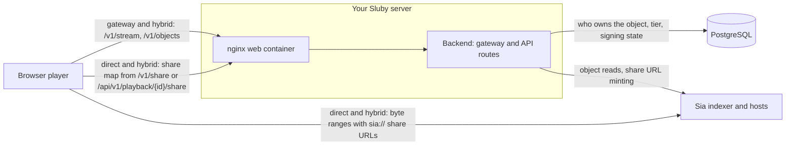

This page explains every path a video takes from Sia storage to a player: the delivery gateway on your Sluby server, direct playback from Sia in the browser, and hybrid playback that mixes the two. It also covers what makes a private video private: signed URLs, their lifetime and revocation, share URLs, playback ids, the public watch page, caching and play counting.

A few Sia terms first. Sia is a decentralized storage network: independent storage providers, called hosts, keep the data. An **object** is one stored file on Sia, named by an object id of 64 lowercase hex characters. The **indexer** is the service that Sluby's backend and the browser connect to in order to look objects up and reach the hosts that hold them. A **share URL** is a signed `sia://` URL, made by the Sia SDK, that lets a Sia client read one object until a set time.

## What a stored video looks like

Every rendition of a video is stored on Sia as one data file plus one HLS playlist, and the video has one HLS master playlist that lists the rendition playlists. Each file is its own Sia object. The playlists Sluby stores name the other objects by root-relative gateway paths of the form `/v1/objects/{objectId}`, and they address the segments of a data file with byte ranges. Because the paths carry no host name, the same stored playlists play through any origin that serves the gateway, and the direct-from-Sia player reads the object id out of the path. How the files are produced is on [Upload pipeline](/developers/concepts/upload-pipeline).

## Delivery modes

| Mode    | Where the bytes come from                                                         | When it applies                                                                                                                                                                                  |
| ------- | --------------------------------------------------------------------------------- | ------------------------------------------------------------------------------------------------------------------------------------------------------------------------------------------------ |
| Gateway | Your Sluby server reads from Sia and streams to the player over HTTP              | Always available. The watch page, plain hls.js, Safari's native HLS, and any player without a Sia viewer session use it.                                                                         |
| Direct  | The browser downloads every playlist and segment from Sia itself, with share URLs | `@sluby/player` with a Sia viewer session and `siaDelivery="direct"` (the default when a session exists)                                                                                         |
| Hybrid  | Playlists and urgent segments from the gateway, the rest from Sia                 | `@sluby/player` with a Sia viewer session and `siaDelivery="hybrid"`. The Studio plays videos this way when it is built with a viewer identity, with `minBufferSec: 5` and `safetyMarginSec: 2`. |

The player reports the mode it ends up using through `onDeliveryChange` with `sia`, `hybrid` or `gateway`. Props and callbacks are listed on the [player reference](/developers/reference/player); enabling a viewer identity for your server is on [Stream from Sia in the browser](/self-hosting/direct-playback).

### Gateway

The gateway is the set of unauthenticated `/v1/` routes on the backend, behind the nginx web container. It needs no API key, so a plain `<video>` element or hls.js can play a public video.

Every request to `GET /v1/objects/{objectId}` first settles access from the asset that owns the object:

- An id that is not 64 lowercase hex characters gets `400`.
- An object that no live asset claims, or whose asset is being deleted, gets `404` with `Object not found`.
- An object of a public asset is served.
- An object of a private asset needs a valid signed URL (see [Signed URLs](#signed-urls)), or the gateway answers `403` with `This object requires a valid signed URL` and a `reason`.
- When the database cannot be read, the answer is `503` with `Delivery is unavailable right now; try again`, so the gateway never serves or refuses on a guess.

Then it sends the bytes by request shape:

- **Range request** (`bytes=N-M`, `bytes=N-` or `bytes=-N`): the gateway looks the object up once and downloads only the part of the object the range covers from the Sia hosts, streaming it to the player as it arrives, with `206`. HLS players send a range for every segment, so this is the media path. A range that starts past the end gets `416`. The gateway ignores a multi-range or malformed header and sends the whole object.
- **Whole object** (no usable `Range`): an object of up to 8 MB (playlists, thumbnails) is read once into an in-memory cache and served from there. A larger object streams from Sia without being kept.
- **HEAD**: the whole-object path without a body.

A failure on the Sia side returns `502` with `The Sia network did not answer; try again`, and an object the indexer no longer has returns `404`. The optional `type` query (`?type=manifest` on playback URLs) sets the `Content-Type` of the answer.

`GET /v1/stream/{id}/master.m3u8` serves a video's master playlist by asset id or playback id, so you can build a playback URL without knowing any object id. Its access rules are in [Playback ids](#playback-ids).

The gateway answers requests from any origin, without credentials, so you can embed a player on any site. The exact CORS headers are on [API conventions](/developers/reference/api-conventions#cors).

Endpoint details: [`GET /v1/objects/{objectId}`](/developers/reference/api/delivery/get-objects-objectid), [`GET /v1/stream/{id}/master.m3u8`](/developers/reference/api/delivery/get-stream-videoassetid-master-m3u8).

### Direct from Sia

In direct mode, `@sluby/player` replaces hls.js's HTTP loader with one that fetches every playlist and segment from Sia through the SDK's Sia session. The backend is not in the byte path. It only hands out the share map (see [Share URLs](#share-urls)).

1. The browser connects to the indexer with a viewer app key. This is a separate Sia app identity from the one the backend uploads with, created with the `provision-viewer` script and given to the SDK as `SlubyConfig.sia` (`indexerUrl`, `appId`, `appKey`). The Sia SDK runs in the browser as WebAssembly and loads on first use.
2. The player fetches the asset's share map: one `sia://` share URL per object, plus the id of the master playlist object.
3. For each request hls.js makes, the loader takes the object id out of the `/v1/objects/{objectId}` path, resolves that object from its share URL, and downloads the requested byte range straight from the hosts.

The player prepares the session before playback starts. If the connection or the share map fails, the player logs `Sluby: direct-from-Sia delivery unavailable, using the gateway.` and plays the video through the gateway. Safari's native HLS path cannot use a custom loader, so it always plays through the gateway.

A failed Sia read reaches hls.js as status `502`, which hls.js retries. A refused share map or signature keeps its own 4xx status, which hls.js does not retry.

### Hybrid

Hybrid mode starts as fast as the gateway and still takes most bytes from Sia. The player plays through the gateway at once and connects to Sia while the video plays. For each request:

- Playlists always come from the gateway.
- A media segment comes from Sia only when all of these hold: no other Sia read is running, Sia is not paused, the hosts of that object have already answered a one-byte warm-up read, and the buffer holds at least `minBufferSec` seconds ahead of the playhead. Otherwise (the start, a seek, a nearly empty buffer, Sia still connecting) the segment comes from the gateway.
- A Sia read gets a time budget of `maxSiaWaitMs`, or the buffered seconds minus `safetyMarginSec`, whichever is smaller. The player cancels a read that fails or runs past its budget and fetches the same segment from the gateway, so playback does not wait on a slow host.
- After `maxFailures` failures in a row, the player pauses Sia for `pauseMs`. A failed session start also pauses Sia for `pauseMs`, and the player retries the start after that.

The defaults of these policy fields are in the [player reference](/developers/reference/player#hybrid-types). You can override any field with the player's `hybridPolicy` prop. The player reports how many bytes and segments came from each side, and how many segments fell back to the gateway, through `onDeliveryStats`.

## Access tiers

Every asset is `public` or `private`, and this tier alone decides how the gateway serves its objects.

- **Public**: anyone with an object URL or the master URL can play it, without a key or signature.
- **Private**: every object URL needs a valid signature. The unsigned `playback_url` that `GET /api/v1/playback/{id}` returns for a private asset is refused by the gateway, so `@sluby/player` asks for a signed URL on its own when it sees `access_tier: "private"`.

You change the tier with [`PATCH /api/v1/assets/{id}`](/developers/reference/api/assets/patch-assets-id). A change of tier also revokes every signed URL of the asset, but not share URLs already handed out (see [Revocation](#revocation)).

## Signed URLs [#signed-urls]

A signed URL is a gateway URL with `expires` and `sig` query values that grants access to one object until a time.

### Minting

[`GET /api/v1/playback/{id}/signed`](/developers/reference/api/playback/get-playback-id-signed) takes an asset id or a playback id and returns:

- `signed_url`: the master playlist as `{PUBLIC_URL}/v1/objects/{manifestObjectId}?type=manifest&expires=...&sig=...`
- `poster_url`: the first thumbnail, signed the same way, or `null`
- `expires_at`: when both stop working

The asset must have finished processing; otherwise the answer is `409` with `Video is not ready for playback`.

### Lifetime [#signed-url-lifetime]

|                      | Seconds             |
| -------------------- | ------------------- |
| Default `expires_in` | `3600` (one hour)   |
| Minimum              | `60`                |
| Maximum              | `21600` (six hours) |

The backend clamps an `expires_in` outside the range to it. It refuses a value that is not a whole number of seconds with `400` and `expires_in must be a whole number of seconds`. The gateway also refuses any URL whose expiry lies more than six hours ahead, whatever minted it, so no signed URL outlives the cap.

For a video longer than the lifetime, `@sluby/player` renews a URL it signed itself before it expires. For a URL you sign on your server, you pass a renewal callback. See [Serve private videos](/developers/guides/private-videos).

### How the signature works

The signature is an HMAC-SHA256 over the object id, the expiry and the asset's signing generation, with a key derived from `SESSION_SECRET` for URL signing alone. So a signature:

- works for one object only, and its expiry cannot be extended;
- stops working when the asset's signing generation changes;
- stops working for every asset if you change `SESSION_SECRET` ([configuration](/self-hosting/configuration#session_secret)).

The gateway checks the signature before it looks at the expiry. A request without `expires` or `sig` fails with `reason: "missing"`, a wrong signature with `"invalid"`, and a good signature past its time with `"expired"`. So an attacker cannot use the error to learn which object ids exist.

### One signed link for the whole video

A signed URL covers only its own object, but a video is many objects. When the gateway serves a private playlist through a valid signed URL, it signs every `/v1/objects/...` URL inside the playlist body with the same expiry before sending it. The rendition playlists are then signed again the same way when they load. One signed master URL therefore unlocks the whole video until its expiry, and nothing longer.

The gateway checks the signature against the master playlist object, so the same `expires` and `sig` pair also opens `/v1/stream/{id}/master.m3u8`, `/v1/share/{id}` and `/watch/{id}` for that video.

### Revocation [#revocation]

[`POST /api/v1/playback/{id}/signed/revoke`](/developers/reference/api/playback/post-playback-id-signed-revoke) raises the asset's signing generation by one and returns `{ "success": true, "signing_generation": N }`. Every signed URL minted before stops verifying, and you can mint new ones right after. A `PATCH` that changes the tier raises the generation in the same database statement as the change.

The backend drops its cached copy of the asset's access state at once, so the next request sees the change. If you run more than one backend process, the others read the new state within a minute, when their cached copy expires. When a public asset becomes private, nginx can still serve its playlists and thumbnails from its cache for up to 60 seconds (see [Caching](#caching)).

Revocation and a tier change do not reach `sia://` share URLs that were already minted: the Sia SDK has no call that revokes a share URL, so each one keeps working until its own `expires_at`. That bound depends on the tier at the moment the map was minted:

- A map minted while the asset was private expires at most one hour after minting.
- A map minted while the asset was public expires at most six hours after minting. Making the asset private afterwards does not shorten it, so its share URLs can keep reading the objects from Sia for up to six hours after the switch.

Maps minted after the switch get the private one-hour cap. The [Share URL lifetime](#share-url-lifetime) table lists every bound.

## Share URLs [#share-urls]

Direct and hybrid playback need a **share map**: a `sia://` share URL for every object of the asset, the `master_object_id`, and `expires_at`. A share URL works for anyone who holds it until it expires, so the backend mints share URLs per playback with a short lifetime and never writes them into the stored playlists.

You get a share map from one of two routes:

| Route                                                                                         | Authentication            | Gated when                                                                |
| --------------------------------------------------------------------------------------------- | ------------------------- | ------------------------------------------------------------------------- |
| [`GET /api/v1/playback/{id}/share`](/developers/reference/api/playback/get-playback-id-share) | API key or Studio session | the asset is private                                                      |
| [`GET /v1/share/{id}`](/developers/reference/api/delivery/get-share-id)                       | none                      | the asset is private, or `{id}` is a playback id with the `signed` policy |

On both routes, a gated map gets the shorter maximum lifetime in the table below. On the public route, a gated map also needs the `expires` and `sig` of the video's signed master URL, and its share URLs never outlive that signature. The SDK builds this URL for you from the playback URL you play, so a page with no API key can play straight from Sia.

### Share URL lifetime

|                       | Seconds |
| --------------------- | ------- |
| Default `expires_in`  | `3600`  |
| Minimum               | `60`    |
| Maximum, public asset | `21600` |
| Maximum, gated        | `3600`  |

The backend rounds the expiry up to a five-minute grid, and never past the maximum or the signature's own expiry. Callers asking for roughly the same lifetime get the same map. Each backend process keeps up to 5000 maps in memory, each until it expires. Minting a map costs one indexer lookup per object, so a repeat request in the same five-minute slot gets the kept map instead of a new mint.

When the SDK needs a map within one minute of its expiry, it fetches a new one; on the public route it marks that request with `renew=1`. If a share URL fails near the end of its life, or an object is missing from the map, the SDK fetches the map again once and retries.

Share maps from `/v1/share/{id}` carry `Cache-Control: no-store` (`private, no-store` when gated). The authenticated route sends `Cache-Control: private, no-store` for a private asset. Minting failures return `502` with `The Sia indexer did not answer while minting share URLs; try again`, or `503` when the database did not answer.

## Playback ids [#playback-ids]

A playback id is a public handle for an asset of the form `pb_` followed by 21 URL-safe characters. You can hand one out instead of the asset id, give one asset several, and delete one to cut off the links that use it without touching the asset.

Each playback id has a `policy` of `public` (the default) or `signed`, and an optional `name`. You manage them with [`POST /api/v1/assets/{id}/playback-ids`](/developers/reference/api/playback/post-assets-id-playback-ids), [`GET /api/v1/assets/{id}/playback-ids`](/developers/reference/api/playback/get-assets-id-playback-ids) and [`DELETE /api/v1/playback-ids/{playbackId}`](/developers/reference/api/playback/delete-playback-ids-playbackid).

A playback id works wherever an asset id does on these routes: `/v1/stream/{id}/master.m3u8`, `/v1/share/{id}`, `/watch/{id}` and the `/api/v1/playback/{id}` routes. On the three public routes:

- The entry point needs a signature when the asset is private, or when the playback id's policy is `signed`, even on a public asset.
- A deleted playback id answers `404` at once; the gateway looks the id up on every request.

A playback id gates only its entry points. The objects themselves follow the asset's tier, so the objects of a public asset stay reachable by their `/v1/objects/{objectId}` URLs whatever playback ids point at it. To keep the bytes behind signatures, make the asset private.

## The watch page

`GET /watch/{id}` is a public HTML page that plays one video, by asset id or playback id. You can send it as a link or embed it in an `<iframe>` on any site. It plays `/v1/stream/{id}/master.m3u8` through the gateway with hls.js served from your Sluby server (or the browser's own HLS where hls.js cannot run), so it loads nothing from a CDN.

- **Public video**: the page needs nothing, carries Open Graph tags (title, URL, and the poster when the video has one) for link previews, and is sent with `Cache-Control: no-cache`, so making the video private or deleting it takes effect on the next load.
- **Private video or signed playback id**: the page needs the `expires` and `sig` of the video's signed master URL, as `/watch/{id}?expires=...&sig=...`. It passes them on to the stream and signs the poster with the same expiry. The page is sent with `Cache-Control: private, no-store` and `noindex`, and has no Open Graph tags.

The page takes the query options `autoplay`, `muted` and `loop`; [Change how the embed plays](/studio/share#change-how-the-embed-plays) describes each.

What a viewer sees when the page cannot play:

| Situation                                            | Status | Heading                             |
| ---------------------------------------------------- | ------ | ----------------------------------- |
| Unknown id, deleted video, or no master playlist yet | `404`  | This video is not available         |
| Signed link past its expiry                          | `403`  | This link has expired               |
| Missing or wrong signature                           | `403`  | This video needs a signed link      |
| Database unavailable                                 | `503`  | This video is unavailable right now |

The page's Content Security Policy loads scripts, styles, images and media only from its own origin (plus `data:` images and `blob:` media and workers, which hls.js uses) and sets `frame-ancestors *`, so any site can frame it.

## Caching [#caching]

Sia objects never change under their id, so every layer can keep bytes, but every layer re-checks access before reuse.

### Browsers and CDNs

- Public responses carry `Cache-Control: public, no-cache` and a strong `ETag` (the object id). A client must revalidate before reusing a copy, and the gateway answers `304` only after checking access again.
- Responses for private assets, and signed responses from `/v1/stream`, carry `Cache-Control: no-store`.
- Error responses carry `Cache-Control: no-store`.

### nginx

The web container keeps small public whole objects (rendition playlists and thumbnails) for 60 seconds, because the gateway marks exactly those with `X-Accel-Expires: 60`. After that it revalidates, and the gateway answers `304` only while the object is still public. So making an asset private, revoking, or deleting reaches every viewer within that minute. nginx never serves a stale copy in place of an answer, even when the backend is down.

nginx never stores:

- range requests (the media data) and objects larger than 8 MB, which stream through;
- signed requests (any request with `sig`);
- master playlists and share maps, so each player load reaches the backend and is counted.

For objects, the cache key is the method, the path and the `type` query value, so adding random query values cannot force misses. The cache lives in the `nginx-cache` volume, up to 10 GB, and drops entries not used for 24 hours.

### Backend memory

- The backend keeps whole objects up to 8 MB in an in-memory LRU cache whose size `CACHE_MAX_SIZE_MB` sets ([configuration](/self-hosting/configuration#cache_max_size_mb)). Master playlists for `/v1/stream` sit in a separate cache of up to 1000 entries and 32 MB, so object reads cannot evict them.
- When a video finishes processing, the backend loads its master playlist, rendition playlists and thumbnails into these caches, so the first play comes from memory.
- When an asset is deleted, the backend evicts its objects.
- The backend answers range requests for an object already in memory from memory.
- The backend keeps which asset owns an object for five minutes, and an asset's tier and signing state for at most one minute. It drops the tier and signing state at once on a tier change, a revoke or a delete made through the same process.

[`GET /v1/cache/stats`](/developers/reference/api/ops/get-cache-stats) reports the in-memory cache's size, item counts, hits and misses. Object and master playlist responses carry an `X-Cache-Status` header; through nginx it is nginx's own cache status.

## Play counting

A play is one player load of a video. The backend counts:

- a `200` for the master playlist at `/v1/stream/{id}/master.m3u8`, or for the master object at `/v1/objects/{objectId}` (where signed URLs point);
- a share map from `/v1/share/{id}`, since direct-from-Sia players never fetch the master from the gateway.

It does not count `HEAD`, `304` or range requests, refused or failed requests, share map refreshes marked `renew=1`, share maps from the authenticated `/api/v1/playback/{id}/share` route, or requests whose `Referer` is a `/studio` page of the same server (Studio previews). The same viewer loading the same video again within 30 minutes counts once. A viewer is a hash of the client address and user agent, so the backend never stores raw addresses. It buffers counts in memory and writes them to the database every 10 seconds.

## Related pages

<Cards>
  <Card title="Serve private videos" href="/developers/guides/private-videos" />
  <Card title="Play videos in React" href="/developers/guides/play-react" />
  <Card title="Stream from Sia in the browser" href="/self-hosting/direct-playback" />
  <Card title="Storage on Sia" href="/developers/concepts/storage-on-sia" />
</Cards>
