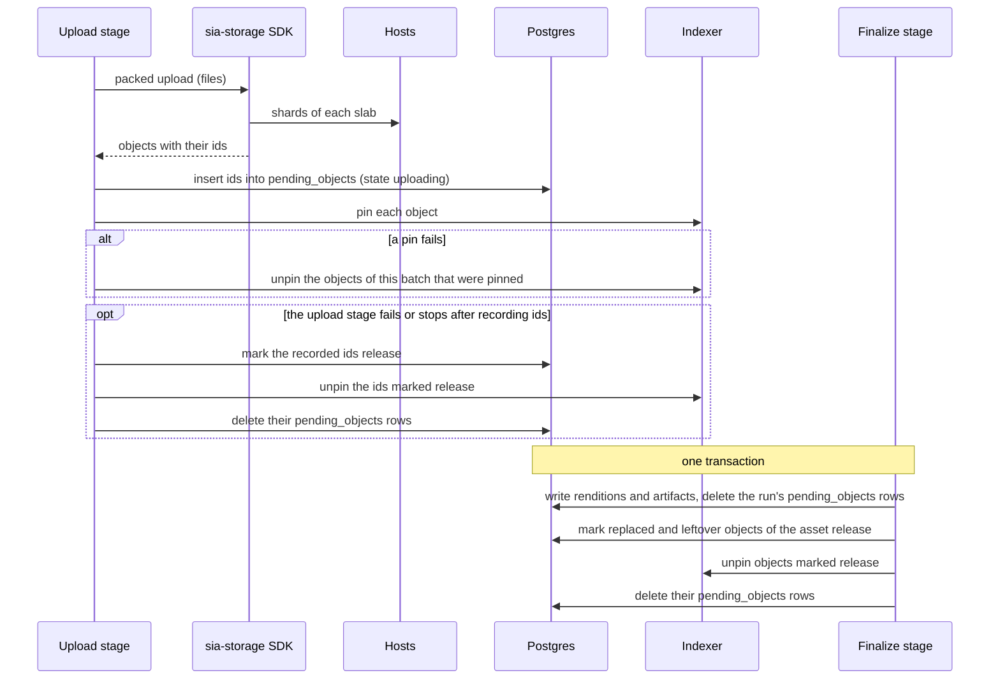

A ready Sluby video lives on the Sia network: its renditions, playlists and thumbnails are Sia objects, and the backend removes its local copies once the video is ready. This page explains the Sia terms Sluby uses, which objects make up one video, how redundant they are, how Sluby makes sure every pinned object is on record, and what each field of the per-video storage breakdown means. For the steps that produce these objects, see [Upload pipeline](/developers/concepts/upload-pipeline).

## Sia terms

| Term                     | Meaning                                                                                                                                                                                                                                                                                                                                                                                                                         |
| ------------------------ | ------------------------------------------------------------------------------------------------------------------------------------------------------------------------------------------------------------------------------------------------------------------------------------------------------------------------------------------------------------------------------------------------------------------------------- |
| Host                     | A storage provider on the Sia network. Hosts store encrypted shards and serve them back.                                                                                                                                                                                                                                                                                                                                        |
| Indexer                  | The service between an app and the hosts. It keeps the record of each object (which slabs and shards make it up and which hosts hold them), watches slab health and coordinates repairs. Sluby connects to an indexer with its app key through the official `@siafoundation/sia-storage` SDK, for example the hosted indexer at `https://sia.storage` or a self-hosted `indexd`. The SDK uploads each shard straight to a host. |
| Object                   | One stored file, such as a rendition's data file or a playlist.                                                                                                                                                                                                                                                                                                                                                                 |
| Object id                | The id of an object, which the SDK returns when an upload finishes. Sluby stores object ids in its database, and playlists name objects by id.                                                                                                                                                                                                                                                                                  |
| Slab                     | A contiguous erasure-coded segment of data. An object's data lives in one or more slabs, and several small objects can share one slab.                                                                                                                                                                                                                                                                                          |
| Data shard, parity shard | Erasure coding splits a slab into data shards and adds parity shards. Any set of shards as large as the number of data shards rebuilds the slab, so the slab survives the loss of as many shards as it has parity shards.                                                                                                                                                                                                       |
| Sector                   | What one host stores for one shard of a slab. Sluby counts every sector as 4 MiB.                                                                                                                                                                                                                                                                                                                                               |
| Pin                      | Telling the indexer to keep an object record, so the object becomes listable and eligible for repair. Unpinning (deleting) an object removes the record; its slabs stay pinned until a prune.                                                                                                                                                                                                                                   |
| Prune                    | Asking the indexer to unpin every slab of the account that no object uses.                                                                                                                                                                                                                                                                                                                                                      |

The app key and the indexer URL come from the indexer connection. [Connect Sia storage](/self-hosting/sia-storage) shows how to set it up.

## What one video stores

Each ready video is a small set of Sia objects. For a video with N renditions and T thumbnails (T is 3 unless a thumbnail shot failed), Sluby stores 2N + 1 + T objects:

| Role               | Count             | Content                                                             |
| ------------------ | ----------------- | ------------------------------------------------------------------- |
| `rendition_data`   | one per rendition | the rendition's `data.m4s`: the fMP4 init section and every segment |
| `variant_playlist` | one per rendition | the rendition's HLS playlist, with byte ranges into the data object |
| `master_manifest`  | one               | the HLS master playlist, one entry per rendition                    |
| `thumbnail`        | up to three       | JPEG frames at 25%, 50% and 75% of the video                        |

The playlists refer to other objects by path: a variant playlist names its data object as `/v1/objects/<object id>`, and the master playlist names each variant playlist the same way. A player that has the master playlist's object id can therefore find every other object of the video. [Playback and delivery](/developers/concepts/playback) explains how those paths are served.

In the database, the `artifacts` table ties every object id to its video, its role and, for rendition files, its rendition. The `renditions` table holds one row per rendition with its data and playlist object ids. [Data model](/developers/concepts/data-model) describes both tables.

## Packed uploads and shared slabs

On Sia, even a 1-byte upload occupies a full slab, with all of its data and parity shards. Uploading each small file on its own would cost one full slab per file. Sluby uses packed uploads instead: one upload that places several objects into shared slabs. Each object references its own byte range inside the slabs it shares.

A video takes three packed uploads, because each playlist must name the ids of the objects it points at:

1. every rendition data file and every thumbnail
2. every variant playlist
3. the master playlist

The playlist uploads each fill one slab even though the playlists are a few kilobytes. Rendition data larger than the room left in a slab spans several slabs.

## Redundancy

Every slab is erasure coded into data shards plus parity shards, and each shard is stored as one sector on a different host. For a slab with `d` data shards and `p` parity shards:

| Quantity                          | Value                  |
| --------------------------------- | ---------------------- |
| Sectors per slab                  | `d + p`, one per shard |
| Data per slab                     | `d` x 4 MiB            |
| Stored per slab                   | `(d + p)` x 4 MiB      |
| Redundancy ratio                  | `(d + p) / d`          |
| Shards needed to rebuild the slab | any `d` of the `d + p` |

For example, a slab with 10 data shards and 20 parity shards holds 40 MiB of data, stores 120 MiB on 30 hosts, has a redundancy ratio of 3, and survives the loss of any 20 of its shards.

Sluby passes a split to the SDK only when both [`SIA_DATA_SHARDS`](/self-hosting/configuration#sia_data_shards) and [`SIA_PARITY_SHARDS`](/self-hosting/configuration#sia_parity_shards) are set. With either one unset, it passes none and the SDK uses its own default. The split a stored video actually uses is in the `data_shards`, `parity_shards` and `redundancy_ratio` fields of its [storage breakdown](#totals).

## Records before pins

A pinned object that Sluby has no record of would stay on Sia with nothing to find and unpin it. Sluby prevents this by writing every object id to its database before it pins the object, in the `pending_objects` table.

A row in `pending_objects` is in one of two states:

| State       | Meaning                                                                                                            |
| ----------- | ------------------------------------------------------------------------------------------------------------------ |
| `uploading` | A processing run recorded the object right before pinning it. Finalize can still promote it to an `artifacts` row. |
| `release`   | Nothing will use the object. It is to be unpinned, and its row is deleted once the unpin succeeds.                 |

What moves a row to `release`:

- A failed or stopped upload marks the objects it pinned.
- Finalize marks objects the video referenced before and no longer does, and any other `uploading` object of the same video (left by an earlier attempt or a duplicate execution).
- The deletion GC sweep marks `uploading` objects whose video is gone, being deleted, or no longer `processing`.

An object that an `artifacts` row still names is never unpinned from `pending_objects`, so a live video cannot lose an object this way. The `pending_objects` table has no foreign key to the video on purpose: its rows outlive a deleted video, because an upload can still pin after the video row is gone. The deletion sweep unpins what is left. [Deletion and reconciliation](/developers/concepts/deletion-and-reconciliation) covers that sweep.

## Slab pruning

The indexer pins slabs separately from the objects that use them. Unpinning an object leaves its slabs pinned until a prune: a request that makes the indexer unpin every slab of the account that no pinned object uses. Sluby requests a prune after a failed upload, after a stopped upload releases the objects it pinned, and after it deletes a video's objects.

Sluby pins the objects of a packed upload only after the whole upload has finished, so while an upload runs, its stored slabs have no pinned object. A prune at that moment would unpin them. Sluby keeps prunes and uploads apart across every backend process that shares the Sia account:

- Each upload holds a lease in Redis and renews it every 15 seconds.
- A prune runs only when no upload lease is live anywhere. Otherwise it is marked as wanted and runs when the last upload ends.
- Uploads wait while a prune runs.
- Right before it pins, an upload checks its lease. A lease lapses only when the process stalls longer than the lease lifetime. If it lapsed and no prune ran in the meantime, the upload takes the lease back and continues. If a prune ran or is running, the upload pins nothing and fails, and the pipeline retries it.

Leases expire after four renewal intervals, so a process that dies while holding one blocks the others for at most that long.

## Storage breakdown

[`GET /assets/{id}/sia`](/developers/reference/api/storage/get-assets-id-sia) returns what the indexer reports about every object of one video, with totals. It needs the `read` [scope](/developers/reference/api-conventions#scopes). The Studio shows the same data on a video's page ([See how a video is stored on Sia](/studio/storage)).

The backend lists the video's objects from the `artifacts` table. For a video stored before that table existed, it falls back to the object ids on the video row, where a playlist and a data file cannot be told apart, so their `role` is `null`.

### Objects

Each entry of `objects`:

| Field               | Meaning                                                                                                                         |
| ------------------- | ------------------------------------------------------------------------------------------------------------------------------- |
| `object_id`         | the Sia object id                                                                                                               |
| `role`              | `master_manifest`, `variant_playlist`, `rendition_data`, `thumbnail`, or `null` for an object stored before roles were recorded |
| `rendition`         | the rendition name, such as `720p`, for playlists and data files; `null` otherwise                                              |
| `size`              | the object's size in bytes, before erasure coding                                                                               |
| `encoded_size`      | the encoded size the indexer reports for the object, after erasure coding                                                       |
| `slab_count`        | slabs that hold part of the object                                                                                              |
| `sector_count`      | sectors of those slabs                                                                                                          |
| `shared_slab_count` | slabs the object shares with another object of the same video                                                                   |
| `host_count`        | distinct hosts that store a sector of the object                                                                                |
| `created_at`        | when the indexer created the object                                                                                             |

`unavailable_object_ids` lists objects the indexer could not describe at that moment. They are listed instead of dropped.

### Totals

Totals count each slab once, even when several objects of the video share it. The slab's identity is its list of sector roots.

| Field                          | Meaning                                                                      |
| ------------------------------ | ---------------------------------------------------------------------------- |
| `object_count`                 | objects of the video                                                         |
| `raw_bytes`                    | sum of the object sizes, before erasure coding                               |
| `encoded_bytes`                | bytes the video occupies on hosts: every unique sector, 4 MiB each           |
| `sector_bytes`                 | the same number as `encoded_bytes`, kept for older clients                   |
| `unique_slab_count`            | distinct slabs                                                               |
| `unique_sector_count`          | distinct sectors                                                             |
| `data_shards`, `parity_shards` | the shard split of the video's slabs; `null` when slabs use different splits |
| `redundancy_ratio`             | total shards divided by data shards; `null` when slabs use different splits  |
| `host_count`                   | distinct hosts storing a sector of the video                                 |
| `country_count`                | distinct countries of those hosts                                            |

`encoded_bytes` comes from the unique sectors of the video, not from adding up the per-object `encoded_size` values, so the two do not have to match.

### Hosts, countries and the indexer

| Field                | Meaning                                                                                                                                                                                                                                                                                      |
| -------------------- | -------------------------------------------------------------------------------------------------------------------------------------------------------------------------------------------------------------------------------------------------------------------------------------------- |
| `hosts[]`            | one entry per host: `public_key`, `sectors` (sectors of this video it stores), `country_code`, `latitude`, `longitude`, `good_for_upload`, sorted by sector count. `country_code`, `latitude`, `longitude` and `good_for_upload` are `null` for a host missing from the indexer's host list. |
| `countries[]`        | one entry per country: `country_code`, `hosts`, `sectors`                                                                                                                                                                                                                                    |
| `contracts`          | ids of active file contracts with the hosts that store the video, from a self-hosted `indexd` admin API; `null` when no admin API is configured                                                                                                                                              |
| `indexer`            | the indexer `url`, the `network`, and the `wallet_address` behind a self-hosted `indexd` (`null` when no admin API is configured or the lookup fails)                                                                                                                                        |
| `manifest_object_id` | the master playlist's object id                                                                                                                                                                                                                                                              |

The admin API counts as configured when [`SIA_ADMIN_PASSWORD`](/self-hosting/configuration#sia_admin_password) is set, and the backend calls it at [`SIA_ADMIN_URL`](/self-hosting/configuration#sia_admin_url).

### Caching

A breakdown asks the indexer about every object of the video, so the backend caches a complete answer per video for 30 seconds and the host list for 5 minutes. An answer with unavailable objects is not cached, so the next request asks again.

## Related pages

- [Upload pipeline](/developers/concepts/upload-pipeline): how the objects are produced and uploaded.
- [Playback and delivery](/developers/concepts/playback): how the objects reach a player.
- [Deletion and reconciliation](/developers/concepts/deletion-and-reconciliation): how objects are unpinned and how Sluby checks its records against the indexer.
