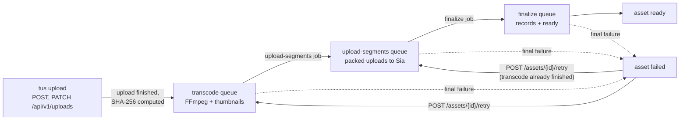

This page explains what the Sluby backend does with a video from the first uploaded byte until the video is ready to play: the tus upload, the three queued stages (transcode, Sia upload, finalize), the rendition ladder and segment format FFmpeg produces, how the output goes to Sia in packed uploads, and how failures retry. For the client side of an upload, see [Upload videos from your app](/developers/guides/upload).

## Stages at a glance

Every video passes through one upload and three queued stages. The queues are BullMQ queues in Redis, and the workers that run them live in the backend process. Each backend process runs up to 2 transcode jobs, 4 Sia upload jobs and 4 finalize jobs at the same time.



| Stage         | What it does                                                                                 | Progress written to the processing job                           |
| ------------- | -------------------------------------------------------------------------------------------- | ---------------------------------------------------------------- |
| Upload        | tus receives the file into `UPLOAD_DIR`, then the backend hashes it and queues the transcode | not part of the processing job (the upload session tracks bytes) |
| Transcode     | probes the source, runs FFmpeg into the rendition ladder, extracts thumbnails                | 0 to 60 while FFmpeg runs, then 65                               |
| Upload to Sia | uploads the data files, thumbnails and playlists in three packed uploads, pins every object  | 65 to 90                                                         |
| Finalize      | writes the storage records, marks the asset `ready`, warms the cache, removes local files    | 90, then 100                                                     |

You read the processing job (stage log, progress, retry count) with [`GET /assets/{id}/processing`](/developers/reference/api/assets/get-assets-id-processing).

## Upload with tus

Uploads use the [tus resumable upload protocol](https://tus.io/protocols/resumable-upload) at `/api/v1/uploads`. A request with a `Tus-Resumable` header, or a `PATCH`, `HEAD` or `OPTIONS` request, goes to the tus server. Other requests on that path go to the REST routes for upload status ([`GET /uploads/{id}`](/developers/reference/api/uploads/get-uploads-id)) and cancel ([`DELETE /uploads/{id}`](/developers/reference/api/uploads/delete-uploads-id)). There is no JSON route that creates an upload: the tus creation request creates it.

When a tus creation request (`POST`) arrives, the backend:

1. Authenticates the caller with an API key or a Studio session, and refuses a caller without the `upload` [scope](/developers/reference/api-conventions#scopes) with `403`.
2. Refuses a declared file type that does not start with `video/` with `415` and an empty file with `400`.
3. Validates the title, description and access tier from the upload metadata. A missing or blank title becomes `Untitled`.
4. Creates the video asset with status `created`, and an upload session that takes the tus upload id as its own id. The id in the tus `Location` header is therefore also the id the REST status and cancel routes take.
5. Sends the `upload.started` webhook once the file store has created the upload.

The maximum upload size is [`MAX_UPLOAD_SIZE`](/self-hosting/configuration#max_upload_size). The metadata keys a client sends are described in [Upload videos from your app](/developers/guides/upload).

While bytes arrive, the first write moves the asset from `created` to `uploading`, and the session records the received byte count. When the last byte arrives, the backend:

1. Computes the SHA-256 of the file by streaming it from disk, and stores the hash on the upload session, whose status becomes `completed`.
2. Creates a processing job row with status `queued`.
3. Adds a job to the `transcode` queue under the job id `transcode-<asset id>`, so a repeated finish hook does not queue a second transcode.
4. Sends the `upload.completed` webhook.

If any of these steps fails, the asset becomes `failed`, the backend sends `upload.failed`, and tus answers the request with the error.

### Unfinished and cancelled uploads

An unfinished upload expires 24 hours after its creation. Once an hour, the backend removes expired incomplete uploads from disk, marks their sessions `failed`, and discards an asset that never got past `created` or `uploading`. A finished upload never expires this way, because it is the source a failed asset needs for a retry.

A tus `DELETE` on an unfinished upload, or `DELETE /uploads/{id}`, cancels it: the session becomes `cancelled`, the partial file is removed and the asset is discarded. A finished upload cannot be cancelled. `DELETE /uploads/{id}` answers `409` for it, and you delete its asset instead.

## Transcode

The transcode worker runs two jobs at a time per backend process, and sets each FFmpeg run to half of the CPU cores (rounded down, at least one) so two transcodes share the machine. Before it starts, it checks that the asset still exists and is not `ready` or `failed`. It then sets the asset to `processing` and sends `processing.started` once per run (BullMQ retries of the same job do not send it again).

### Probe

`ffprobe` reads the source first. The worker picks the first video stream that is not cover art, and the default audio stream (or the first one). It applies rotation and sample aspect ratio, so a portrait phone clip counts as portrait.

Both `ffprobe` and `ffmpeg` read uploads with `-protocol_whitelist file` and a fixed list of container formats (`mov`, `matroska`, `webm`, `avi`, `mpegts`, `mpeg`, `asf`, `flv`, `ogg`, `mxf`, `dv`, `rm`, `nut`, `ivf`, `h264`, `hevc`, `m4v`, `mpegvideo`). The list leaves out playlist formats such as HLS and concat, so an upload cannot make FFmpeg open other files.

A file `ffprobe` reports as `Invalid data found when processing input`, or one without a video stream (`No video stream found`), fails the video at once without retries, and the backend marks its processing job not retryable.

### Rendition ladder

Sluby encodes every source into a ladder of H.264 renditions. Each rung has a fixed video bitrate, a peak rate 7% above it and a buffer 1.5 times the bitrate:

| Rendition | Size (16:9 landscape) | Video bitrate | Max rate | Buffer | Audio bitrate |
| --------- | --------------------- | ------------- | -------- | ------ | ------------- |
| `2160p`   | 3840x2160             | 15000k        | 16050k   | 22500k | 192k          |
| `1440p`   | 2560x1440             | 9000k         | 9630k    | 13500k | 192k          |
| `1080p`   | 1920x1080             | 6000k         | 6420k    | 9000k  | 192k          |
| `720p`    | 1280x720              | 3500k         | 3745k    | 5250k  | 128k          |
| `540p`    | 960x540               | 1800k         | 1926k    | 2700k  | 128k          |
| `360p`    | 640x360               | 800k          | 856k     | 1200k  | 96k           |

Which rungs a video gets:

- The tallest rung is [`TRANSCODE_MAX_RENDITION`](/self-hosting/configuration#transcode_max_rendition), `1080p` when it is not set. Sluby makes `1440p` and `2160p` only when you raise it.
- Sluby makes a rung only when its height fits in the source's short side, so it does not invent taller renditions than the source has. The one exception: a source shorter than 360 pixels on its short side gets the `360p` rung alone, scaled up to it.
- Each rung keeps the source's aspect ratio, with the rung height as the short side. A portrait 1080p source becomes 1080x1920, not a pillarboxed 1920x1080. Sluby rounds sizes to even numbers.

### Encoding settings

| Setting           | Value                                                                                                                                     |
| ----------------- | ----------------------------------------------------------------------------------------------------------------------------------------- |
| Video codec       | `libx264`, profile `high`, preset `veryfast`, 8-bit 4:2:0 (`yuv420p`), square pixels                                                      |
| Keyframes         | forced every 2 seconds, scene-cut keyframes off (`-sc_threshold 0`)                                                                       |
| Audio codec       | AAC, 2 channels, 48 kHz; every rendition carries the one selected source audio stream (renditions have no audio when the source has none) |
| Interlaced frames | deinterlaced with `bwdif` (progressive frames pass through)                                                                               |
| HDR (PQ or HLG)   | tone-mapped to SDR BT.709                                                                                                                 |

When a source with audio has a container that runs on more than half a second past the end of its video stream, FFmpeg cuts the output at the end of the video, so the extra audio does not pile up in the last segment.

### Segment format

FFmpeg writes HLS with fragmented MP4 (fMP4) segments, as a VOD playlist, with a target segment length of 6 seconds (`-hls_time 6`). It uses the `single_file` flag: each rendition is one data file, `data.m4s`, that holds the init section and every segment, and the rendition's playlist addresses each segment by byte range with `EXT-X-BYTERANGE`. The `independent_segments` flag adds `#EXT-X-INDEPENDENT-SEGMENTS` to each playlist.

The output of one run is:

```text
<run directory>/
  master.m3u8            master playlist, one entry per rendition
  1080p/playlist.m3u8    variant playlist, byte ranges into data.m4s
  1080p/data.m4s         init section and every segment of 1080p
  720p/...
  thumb_25.jpg           thumbnails
  thumb_50.jpg
  thumb_75.jpg
  transcode-complete.json
```

### Thumbnails

After FFmpeg, the worker grabs three JPEG frames at 25%, 50% and 75% of the video's length, each 640x360 and letterboxed to keep the aspect ratio. The worker tone-maps HDR sources for thumbnails too. The worker skips a shot that fails, so a video without thumbnails still finishes.

### Time limits

| Limit                         | Value                                                                             |
| ----------------------------- | --------------------------------------------------------------------------------- |
| `ffprobe`                     | 60 seconds                                                                        |
| FFmpeg transcode, total       | 30 minutes plus 60 times the video's length (12 hours when the length is unknown) |
| FFmpeg transcode, no progress | 10 minutes                                                                        |
| Each thumbnail                | 60 seconds                                                                        |

The backend kills a run that passes a limit with `SIGKILL`, so FFmpeg cannot finish the playlists of a truncated video.

### Run directories and the completion marker

Each execution of the transcode stage writes into its own directory, `<TRANSCODE_OUTPUT_DIR>/<asset id>/<timestamp>-<random>`. A run counts as finished only when it holds `transcode-complete.json`, which the worker writes (atomically, by rename) after FFmpeg exits with code 0 and the thumbnails are taken. When a transcode job runs again and finds a finished run, it reuses that output instead of transcoding again.

## Upload to Sia

The upload stage turns the finished run into Sia objects. A Sia object is one stored file, addressed by an object id; [Storage on Sia](/developers/concepts/storage-on-sia) explains objects, slabs, shards and pins.

On Sia, even a 1-byte upload occupies a full slab, so Sluby packs the files of a run into as few uploads as it can. Each playlist has to name the object ids of what it points at, which gives three dependent uploads:

1. **Media**: every rendition's `data.m4s` and every thumbnail, in one packed upload.
2. **Variant playlists**: each `playlist.m3u8` rewritten so its `EXT-X-MAP` URI and segment lines point at `/v1/objects/<data object id>`, with the byte ranges unchanged. All playlists go in one packed upload.
3. **Master playlist**: `master.m3u8` rewritten so each rendition line points at `/v1/objects/<playlist object id>`, in its own upload.

The stored playlists hold root-relative paths, so they resolve against whichever origin serves them, and the direct-from-Sia player reads the object id out of the path. [Playback and delivery](/developers/concepts/playback) explains how those paths are served.

A packed upload puts several files into shared slabs. A file larger than the room left in the current slab starts a new slab, and a large file spans several slabs. After the data is stored, the backend records every object id in the database and then pins each object. [Storage on Sia](/developers/concepts/storage-on-sia#records-before-pins) explains why the record comes first.

Before reading the run, the stage checks it: a master playlist without renditions, a variant playlist without segments or without `#EXT-X-ENDLIST`, or an empty data file stops the stage, so leftovers of a failed FFmpeg run never become a video.

Before each upload, the stage checks that the asset is still `processing`. When the asset was deleted or left processing, the stage stops and releases the objects it already pinned.

### Upload retries and stalls

- The media upload gets up to 5 attempts inside the stage, waiting 2, 4, 8 and 16 seconds between them.
- The stage cancels a packed upload that stores nothing for 10 minutes and fails the attempt.
- When an attempt fails, the stage releases (unpins) the objects it pinned, so a retry uploads everything again from the start.

## Finalize

The finalize stage writes everything in one database transaction, after locking the asset row:

- one `renditions` row per rendition (name, width, height, bitrate, segment count, data size, data and playlist object ids). Width, height and bitrate come from the `RESOLUTION` and `BANDWIDTH` that FFmpeg writes for the rendition in the master playlist, the bitrate in kbps.
- one `artifacts` row per stored object with its role: `master_manifest`, `variant_playlist`, `rendition_data` or `thumbnail`
- the asset's master manifest id, thumbnail ids, duration, resolution, segment count, stored bytes, and status `ready`
- the processing job as `completed` at 100%

In the same transaction, finalize marks for release the objects the asset referenced before and no longer does (from an earlier run), and every other object an earlier attempt or a duplicate execution recorded for the asset. When the asset was deleted, or is no longer `processing`, finalize writes nothing and unpins the run's objects instead.

After the transaction, finalize sends `asset.ready`, unpins replaced objects, loads the master playlist, the variant playlists and the thumbnails into the backend's cache so the first play comes from memory, removes the run directories, and removes the source upload from disk. These steps are best effort: the asset is `ready` either way. A repeated finalize job sends `asset.ready` again, so the event arrives at least once.

The segment count stored on the asset is the per-rendition count, not the sum over renditions, because every rendition is segmented the same way.

## Statuses

### Asset status

| Status       | Set when                                                                                                           |
| ------------ | ------------------------------------------------------------------------------------------------------------------ |
| `created`    | the tus creation request creates the asset                                                                         |
| `uploading`  | the first bytes of the upload arrive                                                                               |
| `processing` | the transcode worker starts (the asset stays `uploading` while the job waits in the queue), or a retry is accepted |
| `ready`      | finalize commits                                                                                                   |
| `failed`     | a stage fails for good, or the upload finish step fails                                                            |

### Processing job status

| Status       | Set when                                                                  |
| ------------ | ------------------------------------------------------------------------- |
| `queued`     | the upload finishes, or a retry restarts the job                          |
| `processing` | the transcode or upload stage starts                                      |
| `retrying`   | a stage attempt fails and BullMQ will try again (the retry count goes up) |
| `completed`  | finalize commits                                                          |
| `failed`     | a stage fails for good; `retryable` is `false` for an unreadable source   |

### Webhook events

The pipeline sends `upload.started`, `upload.completed`, `upload.failed`, `processing.started`, `asset.ready` and `asset.errored` at the points this page describes. [Webhook events](/developers/reference/webhook-events#event-types) lists when each one fires and its payload. A webhook that cannot be queued never fails the upload or a stage.

## Retries

### Automatic retries

Each queue retries a failed job with exponential backoff:

| Queue             | Attempts | First backoff |
| ----------------- | -------- | ------------- |
| `transcode`       | 3        | 30 seconds    |
| `upload-segments` | 3        | 30 seconds    |
| `finalize`        | 3        | 10 seconds    |

While attempts remain, the processing job shows `retrying` with the error. After the last attempt, or at once for an unreadable source, the asset becomes `failed` and the backend sends `asset.errored`.

### Manual retry

[`POST /assets/{id}/retry`](/developers/reference/api/assets/post-assets-id-retry) restarts a `failed` asset:

- When a finished transcode run is still on disk, the retry starts at the Sia upload and does not transcode again.
- Otherwise it transcodes the source upload again, which needs the uploaded file on disk. When neither exists, the API answers `410` with `Could not retry because the original file is gone. Upload the video again.`
- An asset that is not `failed` gets `400` with `Only a failed video can be retried. It may have restarted already.` Two retries at the same time move the asset once; the second one gets this `400`.

A retry gets its own run id, so its upload and finalize jobs have job ids the failed attempt never used.

A failed asset keeps its source upload and its finished transcode output for a retry. A ready asset no longer has either.

## Duplicate executions

BullMQ can hand a job to a second worker when the first one stalls, for example when the host freezes for longer than the job lock (5 minutes). The pipeline makes a second execution harmless:

- Each stage queues the next one under a fixed job id (`upload-<asset id>` and `finalize-<asset id>`, with the run id appended for a retry), so a stage that runs twice starts its successor once.
- Each transcode execution writes to its own run directory. When two finish, the upload reads only the directory queued first, and the other is removed.
- The Sia upload of a job holds a lease in Redis, renewed every 10 seconds. A second execution waits until the lease is free, and an execution that loses its lease stops at its next checkpoint.
- Finalize checks the asset's state inside its transaction, so a stale run never replaces the objects of a ready asset.

## Related pages

- [Storage on Sia](/developers/concepts/storage-on-sia): objects, slabs, shards, redundancy and the storage breakdown.
- [Playback and delivery](/developers/concepts/playback): how the stored playlists and data files reach a player.
- [Deletion and reconciliation](/developers/concepts/deletion-and-reconciliation): how deleting a video unpins its objects.
