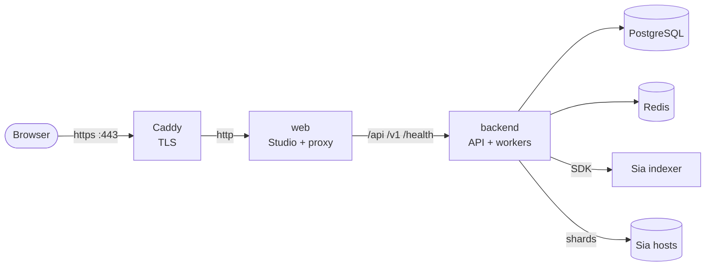

# Production deployment

The production setup is the same Compose stack as the [quickstart](./quickstart) with an override file on top. The override:

- adds [Caddy](https://caddyserver.com) in front of everything. It gets a TLS certificate for your domain from Let's Encrypt and renews it on its own, and sends `Strict-Transport-Security` so browsers stay on HTTPS. The other security headers (`X-Frame-Options`, `X-Content-Type-Options`, `Referrer-Policy` and the Studio's `Content-Security-Policy`) come from the web container in every setup.
- sets `CORS_ORIGIN` to `https://$DOMAIN`, so only the Studio's own origin is trusted with the session cookie. Apps on other origins can still call the API with a key.
- publishes only ports 80 and 443. PostgreSQL, Redis and the web container are reachable only inside the Compose network.
- runs the backend with `NODE_ENV=production`, which refuses to start with a missing or weak `SESSION_SECRET`, with `AUTH_DISABLED=true`, or with a `BOOTSTRAP_API_KEY` that is not a generated key.
- requires a PostgreSQL password, a session secret, GitHub sign-in with an allowlist (`GITHUB_ALLOWED_USERS`) and the Sia app identity, and stops with a message naming whichever one is missing.



## Requirements

- a Linux server with Docker Engine and the Compose plugin. The override uses the `!reset` tag, which needs a current Compose v2 release; `docker compose version` shows yours.
- a domain name with an A (and optionally AAAA) record pointing at the server
- ports 80 and 443 reachable from the internet. Caddy needs port 80 for the ACME HTTP challenge and to redirect HTTP to HTTPS.
- disk for uploads in flight, transcoder output and the delivery caches. Finished videos live on Sia, not on this disk.
- memory for the backend: the gateway's object cache (`CACHE_MAX_SIZE_MB`, 256 MB by default) on top of the process itself. Video bytes are streamed from Sia to the viewer and never held whole, so the number of viewers does not grow it.

## 1. Configure

```sh
git clone https://github.com/justmert/Sluby.git
cd Sluby
cp .env.example .env
```

Edit `.env`:

```sh
DOMAIN=video.example.com
ACME_EMAIL=you@example.com          # let's encrypt expiry notices
POSTGRES_PASSWORD=...               # openssl rand -base64 24
SESSION_SECRET=...                  # openssl rand -base64 32
AUTH_DISABLED=false
```

`AUTH_DISABLED` is forced off by the override anyway; setting it here keeps `.env` honest.

## 2. GitHub sign-in

The Studio signs people in with GitHub. Create an OAuth app at [github.com/settings/developers](https://github.com/settings/developers):

- **Homepage URL**: `https://video.example.com`
- **Authorization callback URL**: `https://video.example.com/api/v1/auth/github/callback`

Then add to `.env`:

```sh
GITHUB_CLIENT_ID=...
GITHUB_CLIENT_SECRET=...
GITHUB_ALLOWED_USERS=your-login,a-colleague
OPERATOR_USERS=github:id:<your numeric GitHub id>
```

`GITHUB_ALLOWED_USERS` says who may sign in: GitHub logins, `id:<numeric GitHub id>` entries, or `*` for anyone. Each person gets their own account, keyed on their numeric GitHub id rather than the login, so a renamed or re-registered login never moves data between people. A login entry is matched when someone signs in and then pinned to that account: it keeps admitting them after a rename and refuses whoever registers the freed login next. To move an entry to another account, write it as `id:<number>` (`https://api.github.com/users/<login>` shows the id). Removing an entry signs that person out and stops their API keys on their next request; adding it back restores the keys. `*` opens sign-up to every GitHub account. The production override refuses to start with `GITHUB_ALLOWED_USERS` empty, so open sign-up is always a choice you write down; without the override an empty value also lets everyone in, with a warning at startup. An open Studio lets anyone store and transcode video on your Sia account with no quota, so put limits in front of it before opening it. See [the allowlist](/architecture/auth-and-tenancy#the-allowlist).

`OPERATOR_USERS` names the accounts that run the deployment. Set it to your own account, so your Studio sign-in shows the indexer account, storage, cache, reconciliation and analytics views; without it those views stay empty for every Studio user, and only a platform key from `npm run db:seed-key -- --platform` sees that data. Each entry names the sign-in provider first: `github:id:<number>` (`https://api.github.com/users/<login>` shows the number), or `github:<login>`, which is pinned to the account that first signs in with it, like an allowlist login. An operator sees deployment-wide operations data through their sessions and their API keys, but still only their own videos, keys and webhooks. Removing an entry ends the role on that person's next request. See [operators](/architecture/auth-and-tenancy#operators).

The Studio needs https outside localhost: the session cookie is only marked `Secure` when `PUBLIC_URL` starts with `https://`, and the backend logs a warning when `PUBLIC_URL` is plain http on any other host.

Upgrading from a version that keyed accounts on GitHub logins signs everyone out once. Each person's first sign-in after the upgrade links their old assets, keys and webhooks to their account (see [upgrading](/architecture/auth-and-tenancy#upgrading-from-login-keyed-versions)); their API keys keep working in the meantime.

## 3. Connect to a Sia indexer

The backend stores data through an app identity registered with an indexer. Pick one of the options below, then run the connect script with the indexer's URL:

```sh
docker compose run --rm --no-deps -e SIA_INDEXER_URL=https://sia.storage \
  backend node scripts/connect-indexer.mjs
```

It prints an approval URL. Open it while signed in to the indexer account, approve, and copy the printed `SIA_INDEXER_URL`, `SIA_APP_ID` and `SIA_APP_KEY` into `.env`. Run this once per deployment. Running it again registers a second app with its own, separate storage.

### Mainnet with sia.storage

[sia.storage](https://sia.storage) is a hosted mainnet indexer with a free 50 GB tier, and it is what `.env.example` points at.

```sh
SIA_INDEXER_URL=https://sia.storage
SIA_NETWORK=mainnet
```

Leave `SIA_DATA_SHARDS` and `SIA_PARITY_SHARDS` unset. The SDK then uses its default of 10 data and 20 parity shards per slab, spread over 30 hosts.

### Mainnet with your own indexer

Run [indexd](https://github.com/SiaFoundation/indexd) on mainnet (its README covers the setup; it needs PostgreSQL 18 and a funded wallet to form contracts), approve the connection in its admin UI, and point Sluby at its application API:

```sh
SIA_INDEXER_URL=https://indexer.example.com   # indexd's application api, port 9982 by default
SIA_NETWORK=mainnet
# optional: the admin api adds contract ids and the wallet to the storage view
SIA_ADMIN_URL=http://indexd:9980
SIA_ADMIN_PASSWORD=...
```

The admin API is password protected and should never be exposed publicly. Only set `SIA_ADMIN_URL` when the backend can reach it over a private network.

### Zen testnet

[Zen](https://docs.sia.tech/testnet/zen-testnet) is Sia's testnet, where coins have no value. There is no hosted Zen indexer, so you run indexd yourself. `docker-compose.sia.yml` in the repository runs indexd on Zen with PostgreSQL 18, plus walletd and a CPU miner so you can mine the Zen coins indexd needs to form contracts. Its header comments walk through the setup.

This path was not re-verified for this release. The file pins indexd 0.6.0 and walletd 2.15.2, but nobody ran the setup end to end with those versions, so check its steps against the indexd README as you go. The changes in this release were tested live on mainnet with sia.storage.

Zen's host pool is small: 14 hosts were online in October 2026 ([zen.siascan.com](https://zen.siascan.com)). Two defaults assume a mainnet sized pool and have to change:

**Shards per slab.** The default 10 data + 20 parity shards needs 30 hosts. Set a ratio that fits the pool:

```sh
SIA_NETWORK=zen
SIA_DATA_SHARDS=3
SIA_PARITY_SHARDS=9
```

Both the SDK and indexd validate the ratio before accepting a slab. They require redundancy between 1.5x and 4x, and at least a 99.99% chance of recovering the slab assuming each host independently stays available with probability 0.75. With 14 or fewer hosts, the ratios that pass are 3 data shards over 12 hosts (3 + 9) and 4 data shards over 14 hosts (4 + 10). 3 over 13 hosts is 4.33x redundancy, above the 4x limit, so every upload with it is refused. Smaller ratios such as 2-of-6 are rejected unless both the SDK and indexd are built with a higher per-host availability assumption. `backend/vendor/README.md` describes building the SDK that way and passing the binary in with the `SIA_STORAGE_NATIVE` build argument.

**Account readiness.** indexd reports an app's account as ready once it has funded 30 host accounts (`ReadyHostThreshold` in indexd's `accounts/manager.go`). A pool smaller than that never gets there, so on Zen the account keeps reporting not ready, and the Studio dashboard shows it that way. Getting a ready account on Zen means building indexd from source with that constant lowered below the number of hosts you have contracts with.

The connect step and everything else work the same as on mainnet.

## 4. Start

**Coming from the quickstart?** PostgreSQL sets the `sluby` user's password only when it creates its data volume, so a volume made by the quickstart keeps the password `sluby`, and a backend started with a new `POSTGRES_PASSWORD` fails with `password authentication failed` and restarts in a loop. Either start from empty volumes (`docker compose down -v`, which deletes the quickstart's database, uploads and caches; videos already on Sia stay in your indexer account but Sluby forgets them), or keep the data and change the password before you switch, with the quickstart stack still running:

```sh
docker compose exec postgres psql -U sluby -d sluby -c "ALTER USER sluby PASSWORD 'the POSTGRES_PASSWORD from .env'"
```

```sh
docker compose -f docker-compose.yml -f docker-compose.prod.yml up -d --build
```

Watch the first start:

```sh
docker compose -f docker-compose.yml -f docker-compose.prod.yml logs -f caddy backend
```

Caddy logs the certificate it obtained, the backend logs `Sluby backend is running` and `sia-storage SDK ready`. Open `https://video.example.com`, sign in with GitHub, and the dashboard shows the indexer's status.

To save typing, put the file list in `.env`:

```sh
COMPOSE_FILE=docker-compose.yml:docker-compose.prod.yml
```

and plain `docker compose up -d`, `docker compose logs` and so on use both files.

## Behind an existing reverse proxy

If the server already terminates TLS (nginx, Traefik, a cloud load balancer), skip the Caddy override and point your proxy at the `web` container, which the base file publishes on `127.0.0.1:${WEB_PORT}` (8080 by default). Then set in `.env`:

```sh
NODE_ENV=production
PUBLIC_URL=https://video.example.com
CORS_ORIGIN=https://video.example.com
AUTH_DISABLED=false
```

along with `SESSION_SECRET`, `POSTGRES_PASSWORD` and the GitHub settings. Your proxy must pass the original `Host` header and set `X-Forwarded-Proto: https`, so that upload and sign-in URLs come out as `https://`, and set `X-Forwarded-For` to the client's address: the web container takes the client from it because your proxy reaches it from a private address, and the per-client [limits](./configuration#web-proxy) key on it. Allow request bodies of at least 10 MiB, the tus chunk size `@sluby/sdk` uploads with by default (the Studio uses 8 MiB), and more if your apps raise `chunkSize`; nginx's default `client_max_body_size` of 1 MB is too small. Send `Strict-Transport-Security` from your proxy, where TLS ends; the web container sends the other security headers.

## Operating it

**Upgrades.** Pull and rebuild; migrations run when the backend starts. Replicas starting together take turns on a database lock, so each migration runs once. A migration that adds an index locks its table while it builds, which takes a while on a large table, so plan the upgrade window for a big database.

```sh
git pull
docker compose up -d --build
```

**BullMQ stays on version 5.** BullMQ 6 refuses the legacy repeat entries that 0.1.0 used for the reconciliation and deletion sweeps. This release moves them to job schedulers and removes the old entries on its first start, which needs BullMQ 5 to read them. A later release can move to BullMQ 6 once deployments have started this one at least once, so upgrade through this release rather than skipping it.

**Backups.** The database is the one thing to back up: it maps every asset to its Sia objects. Video data lives on Sia and the app key in `.env` is what grants access to it, so keep a copy of `.env` somewhere safe too.

```sh
docker compose exec postgres pg_dump -U sluby sluby | gzip > sluby-$(date +%F).sql.gz
```

**Health.** `GET /health` is a liveness check. `GET /api/v1/system/status` reports PostgreSQL, Redis, the indexer account and host counts to a platform key (one minted with `docker compose exec backend node dist/db/seed-api-key.js --platform`; the `BOOTSTRAP_API_KEY` is not one) and to the accounts in `OPERATOR_USERS`, their Studio sessions and keys included; other callers get a health summary without the account, error details or caches. The backend serves Prometheus metrics at `GET /metrics` on port 3000. The web proxy does not expose that path (it answers 404), so scrape it from a container on the Compose network. Set `METRICS_TOKEN` and the endpoint also needs `Authorization: Bearer <token>`, which a Prometheus scrape config sends with `authorization: { credentials: <token> }`; do that whenever port 3000 is reachable from outside the Compose network. A scrape answers even while Redis is down: the queue depth read is cut off after 2 seconds, `sluby_redis_up` is then 0 and `sluby_processing_queue_depth` is `NaN`. Cache use is exposed as the counters `sluby_cache_hits_total` and `sluby_cache_misses_total` (whole-object reads only; ranged media reads bypass that cache), so take a rate over a window rather than a ratio since start.

**Limits.** The web container limits each client address on delivery and sign-in, and the backend limits unauthenticated API calls per address and every key per minute. The defaults are generous; the [configuration reference](./configuration#rate-limits) lists the knobs.

**More than one backend.** Run one backend container. A second replica against the same PostgreSQL and Redis starts and shares the queues, and slab prunes wait for the uploads of every replica, since the prune gate lives in Redis. Some state still stays in each process, see [one backend process](../architecture/#components) for the details:

- making an asset private, deleting it or revoking its signed URLs takes up to 60 seconds to reach the other replicas;
- each replica allows the full API rate limits, so the effective limit is that many times higher;
- uploads and the pipeline stages read files on `UPLOAD_DIR` and `TRANSCODE_OUTPUT_DIR`, so replicas need the same volumes, which Compose only gives replicas on one host;
- `/metrics` and the Studio's storage views describe only the replica that answered.

**Stopping.** On `docker compose stop`, `down` or an upgrade the backend stops taking requests and jobs, finishes what is running for up to 25 seconds, closes its connections and exits with code 0, logging `Graceful shutdown complete`. Compose waits 30 seconds (`stop_grace_period`) before killing it. A transcode or Sia upload still running after 25 seconds is cut off and runs again from the start once the backend is back.

**Logs.** Each container keeps at most five 10 MB log files (Docker's `json-file` driver).

**Volumes.** Every piece of state is in a named volume: `pgdata`, `redis-data`, `uploads`, `transcode-output`, `nginx-cache`, and in production `caddy-data` (certificates) and `caddy-config`. `docker compose down` keeps them; `docker compose down -v` deletes them.
