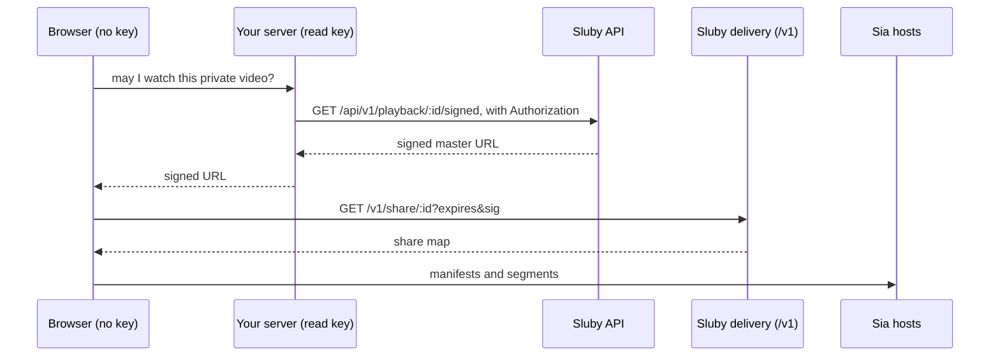

# React

This guide builds a React app that uploads a video to Sluby, waits for it to be processed and stored on Sia, and plays it with `<SlubyPlayer>`. The snippets come from the runnable example in [`examples/quickstart`](https://github.com/justmert/Sluby/tree/main/examples/quickstart), which CI builds and typechecks against the current packages, except the keyless client and the two private-video players near the end, which show calls the example makes through form fields instead.

You need a running Sluby stack (see the [quickstart](./quickstart)) and an API key from **Settings → API keys** in the Studio.

## Install

```sh
npm install @sluby/sdk @sluby/player
```

`@sluby/player` needs React 18 or 19 and brings hls.js with it.

::: warning Package versions
This guide needs `@sluby/sdk` and `@sluby/player` 0.2.0. Version 0.1.0 predates direct-from-Sia playback, `assets.processing`, the typed errors, and the player's quality and delivery callbacks. If `npm view @sluby/sdk version` still prints 0.1.0, 0.2.0 is not on npm yet: build the packages from this repository instead (`npm install`, `npm run build:sdk` and `npm run build:player` at the repository root), as the example apps do.
:::

## Where API keys may live

Every API key belongs to one account and carries scopes:

| Scope    | Allows                                                                                                                            |
| -------- | --------------------------------------------------------------------------------------------------------------------------------- |
| `upload` | Creating uploads through tus and cancelling them.                                                                                 |
| `read`   | Listing and reading every asset of the account, processing status, playback URLs, signed URLs for private assets, Sia share maps. |
| `manage` | Editing and deleting assets, retrying processing, managing API keys, creating and deleting webhooks and playback ids.             |

Anything shipped to a browser can be read by whoever loads the page. A key with `manage` lets them delete your library and create new keys. A key with `upload` lets them fill your storage. A `read` key is not harmless either: it lists every asset of the account and mints signed URLs for private ones. The API has no short-lived or per-viewer tokens, so the safe setup keeps every key on a server you control:

- **Uploads** run on your server with an `upload` key. The [Node.js section of the plain JavaScript guide](./javascript#upload-from-a-server) shows the code.
- **Playback** in the browser needs no key at all, direct from Sia included. A public video plays from its stream URL, which the SDK builds without a request, and a private video plays from a signed URL that your server mints. See [Keeping keys out of the browser](#keeping-keys-out-of-the-browser).

The example app takes a key in a form field so you can try the whole flow against a local stack. Treat that as a development convenience, not a pattern for a public site.

## Create a client

```tsx
const client = useMemo(() => {
  if (!baseUrl) return null;
  const sia =
    siaIndexerUrl && siaAppId && siaAppKey
      ? { indexerUrl: siaIndexerUrl, appId: siaAppId, appKey: siaAppKey }
      : undefined;
  return new SlubyClient({
    // public playback, direct from Sia included, needs no key; uploading,
    // deleting and minting signed urls do
    apiKey: apiKey || undefined,
    baseUrl,
    deliveryBaseUrl: deliveryUrl || undefined,
    sia,
  });
}, [apiKey, baseUrl, deliveryUrl, siaIndexerUrl, siaAppId, siaAppKey]);
```

- `baseUrl` is where the REST API is, for example `http://localhost:8080` on the Compose stack.
- `deliveryBaseUrl` is where the browser fetches manifests and segments from. It defaults to `baseUrl`, which is right for the Compose stack because nginx serves the API and the gateway on one port.
- `apiKey` is sent as a bearer token on API calls. The constructor throws on an empty string, because that is usually an unset environment variable, so pass `undefined` when there is no key. Playback requests to the delivery base never carry it.
- `sia` is the optional viewer identity for [direct-from-Sia playback](#direct-from-sia-playback).

Create the client once per configuration with `useMemo`. `<SlubyPlayer>` resolves its playback URL again whenever the `client` prop changes, so a new client on every render would restart playback.

## Upload with progress

`client.uploads.upload` creates the asset and sends the file with resumable tus uploads in one call. It returns a promise that settles when the bytes are uploaded, with an extra `assetId` promise that resolves as soon as the server has created the asset.

```tsx
const upload = client.uploads.upload(file, {
  title: file.name,
  description: 'Uploaded from the Sluby quickstart example',
  accessTier,
  onProgress: (pct) => setProgress(pct),
});
uploadRef.current = upload;

// the asset exists as soon as the upload starts
const videoAssetId = await upload.assetId;
await upload;
```

`onProgress` also receives the byte counts as its second and third arguments. Files go up in 10 MiB chunks by default (`chunkSize`), and failed chunks are retried after 0, 1, 3 and 5 seconds (`retryDelays`).

The handle can pause and resume the upload. `abort()` stops it for good, discards the partial upload and rejects the handle with an `AbortError`. Once the upload has finished, `pause()` and `abort()` do nothing, so the asset is kept. `uploadId` resolves to the id `uploads.getStatus()` and `uploads.cancel()` take.

```tsx
function togglePause() {
  const upload = uploadRef.current;
  if (!upload) return;
  if (upload.isPaused) {
    upload.resume();
    setPaused(false);
  } else {
    void upload.pause();
    setPaused(true);
  }
}
```

## Wait until it is ready

After the upload, the backend transcodes the video to HLS and stores it on Sia. `assets.waitForReady` polls the asset until its status is `ready`:

```tsx
const stagePoll = setInterval(() => {
  client.assets
    .processing(videoAssetId)
    .then((job) => setStage(`${job.stage}, ${job.progressPercent}%`))
    .catch(() => {
      // the next poll tries again; waitForReady reports real failures
    });
}, 3000);
let ready: VideoAsset;
try {
  ready = await client.assets.waitForReady(videoAssetId, {
    pollInterval: 3000,
    timeout: 30 * 60_000,
  });
} catch (err) {
  if (!(err instanceof ProcessingFailedError)) throw err;
  // the processing job says why it failed
  const job = await client.assets.processing(videoAssetId).catch(() => null);
  throw new Error(`Processing failed: ${job?.errorMessage ?? 'no reason was recorded'}`, {
    cause: err,
  });
} finally {
  clearInterval(stagePoll);
}
```

- `waitForReady` polls every 5 seconds and gives up after 10 minutes unless you pass `pollInterval` and `timeout`. On timeout it throws a `TimeoutError`. When the asset fails, it throws a `ProcessingFailedError` carrying the failed `asset`, and `assets.processing(id).errorMessage` has the reason. Pass `signal` to stop waiting, for example when the component unmounts.
- `assets.processing(id)` returns the pipeline `stage` (`queued`, `transcode`, `upload`, `finalize`, `completed` or `failed`), an overall `progressPercent` and the worker's log lines.
- Storing on Sia takes minutes even for a short clip, because each upload sends whole erasure-coded slabs (see [how long it takes](./quickstart#how-long-it-takes)). The example allows 30 minutes.

## Play it

Give `<SlubyPlayer>` a playback URL, the client and the asset id:

```tsx
<SlubyPlayer
  key={`${playing.assetId}:${playing.signed}:${playing.src ?? ''}`}
  ref={playerRef}
  // a public asset plays from its stream url with no key, and with a
  // viewer identity straight from Sia; "signed" without a url has the
  // client mint one, which needs a key
  src={playing.src ?? (playing.signed ? undefined : client.playback.streamUrl(playing.assetId))}
  client={client}
  assetId={playing.assetId}
  signed={playing.signed}
  expiresIn={3600}
  controls
  style={{ width: '100%' }}
  onQualitiesChange={setQualities}
  onQualityChange={setCurrentQuality}
  onDeliveryChange={setDelivery}
  onError={(err) => setError(`Playback failed: ${err.message}`)}
/>
```

- `client.playback.streamUrl(id)` returns the public master manifest URL, `{deliveryBaseUrl}/v1/stream/{id}/master.m3u8`, for an asset id or a `pb_...` playback id. It makes no request and needs no key, and the gateway serves it to anyone while the asset is public (a private asset or a `signed` playback id answers 403). A `signed` playback id gates only its own stream URL: the asset's other playback ids keep playing, and its objects stay public, so make the asset private to keep the video private.
- With `src` and `assetId`, a `client` that has a [viewer identity](#direct-from-sia-playback) streams that URL straight from Sia. Without one, the player plays `src` through the gateway.
- With `client` and `assetId` but no `src`, the player asks the API for the URL (`playback.getUrl`, or `playback.getSignedUrl` when `signed` is set), which needs a key or a signed-in session. The example uses this only for `signed`.

The player uses hls.js wherever hls.js is supported (any browser with Media Source Extensions, including Safari's ManagedMediaSource), and plays HLS natively where it is not, such as Safari on an iPhone whose iOS has no ManagedMediaSource yet. It retries fatal network errors up to 3 times and media errors up to 2 times (`maxNetworkRetries`, `maxMediaRetries`), and shows a spinner and an error overlay with a **Retry** button unless you pass `overlay={false}`. Other props: `poster`, `autoPlay`, `muted`, `width`, `height`, `className`, and the callbacks `onReady`, `onPlay`, `onPause`, `onEnd` and `onStateChange`.

`src` on its own, without `client`, plays any gateway URL through the gateway, with no SDK client in the browser at all.

## Pick a rendition

Sluby transcodes each video into several renditions, and hls.js switches between them by bandwidth. `onQualitiesChange` reports every rendition once the manifest is parsed, `onQualityChange` reports the one playing on every switch, and the ref's `setQuality` pins one by its `index`. `-1` returns to adaptive selection.

```tsx
function pickQuality(value: string) {
  const index = Number(value);
  // -1 hands the choice back to hls.js's adaptive bitrate logic
  playerRef.current?.setQuality(index);
  setPinnedQuality(index);
}
```

```tsx
<select
  value={String(pinnedQuality)}
  disabled={qualities.length === 0}
  onChange={(e) => pickQuality(e.target.value)}
>
  <option value="-1">
    Auto{pinnedQuality === -1 && currentQuality ? ` (${currentQuality.name})` : ''}
  </option>
  {qualities.map((q) => (
    <option key={q.index} value={q.index}>
      {q.name} · {Math.round(q.bitrate / 1000)} kbps
    </option>
  ))}
</select>
```

On the native HLS path the browser picks the rendition itself, so the list stays empty there. The ref also has `isAutoQuality()`, `getQualities()`, `getVideoElement()` and `getHlsInstance()`.

## Direct-from-Sia playback

By default the bytes come through the gateway: the backend fetches them from Sia for each request, and nginx in front of it keeps small whole objects such as manifests and thumbnails for at most a minute; media segments are byte ranges and are never cached. With a viewer identity, the browser downloads them from Sia hosts itself and the backend leaves the byte path.

The viewer identity is a separate Sia app key with no access to your uploads. Provision one once per deployment:

```sh
cd backend
SIA_INDEXER_URL=https://sia.storage npm run provision-viewer
```

It prints a URL to approve in your indexer account, then three values: the indexer URL, the app id and the app key (both 64 hex characters). Pass them as `sia: { indexerUrl, appId, appKey }` in the client config (see [Create a client](#create-a-client)). They are meant to be public, like a publishable key.

For each playback the client fetches a share map: a short-lived `sia://` share URL for every object of the asset, valid for an hour by default. When the player has `src`, the map comes from the public `GET /v1/share/:id` on the same delivery base as `src`, with the `expires` and `sig` of `src` when it is a signed URL, and the request carries no key and no cookie. The backend gates it exactly like the gateway: a public asset needs nothing, a private one needs the signature, and the shares never outlive that signature. Without `src` (the `client` and `assetId` path), the map comes from `GET /api/v1/playback/:id/share`, which needs the `read` scope. The player then streams each playlist and segment through the viewer session with a custom hls.js loader. The WASM part of the Sia SDK (about 1.7 MB) is only loaded when `sia` is set.

`onDeliveryChange` tells you which path a load took. The player uses the gateway when no viewer identity is configured, on the native HLS path, and when the viewer session fails to start, in which case it logs `Sluby: direct-from-Sia delivery unavailable, using the gateway.` as a console warning with the cause.

The viewer session talks to many Sia hosts at once, and some of them are always unreachable. Chrome logs each failed host connection in the console (for example `ERR_CONNECTION_REFUSED`, a QUIC idle timeout, or a WebTransport warning about too many pending sessions). Playback carries on as long as enough hosts answer, because every object is erasure-coded across many of them.

## Keeping keys out of the browser

Playback in a public page needs no API key, direct from Sia included:

- **Public video**: pass `src={client.playback.streamUrl(id)}` with `assetId={id}` and a keyless client. The page talks to the gateway (or, with a viewer identity, fetches one share map from `/v1/share/:id` and then talks to Sia hosts) and never to `/api/v1`.
- **Private video**: your server mints a signed URL with its own key and decides who gets one. The page passes it as `src` with the asset id. The signature unlocks the manifests on the gateway and the share map on `/v1/share/:id`, and only until it expires.

```ts
new SlubyClient({
  baseUrl: 'https://sluby.example.com', // used only for api calls, which playback does not make
  sia: { indexerUrl, appId, appKey }, // optional, publishable
});
```



Your server decides who may watch what, so a private asset's signed URL only reaches viewers you allowed. The plain JavaScript example ships a small server that does exactly this; see [Mint signed URLs on your server](./javascript#mint-signed-urls-on-your-server). The example apps in both guides work against it: leave the API key empty, set the base URL to the server and the delivery URL to Sluby, and tick **signed URL**. `<SlubyPlayer client={client} assetId={id} signed />` then calls `GET /api/v1/playback/:id/signed` on your server (with `expires_in` when you pass `expiresIn`) and plays the answer.

## Private videos

Upload with `accessTier: 'private'` and the gateway refuses to serve the asset's objects without a valid signature (`403 This object requires a valid signed URL`). Play it from a signed URL, either one your server handed the page or one the client mints with `signed` (which needs a key):

```tsx
// a signed url your server minted and handed to the page
<SlubyPlayer src={signedUrl} client={client} assetId={id} />
```

```tsx
// or let the client mint one, which needs a key with the read scope
<SlubyPlayer client={client} assetId={id} signed expiresIn={3600} />
```

`playback.getSignedUrl` returns a manifest URL carrying an expiry and an HMAC signature, and a `posterUrl` signed the same way, which the player shows as the poster. The gateway signs every playlist and segment URL inside the manifests it serves with the same expiry, so the one URL authorizes the whole video until it expires (one hour by default, six at most; the player renews a URL it signed itself before then). The same signature unlocks the asset's share map on `/v1/share/:id`; share maps for private assets are capped at one hour and never outlive the signature. Changing the asset's tier, or `POST /api/v1/playback/{id}/signed/revoke`, voids every signed URL of the asset at once.

`assets.update(id, { accessTier })` changes the tier of an existing asset. It needs the `manage` scope.

## Handle errors

Every REST call throws a typed error. All of them extend `SlubyError`, which has the HTTP `statusCode` and the raw `responseBody`:

| Error                   | When                                                                                     |
| ----------------------- | ---------------------------------------------------------------------------------------- |
| `AuthenticationError`   | 401: a missing, invalid, deactivated or expired key, or an ended session.                |
| `PermissionError`       | 403: the key lacks the scope the call needs.                                             |
| `NotFoundError`         | 404 or 410, including an asset that belongs to another account.                          |
| `ValidationError`       | 400 or 422: the request was refused as invalid. The message names the problem.           |
| `ConflictError`         | 409, such as asking for playback of an asset that is not ready, or rotating a key twice. |
| `RateLimitError`        | 429. `retryAfter` has the seconds from the `Retry-After` header when the API sent one.   |
| `TimeoutError`          | A request ran past `timeoutMs`, or `waitForReady` ran out of time. `statusCode` is 0.    |
| `AbortError`            | An `AbortSignal` you passed fired, or `abort()` stopped an upload. `statusCode` is 0.    |
| `ProcessingFailedError` | `waitForReady` saw the asset fail. `asset` is the failed asset, `statusCode` is 0.       |
| `SlubyError`            | Anything else, such as a 5xx.                                                            |

```ts
export function describeError(err: unknown): string {
  if (err instanceof AuthenticationError) {
    return `The API key was rejected: ${err.message}`;
  }
  if (err instanceof PermissionError) {
    return `This API key lacks the scope for that call: ${err.message}`;
  }
  if (err instanceof NotFoundError) {
    return `Not found: ${err.message}`;
  }
  if (err instanceof ValidationError) {
    return `The request was refused: ${err.message}`;
  }
  if (err instanceof ConflictError) {
    // for example playing an asset that is not ready yet
    return `Not possible right now: ${err.message}`;
  }
  if (err instanceof RateLimitError) {
    return `Rate limited, retry in ${err.retryAfter ?? '?'} seconds.`;
  }
  if (err instanceof SlubyError) {
    // timeouts, aborts and failed processing carry statusCode 0
    return err.statusCode ? `API error ${err.statusCode}: ${err.message}` : err.message;
  }
  return err instanceof Error ? err.message : String(err);
}
```

An upload that fails rejects the handle, and `assetId` too when it fails before the asset exists, with the `SlubyError` class for the HTTP status the server answered and tus-js-client's error as `cause`. The player reports playback failures through `onError` once its retries are used up.

## Run the example

```sh
npm install
npm run build:sdk
npm run build:player
cd examples/quickstart
cp .env.example .env   # optional: defaults for the form fields
npm run dev
```

Open [http://localhost:5180](http://localhost:5180), enter the API base URL and a key, pick a video, and follow it through upload, processing and playback. The **Play an asset by id** field plays any public asset with no key (paste a signed URL into the playback URL field for a private one), and **Delete asset** removes it and unpins its objects from Sia.
