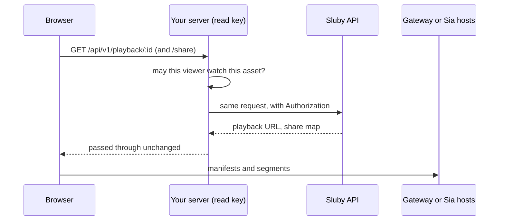

# React

This guide builds a React app that uploads a video to Sluby, waits for it to be processed and stored on Sia, and plays it with `<SlubyPlayer>`. Every snippet comes from the runnable example in [`examples/quickstart`](https://github.com/justmert/Sluby/tree/main/examples/quickstart), which CI builds and typechecks against the current packages.

You need a running Sluby stack (see the [quickstart](./quickstart)) and an API key from **Settings → API keys** in the Studio.

## Install

```sh
npm install @sluby/sdk @sluby/player
```

`@sluby/player` needs React 18 or 19 and brings hls.js with it.

::: warning Package versions
This guide needs a release of `@sluby/sdk` and `@sluby/player` newer than 0.1.0. Version 0.1.0 on npm predates direct-from-Sia playback, `assets.processing`, and the player's quality and delivery callbacks. Until a newer version is published, the example apps use the packages built from this repository (`npm install`, `npm run build:sdk` and `npm run build:player` at the repository root).
:::

## Where API keys may live

Every API key belongs to one account and carries scopes:

| Scope    | Allows                                                                                                                            |
| -------- | --------------------------------------------------------------------------------------------------------------------------------- |
| `upload` | Creating uploads through tus and cancelling them.                                                                                 |
| `read`   | Listing and reading every asset of the account, processing status, playback URLs, signed URLs for private assets, Sia share maps. |
| `manage` | Editing and deleting assets, retrying processing, managing API keys, creating and deleting webhooks and playback ids.             |

Anything shipped to a browser can be read by whoever loads the page. A key with `manage` lets them delete your library and create new keys. A key with `upload` lets them fill your storage. A `read` key is not harmless either: it lists every asset of the account and mints signed URLs for private ones. The API has no short-lived or per-viewer tokens, so the safe setup keeps every key on a server you control:

- **Uploads** run on your server with an `upload` key. The [Node.js section of the plain JavaScript guide](./javascript#upload-from-a-server) shows the code.
- **Playback** in the browser needs no key at all. Public video is served by the gateway without authentication, and a private video plays from a signed URL that your server mints. See [Keeping keys out of the browser](#keeping-keys-out-of-the-browser).

The example app takes a key in a form field so you can try the whole flow against a local stack. Treat that as a development convenience, not a pattern for a public site.

## Create a client

```tsx
const client = useMemo(() => {
  if (!baseUrl) return null;
  const sia =
    siaIndexerUrl && siaAppId && siaAppKey
      ? { indexerUrl: siaIndexerUrl, appId: siaAppId, appKey: siaAppKey }
      : undefined;
  return new SlubyClient({
    // no key means the base url is a server of yours that adds it
    apiKey: apiKey || undefined,
    baseUrl,
    deliveryBaseUrl: deliveryUrl || undefined,
    sia,
  });
}, [apiKey, baseUrl, deliveryUrl, siaIndexerUrl, siaAppId, siaAppKey]);
```

- `baseUrl` is where the REST API is, for example `http://localhost:8080` on the Compose stack.
- `deliveryBaseUrl` is where the browser fetches manifests and segments from. It defaults to `baseUrl`, which is right for the Compose stack because nginx serves the API and the gateway on one port.
- `apiKey` is sent as a bearer token. The constructor throws on an empty string, because that is usually an unset environment variable, so pass `undefined` when there is no key.
- `sia` is the optional viewer identity for [direct-from-Sia playback](#direct-from-sia-playback).

Create the client once per configuration with `useMemo`. `<SlubyPlayer>` resolves its playback URL again whenever the `client` prop changes, so a new client on every render would restart playback.

## Upload with progress

`client.uploads.upload` creates the asset and sends the file with resumable tus uploads in one call. It returns a promise that settles when the bytes are uploaded, with an extra `assetId` promise that resolves as soon as the server has created the asset.

```tsx
const upload = client.uploads.upload(file, {
  title: file.name,
  description: 'Uploaded from the Sluby quickstart example',
  accessTier,
  onProgress: (pct) => setProgress(pct),
});
uploadRef.current = upload;

// the asset exists as soon as the upload starts
const videoAssetId = await upload.assetId;
await upload;
```

`onProgress` also receives the byte counts as its second and third arguments. Files go up in 10 MiB chunks by default (`chunkSize`), and failed chunks are retried after 0, 1, 3 and 5 seconds (`retryDelays`).

The handle can pause and resume the upload. `abort()` stops it for good and discards the partial upload.

```tsx
function togglePause() {
  const upload = uploadRef.current;
  if (!upload) return;
  if (upload.isPaused) {
    upload.resume();
    setPaused(false);
  } else {
    void upload.pause();
    setPaused(true);
  }
}
```

## Wait until it is ready

After the upload, the backend transcodes the video to HLS and stores it on Sia. `assets.waitForReady` polls the asset until its status is `ready`:

```tsx
const stagePoll = setInterval(() => {
  client.assets
    .processing(videoAssetId)
    .then((job) => setStage(`${job.stage}, ${job.progressPercent}%`))
    .catch(() => {
      // the next poll tries again; waitForReady reports real failures
    });
}, 3000);
let ready: VideoAsset;
try {
  ready = await client.assets.waitForReady(videoAssetId, {
    pollInterval: 3000,
    timeout: 30 * 60_000,
  });
} catch (err) {
  // waitForReady throws a plain Error when processing failed; the
  // processing job carries the reason
  const job = await client.assets.processing(videoAssetId).catch(() => null);
  throw job?.errorMessage ? new Error(`Processing failed: ${job.errorMessage}`) : err;
} finally {
  clearInterval(stagePoll);
}
```

- `waitForReady` polls every 5 seconds and gives up after 10 minutes unless you pass `pollInterval` and `timeout`. On timeout it throws a `TimeoutError`. When the asset fails, it throws a plain `Error`, and `assets.processing(id).errorMessage` has the reason.
- `assets.processing(id)` returns the pipeline `stage` (`queued`, `transcode`, `upload`, `finalize`, `completed` or `failed`), an overall `progressPercent` and the worker's log lines.
- Storing on Sia takes minutes even for a short clip, because each upload sends whole erasure-coded slabs (see [how long it takes](./quickstart#how-long-it-takes)). The example allows 30 minutes.

## Play it

Give `<SlubyPlayer>` the client and an asset id, and it resolves the playback URL itself:

```tsx
<SlubyPlayer
  key={`${playing.assetId}:${playing.signed}`}
  ref={playerRef}
  client={client}
  assetId={playing.assetId}
  signed={playing.signed}
  expiresIn={3600}
  controls
  style={{ width: '100%' }}
  onQualitiesChange={setQualities}
  onQualityChange={setCurrentQuality}
  onDeliveryChange={setDelivery}
  onError={(err) => setError(`Playback failed: ${err.message}`)}
/>
```

The player uses hls.js wherever hls.js is supported (any browser with Media Source Extensions, including Safari's ManagedMediaSource), and plays HLS natively where it is not, such as Safari on an iPhone whose iOS has no ManagedMediaSource yet. It retries fatal network errors up to 3 times and media errors up to 2 times (`maxNetworkRetries`, `maxMediaRetries`), and shows a spinner and an error overlay with a **Retry** button unless you pass `overlay={false}`. Other props: `poster`, `autoPlay`, `muted`, `width`, `height`, `className`, and the callbacks `onReady`, `onPlay`, `onPause`, `onEnd` and `onStateChange`.

Instead of `client` and `assetId` you can pass `src`, an absolute HLS manifest URL. That is the way to play a URL your server handed you without any SDK client in the browser.

## Pick a rendition

Sluby transcodes each video into several renditions, and hls.js switches between them by bandwidth. `onQualitiesChange` reports every rendition once the manifest is parsed, `onQualityChange` reports the one playing on every switch, and the ref's `setQuality` pins one by its `index`. `-1` returns to adaptive selection.

```tsx
function pickQuality(value: string) {
  const index = Number(value);
  // -1 hands the choice back to hls.js's adaptive bitrate logic
  playerRef.current?.setQuality(index);
  setPinnedQuality(index);
}
```

```tsx
<select
  value={String(pinnedQuality)}
  disabled={qualities.length === 0}
  onChange={(e) => pickQuality(e.target.value)}
>
  <option value="-1">
    Auto{pinnedQuality === -1 && currentQuality ? ` (${currentQuality.name})` : ''}
  </option>
  {qualities.map((q) => (
    <option key={q.index} value={q.index}>
      {q.name} · {Math.round(q.bitrate / 1000)} kbps
    </option>
  ))}
</select>
```

On the native HLS path the browser picks the rendition itself, so the list stays empty there. The ref also has `isAutoQuality()`, `getQualities()`, `getVideoElement()` and `getHlsInstance()`.

## Direct-from-Sia playback

By default the bytes come through the gateway: the backend fetches them from Sia, and nginx in front of it caches whole objects such as manifests. With a viewer identity, the browser downloads them from Sia hosts itself and the backend leaves the byte path.

The viewer identity is a separate Sia app key with no access to your uploads. Provision one once per deployment:

```sh
cd backend
SIA_INDEXER_URL=https://sia.storage npm run provision-viewer
```

It prints a URL to approve in your indexer account, then three values: the indexer URL, the app id and the app key (both 64 hex characters). Pass them as `sia: { indexerUrl, appId, appKey }` in the client config (see [Create a client](#create-a-client)). They are meant to be public, like a publishable key.

For each asset the player asks the API for a share map (`GET /api/v1/playback/:id/share`, `read` scope): a short-lived `sia://` share URL for every object of the asset, valid for an hour by default. It then streams each playlist and segment through the viewer session with a custom hls.js loader. The WASM part of the Sia SDK (about 1.7 MB) is only loaded when `sia` is set.

`onDeliveryChange` tells you which path a load took. The player uses the gateway when no viewer identity is configured, on the native HLS path, and when the viewer session fails to start, in which case it logs `Sluby: direct-from-Sia delivery unavailable, using the gateway.` as a console warning with the cause.

Because the share map needs the `read` scope, the browser either holds a read key or gets the share map from your server, as described next.

The viewer session talks to many Sia hosts at once, and some of them are always unreachable. Chrome logs each failed host connection in the console (for example `ERR_CONNECTION_REFUSED`, a QUIC idle timeout, or a WebTransport warning about too many pending sessions). Playback carries on as long as enough hosts answer, because every object is erasure-coded across many of them.

## Keeping keys out of the browser

The client does not need a key when its `baseUrl` points at your own server and that server answers the playback calls the browser makes, adding the key on its side. `<SlubyPlayer>` makes two kinds:

- `GET /api/v1/playback/:id` for a public asset, or `GET /api/v1/playback/:id/signed` (with `expires_in` when you pass `expiresIn`) for a private one
- `GET /api/v1/playback/:id/share` when `sia` is configured

Point `deliveryBaseUrl` at Sluby, because the playback URL that comes back is a path on the gateway:

```ts
new SlubyClient({
  baseUrl: 'https://app.example.com', // your server
  deliveryBaseUrl: 'https://sluby.example.com', // the sluby gateway
  sia: { indexerUrl, appId, appKey }, // optional
});
```



Your server decides who may watch what, so a private asset's signed URL only reaches viewers you allowed. The plain JavaScript example ships a small server that does exactly this; see [Serve playback from your server](./javascript#serve-playback-from-your-server). The example apps in both guides work against it: leave the API key empty, set the base URL to the server and the delivery URL to Sluby.

If you do not need direct-from-Sia playback, there is a simpler option: your server calls `client.playback.getUrl(id)` or `getSignedUrl(id)` with its own client and gives the browser only the URL, which you pass to `<SlubyPlayer src={url} />`.

## Private videos

Upload with `accessTier: 'private'` and the gateway refuses to serve the asset's objects without a valid signature (`403 This object requires a valid signed URL`). Play it with `signed`:

```tsx
<SlubyPlayer client={client} assetId={id} signed expiresIn={3600} />
```

The player then calls `playback.getSignedUrl`, which returns a manifest URL carrying an expiry and an HMAC signature. The gateway signs every playlist and segment URL inside the manifests it serves with the same expiry, so the one URL authorizes the whole video until it expires (one hour by default). Share maps for private assets are capped at one hour as well.

`assets.update(id, { accessTier })` changes the tier of an existing asset. It needs the `manage` scope.

## Handle errors

Every REST call throws a typed error. All of them extend `SlubyError`, which has the HTTP `statusCode` and the raw `responseBody`:

| Error                 | When                                                                                   |
| --------------------- | -------------------------------------------------------------------------------------- |
| `AuthenticationError` | 401 (missing, invalid, deactivated or expired key) or 403 (the key lacks the scope).   |
| `NotFoundError`       | 404, including an asset that belongs to another account.                               |
| `RateLimitError`      | 429. `retryAfter` has the seconds from the `Retry-After` header when the API sent one. |
| `TimeoutError`        | `waitForReady` ran out of time. `statusCode` is 0.                                     |
| `SlubyError`          | Anything else, such as 409 when you ask for playback of an asset that is not ready.    |

```ts
export function describeError(err: unknown): string {
  if (err instanceof AuthenticationError) {
    // 401 is a missing or bad key, 403 a key without the scope this call needs
    return err.statusCode === 403
      ? `This API key lacks the scope for that call: ${err.message}`
      : `The API key was rejected: ${err.message}`;
  }
  if (err instanceof NotFoundError) {
    return `Not found: ${err.message}`;
  }
  if (err instanceof RateLimitError) {
    return `Rate limited, retry in ${err.retryAfter ?? '?'} seconds.`;
  }
  if (err instanceof SlubyError) {
    // TimeoutError lands here too, with statusCode 0
    return err.statusCode ? `API error ${err.statusCode}: ${err.message}` : err.message;
  }
  return err instanceof Error ? err.message : String(err);
}
```

Upload errors come from tus-js-client and are plain `Error`s: the handle's promise rejects with them, and so does `assetId` when the upload fails before the asset exists. The player reports playback failures through `onError` once its retries are used up.

## Run the example

```sh
npm install
npm run build:sdk
npm run build:player
cd examples/quickstart
cp .env.example .env   # optional: defaults for the form fields
npm run dev
```

Open [http://localhost:5180](http://localhost:5180), enter the API base URL and a key, pick a video, and follow it through upload, processing and playback. The **Play an asset by id** field plays any asset of the account, and **Delete asset** removes it and unpins its objects from Sia.
